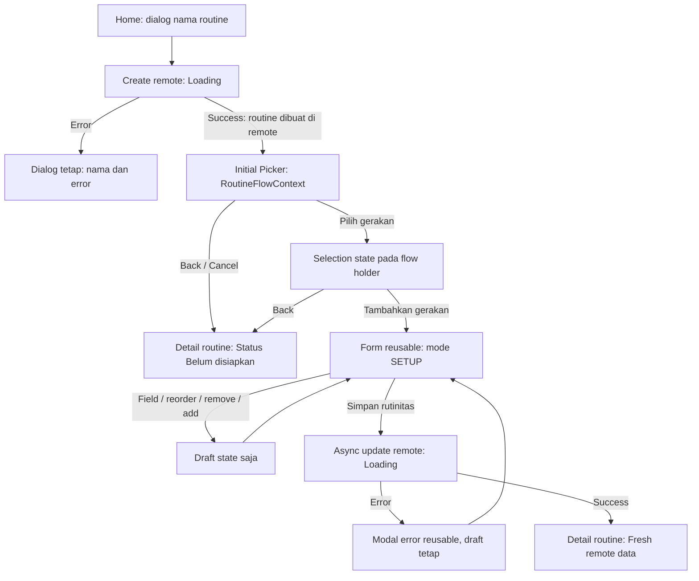

# FLOW ADD ROUTINE REFACTOR

## 0. Metadata

| Field | Detail |
| --- | --- |
| Versi / tanggal | **2.2 — Final Implementation-Ready Specification (Architecture & Fitness Coaching Refinements)** / 2026-10-31 |
| Status | **APPROVED FOR IMPLEMENTATION WITH RELEASE GATES** (Dokumen spesifikasi final; siap dikembangkan per langkah, release diblokir gate verifikasi backend & cutover) |
| Platform / topology | Android native, Jetpack Compose; single application module `:app` |
| Flavor | Production memakai API Supabase; demo tetap implementasi in-memory eksplisit untuk UI/testing, bukan fallback production |
| Source revision scan | `5129c53e4e42` beserta source working tree yang dibaca; bukan klaim seluruh file identik dengan commit |
| Scope | Seluruh CRUD routine template, Home routine list, detail, create → picker → setup, edit draft, delete, shared picker, navigation dan dependency cutover |
| Confidence | Source dan definisi/metadata RPC yang diinspeksi: Verified; perilaku target/E2E: belum diverifikasi sebagai implementasi |
| Deliverable | Revisi dokumen ini saja; tidak mengubah aplikasi atau database remote |
| Ticket / target rilis | N/A |

**Prioritas kontrak:** revisi pengguna dan review arsitektur/fitness v2.1 & v2.2 menggantikan keputusan v1.0 yang masih menggunakan Room mirror, create → Detail, serta direct-add mutation dari picker Detail. Dokumen ini mengunci 3 area prioritas P0 teknis (`RoutineFlowContext` & `RoutineFlowState` handoff owner, verifikasi hak akses & order preservation pada targeted exercise hydration, serta finish workout compatibility release blocker) dan 2 penyempurnaan domain fitness (integritas semantik repetisi vs durasi/volume, serta kebijakan edit/delete saat sesi aktif). “Saat ini” berarti fakta source; “target/usulan” berarti rancangan yang disepakati untuk diimplementasikan.

## 1. Ringkasan dan Invariants

**Keputusan utama: seluruh CRUD routine template langsung ke remote seperti client REST API, tanpa mirror Room.** Request boleh menggunakan Supabase PostgREST/RPC existing; tidak perlu membuat server REST baru atau memaksa table endpoint yang sudah dicabut aksesnya.

### 1.1 Invariants target

1. **Remote adalah satu-satunya sumber routine tersimpan:** create, read/list/detail, update dan delete production menuju API remote. Tidak membaca routine dari Room, mengimpor snapshot routine ke Room, menulis routine/child template ke Room, memakai local pending overlay, atau enqueue routine sync.
2. **State bukan mirror database:** `ViewModel`/`StateFlow` menampung response remote dan draft UI; `SavedStateHandle` menyimpan state minimum untuk recreation. State ini bukan penyimpanan CRUD routine, bukan cache Room, dan bukan antrean sync offline.
3. **Create dua tahap:** nama routine dibuat remote lebih dahulu; setelah sukses masuk picker. Pemilihan exercise dan setup belum tersimpan remote sampai tombol final pada halaman setup ditekan.
4. **Satu halaman form reusable, dua mode eksplisit:** `SETUP` awal dan `EDIT`. Layout, field, exercise editor, validasi, loading/error handling dan draft pipeline dipakai bersama. Yang berbeda adalah konteks, initial draft, label CTA dan navigation outcome.
5. **Tidak ada autosave:** ketikan nama/angka, remove/add exercise, hasil picker, dan aksi form lain hanya mengubah draft setup/edit. Tidak menulis remote atau Room sebelum final Save.
6. **State operasi jelas:** loading → success atau error untuk create/read/save/delete; picker memisahkan initial load, append dan refresh. Success hanya setelah remote acknowledge, bukan setelah local state update atau enqueue worker.
7. **Reuse dahulu:** gunakan komponen, wording, theme dan validation patterns yang sudah ada. Tambah komponen/kode/wording baru hanya untuk capability yang memang belum ada, bukan duplikasi visual.
8. **Light/dark setara:** seluruh mode, modal, footer, loading/error/success dan disabled state mengikuti theme existing; mengganti theme tidak mereset draft atau mengirim request ulang.
9. **P0-1 Flow-scoped Draft Ownership (`RoutineFlowContext` & `RoutineFlowState`):** Initial picker tidak mengasumsikan form ViewModel sudah hidup di backstack. Transisi create → initial picker → SETUP dikawal context dan state holder flow eksplisit sehingga selection di-handoff tepat satu kali ke SETUP bahkan saat rotation atau system-initiated process recreation.
10. **P0-2 Targeted Remote Exercise Hydration (Akses, Urutan, dan Status):** Pemenuhan atribut display exercise untuk picker, SETUP/EDIT, dan ActiveWorkout menggunakan targeted remote lookup (by IDs), tanpa download seluruh katalog dan tanpa Room dependency. Hak akses client authenticated pada endpoint/RPC ini diverifikasi sebagai gate Langkah 2; urutan input (`order_index`) wajib dipertahankan terlepas dari urutan respons database; atribut `is_active` disertakan untuk integritas data.
11. **P0-3 Complete Workout Backend Compatibility (Release Blocker):** Rantai kritis `Create Routine → Save SETUP → Start Workout → Complete Workout → Persist Workout Log → Resume/History` wajib terbukti berfungsi pada backend sebelum production release.
12. **Fitness Programming Invariants:**
    - **Status routine kosong:** Ditandai jelas *"Belum disiapkan"* / *"Rutinitas ini belum memiliki gerakan"*, CTA Detail *"Lengkapi rutinitas"*, tombol *"Mulai Latihan"* dinonaktifkan.
    - **Exercise order adalah variabel latihan esensial:** Form SETUP/EDIT wajib mendukung reorder exercise (move up/down) yang tersinkron ke `order_index` 0..N-1 server dan ActiveWorkout.
    - **Integritas Semantik Prescription:** Skema `sets/reps/rest` dipertahankan untuk gerakan resistansi. Dilarang mengaliaskan durasi (detik) menjadi `reps` pada UI semata (mis. Plank 45 detik disimpan sebagai `reps=45`), karena akan merusak perhitungan volume latihan dan data histori. Gerakan durasi/kardio ditandai keterbatasannya secara eksplisit hingga schema mendukung `PrescriptionType` multi-unit.
    - **Isolasi Rencana vs Pelaksanaan:** Sesi aktif dan completed history terisolasi penuh dari mutasi routine; edit/delete routine tidak mengubah running session snapshot atau catatan historis. Kebijakan mutasi saat sesi aktif dijelaskan transparan pada UI bila ditolak guard.
    - **Keandalan di Gym (Offline Start):** Jika koneksi gagal di gym, workout dapat dimulai menggunakan canonical snapshot routine yang sudah ada di memori berdasarkan last known revision (bukan diklaim sebagai revision server terbaru), tanpa membuat mirror Room terselubung.

**Batas non-goal:** migrasi session aktif, timer, finish workout, history/progress atau profil menjadi remote-only tidak termasuk permintaan ini. Infrastruktur lokal fitur tersebut boleh tetap ada, tetapi **tidak boleh dijadikan alasan menyisakan CRUD/mirror routine di Room**.

## 2. Kebutuhan dan Acceptance Criteria

### 2.1 Requirement map

| ID | Kebutuhan | Kontrak target |
| --- | --- | --- |
| R1 | Semua CRUD routine langsung remote, tanpa mirror Room | Home/list/detail/create/save/delete remote-only; tidak ada routine DAO, snapshot import, pending overlay atau routine worker pada flow target |
| R2 | Create → pilih gerakan | Buat routine bernama dan kosong di remote; setelah success arahkan ke picker initial, bukan langsung Detail |
| R3 | Back picker initial | Buka Detail routine yang sudah dibuat; pilihan belum disimpan dibuang dari flow tersebut, routine remote tidak otomatis dihapus |
| R4 | Konfirmasi pilihan → setup awal | Tambahkan pilihan ke draft state dan buka form mode SETUP; callback picker tidak mengirim update routine |
| R5 | Setup/Edit draft-only dan CTA berbeda | SETUP: **Simpan rutinitas**; EDIT: **Simpan perubahan**. Semua field/add/remove hanya state sampai CTA final |
| R6 | Async loading/success/error dan fresh return | Await remote save; success buka Detail dengan data remote fresh; error tetap di form dengan draft dan modal reusable |
| R7 | Picker footer/paging/refresh | Atas ke row 16.dp, row ke tombol 16.dp; on-entry remote page size 10, infinite scroll, pull-to-refresh |
| R8 | Reuse dan theme | Satu form/shared primitives, wording kontekstual ID/EN; light/dark, large font, IME dan accessibility diperiksa |

### 2.2 Acceptance criteria — seluruhnya target, belum klaim pass

| ID | Skenario | Expected result |
| --- | --- | --- |
| AC-01 | Nama valid lalu create | Satu routine kosong dibuat remote, loading jelas; success langsung ke initial picker dengan ID/revision server |
| AC-02 | Create gagal | Dialog/nama tetap; error jelas; tidak navigate atau membuat routine lokal/pending |
| AC-03 | Create double tap / response hilang setelah commit | Tidak duplicate routine; request identity dan payload tetap untuk resolve outcome/replay |
| AC-04 | Back dari initial picker, tanpa/dengan pilihan | Detail routine yang sudah dibuat terbuka; tidak update exercise atau otomatis delete routine |
| AC-05 | Pilih exercise lalu konfirmasi Tambahkan gerakan | Mode SETUP terbuka, pilihan ada di draft saja; remote routine masih kosong dan tidak ada routine Room write |
| AC-06 | Mode SETUP/EDIT | Form dan komponen sama; CTA masing-masing Simpan rutinitas / Simpan perubahan; title/body/hint sesuai mode |
| AC-07 | Ketik nama/config, remove/add exercise di kedua mode | Tidak ada remote write atau local routine write sebelum CTA final |
| AC-08 | SETUP/EDIT → picker tambahan → kembali | Draft asal dan mode tetap; confirm menggabungkan pilihan satu kali; Back nested picker hanya kembali ke form |
| AC-09 | Detail → tambah gerakan | Masuk flow draft form/picker, bukan legacy direct-add remote atau local mutation |
| AC-10 | Save valid | Satu async aggregate update remote dengan baseline revision; loading menonaktifkan konflik; success buka Detail dengan data tersimpan |
| AC-11 | Save gagal | Loading berhenti, tetap pada mode/form yang sama, draft utuh dan dialog error reusable; retry/close tidak membuang draft |
| AC-12 | Revision conflict / routine dihapus di server | Tidak overwrite otomatis/recreate; contextual conflict/not-found, draft tetap dan tindakan eksplisit |
| AC-13 | Back form tanpa Save | Tidak commit; discard draft dikonfirmasi bila dirty; Detail menampilkan versi remote, bukan draft |
| AC-14 | Rotate/process recreation/picker round-trip | Nama, membership/order, raw angka invalid, mode, owner/routine ID, baseline dan pilihan pulih tanpa Room |
| AC-15 | Home/list/detail request gagal | Error read yang jelas; bukan `Success(empty/null)` dan bukan fallback Room. Memory response lama boleh terlihat sebagai stale/error, bukan klaim request sukses |
| AC-16 | CRUD routine saat routine tables lokal kosong | Create/read/setup/edit/delete tetap bekerja; tidak ada routine Room access/import/enqueue sebagai prerequisite atau side effect |
| AC-17 | Delete confirmed sukses/gagal | Sukses: routine hilang dari active remote list dan UI; gagal: tetap Detail dengan error dialog, bukan local tombstone success |
| AC-18 | Start dari Detail routine remote | Session dibuat dari remote routine snapshot, tidak memanggil local `getTemplateById` atau membuat mirror template |
| AC-19 | Picker dibuka | Remote page pertama limit 10; tidak full catalog download/observe Room sebelum atau sebagai prasyarat |
| AC-20 | Scroll / page seluruhnya excluded | Continuation maju; satu request per demand, stable row IDs, tidak duplicate atau menganggap habis dari jumlah row terlihat |
| AC-21 | Append gagal | Daftar/selection tetap; inline retry continuation yang gagal, bukan reset seluruh list |
| AC-22 | Query/filter berubah saat request berjalan | Reset page dan request generation; stale response ditolak; selection lintas filter tetap |
| AC-23 | Pull-to-refresh sukses/gagal | Reload page pertama query aktif; selection lintas page tetap; data lama tidak hilang saat error; spinner berakhir sesuai request owner |
| AC-24 | Append/refresh/query berlomba | Response/finally lama tidak append ke query baru atau menghentikan spinner baru; rapid duplicate refresh coalesced/diabaikan |
| AC-25 | Footer normal/large font/IME | Top padding 16.dp dan row-to-button gap 16.dp berdasarkan bounds; wrap-content, touch target/tombol tidak terpotong |
| AC-26 | Hasil picker remote dengan catalog Room kosong | Setup/Edit/ActiveWorkout menerima pilihan lengkap atau error eksplisit, tidak silent skip ID |
| AC-27 | Shared active-session picker | `sessionId` guard/prefill tetap; menambah gerakan sesi tidak mengubah routine template |
| AC-28 | Account switch/logout saat request/draft aktif | Tidak ada response, draft, selection/result atau navigation akun A diterapkan ke akun B |
| AC-29 | Success response lama / refresh lama setelah Save/Delete | In-memory routine state tidak ditimpa snapshot revision/generation lebih lama |
| AC-30 | Background sync legacy | Tidak membaca/menulis/import routine atau menghidupkan kembali routine yang dihapus setelah cutover |
| AC-31 | Light/dark diganti pada SETUP/EDIT/picker/modal | Draft dan mode tetap, tidak submit/refetch akibat theme change; semua state dan aksi terbaca |
| AC-32 | Save committed tetapi canonical read/presentation gagal | Commit tetap dicatat sukses; error pemuatan ditampilkan terpisah dan resolve outcome, bukan submit command baru seolah belum commit |
| AC-33 | Initial picker → SETUP setelah recreation | Selection diterima tepat satu kali oleh flow yang benar via `RoutineFlowContext` tanpa duplicate handoff |
| AC-34 | Routine tersimpan tanpa exercise | Ditandai status *Belum disiapkan*, CTA utama *Lengkapi rutinitas*, tombol *Mulai Latihan* dinonaktifkan sampai ada exercise tersimpan |
| AC-35 | Pengguna mengubah exercise order | Urutan reorder di SETUP/EDIT, Detail, remote `order_index` 0..N-1, dan ActiveWorkout konsisten |
| AC-36 | Exercise membutuhkan prescription durasi/jarak | Ditangani sesuai capability katalog yang didukung, tidak dipaksa menjadi repetisi tanpa penjelasan kontekstual |
| AC-37 | Edit/delete routine ketika workout berlangsung | Active session snapshot dan completed history tetap konsisten dan terisolasi tanpa mutasi retrospektif |
| AC-38 | Complete workout setelah cutover remote routine | Workout log berhasil dipersist dan muncul pada histori sesuai kontrak backend (**Release Blocker**) |
| AC-39 | Upgrade dengan routine lokal pending | Tidak terjadi kehilangan data tanpa pemberitahuan atau recovery path yang teruji |
| AC-40 | Hydration beberapa exercise dengan urutan berbeda dari respons server | Urutan draft dan `order_index` tidak berubah mengikuti urutan respons; exercise yang tidak ditemukan dilaporkan eksplisit |
| AC-41 | Exercise berbasis durasi dipilih dalam SETUP | Unit prescription konsisten sampai ActiveWorkout dan History, atau fitur ditandai belum didukung secara jelas tanpa merusak semantik repetisi/volume |
| AC-42 | Start workout dari snapshot memori saat remote gagal | Session dibuat dari last known revision hanya jika kontrak session existing mendukung; tidak ada success palsu atau kehilangan workout |

## 3. User Flow Target

### 3.1 Create, initial picker dan setup



- Create tetap memakai dialog nama Home existing. **Success create tidak langsung ke Detail**; tujuan normalnya initial picker dengan context flow.
- Routine sudah benar-benar ada di server sejak create. Back/cancel picker initial berarti meninggalkan routine kosong, bukan rollback/delete otomatis.
- **UX Routine Kosong (Fitness Coach Perspective):** Routine kosong hasil create ditampilkan di Detail dengan badge/status **"Belum disiapkan"** (*"Rutinitas ini belum memiliki gerakan"*), CTA utama **"Lengkapi rutinitas"** (yang membuka flow setup/picker), dan tombol **"Mulai Latihan" dinonaktifkan** sampai minimal 1 gerakan tersimpan. Pengguna memahami ini adalah program yang belum selesai disusun, bukan data rusak.
- **P0-1 Flow Draft Ownership (`RoutineFlowContext` & `RoutineFlowState`):**
  Transisi Initial Picker → SETUP membawa context dan state holder terikat `flowId`:
  ```kotlin
  data class RoutineFlowContext(
      val flowId: String,
      val routineId: String,
      val ownerId: String,
      val mode: RoutineFormMode
  )

  data class RoutineFlowState(
      val selectedExerciseIds: List<String>,
      val selectionRevision: Long,
      val pendingResultId: String?,
      val acceptedResultId: String?
  )
  ```
  Initial picker tidak mengasumsikan `EditWorkoutViewModel` sudah hidup di backstack. Initial picker memperbarui seleksi pada `RoutineFlowState` sebelum navigasi ke SETUP. Form SETUP mengonsumsi seleksi menggunakan `pendingResultId` yang stabil dan mengakui (`acceptedResultId`) hanya setelah seleksi berhasil digabung ke dalam draft.
  Flow state dibersihkan hanya ketika workflow selesai sepenuhnya (Save sukses) atau dibatalkan eksplisit oleh pengguna, bukan otomatis terhapus saat picker dikeluarkan dari backstack.
  `SavedStateHandle` menangani pemulihan state saat system-initiated process death (rotasi layar/latar belakang), namun tidak menjamin pemulihan jika task dihapus atau aplikasi di-force-stop.
- Kata “Tambahkan gerakan” pada initial picker menyerahkan data pilihan ke draft SETUP satu kali dan membuka form mode SETUP. Tidak ada remote write pada langkah ini.
- Bila first picker load gagal setelah create sukses, tampil picker error/retry; Back tetap menuju Detail dengan ID routine yang telah dibuat. Jangan mengulangi create.
- Tombol confirm picker disabled saat selection kosong. Back tetap dapat membuka Detail routine kosong; Detail tidak boleh memulai workout sebelum mempunyai exercise.
### 3.2 Edit dan picker tambahan

| Entry | Halaman/aksi berikut | Back / success behavior |
| --- | --- | --- |
| Detail → Edit | Form shared mode EDIT, baseline dari remote | CTA Simpan perubahan; save sukses kembali Detail |
| Detail → Tambah gerakan | Form mode EDIT sebagai owner draft, lalu nested picker | Pilihan kembali ke draft EDIT; tetap perlu Simpan perubahan |
| SETUP → Tambah gerakan | Nested picker dengan target draft SETUP | Confirm merge draft, Back kembali SETUP tanpa mengubah mode |
| EDIT → Tambah gerakan | Nested picker dengan target draft EDIT | Confirm merge draft, Back kembali EDIT tanpa commit |
| Back form dirty | Reuse dialog buang perubahan; confirm discard | Buka Detail versi remote. Pada SETUP, routine kosong hasil create tetap ada |
| Back form clean | Buka Detail routine | Tidak ada write request |
| Delete dari Detail | Confirmation existing → remote delete | Pop ke Home hanya setelah acknowledge; history selesai tetap |

**Tidak ada jalur “picker Detail → updateTemplateExercises langsung” pada target.** Semua perubahan detail exercise routine melalui draft SETUP/EDIT dan final Save.

### 3.3 Navigation/backstack invariants

- Mode ditentukan dari navigation context eksplisit (`RoutineFormMode.SETUP` atau `RoutineFormMode.EDIT`), bukan dari jumlah exercise, nama default atau ada/tidaknya row Room. Routine kosong yang dibuka lewat Edit tetap mode EDIT.
- **P0-1 Lifecycle Scope NavEntry:** Mengacu pada arsitektur Navigation 3, ViewModel yang di-scope pada NavEntry dibersihkan saat entry dikeluarkan dari backstack. Oleh karena itu, pada initial flow, seleksi exercise dari Initial Picker di-handoff ke SETUP melalui flow holder / Navigation result yang terikat pada `flowId` sebelum entry picker di-pop/replace. Pada nested picker (dibuka dari form SETUP/EDIT yang sudah aktif), parent ViewModel tetap hidup di backstack sebagai owner draft.
- Setelah create: Home → initial picker (dengan `RoutineFlowContext`). Back initial mengganti flow tersebut menjadi Detail, bukan pop ke Home. Setelah confirm initial: setup menggantikan initial picker; Back dari setup tidak mengembalikan picker initial dengan pilihan yang sudah ditinggalkan.
- Nested picker milik draft harus pop kembali ke **entry draft yang sama**, bukan membuat form baru. Parent ViewModel/draft tetap hidup melalui Navigation 3 entry decorators existing.
- Sukses final Save menyelesaikan flow ke satu Detail routine yang sama. Jika Detail retained sudah ada, pop ke sana; jika create flow belum memiliki Detail, replace flow entry dengan Detail. Jangan menumpuk duplicate Detail atau meninggalkan form yang sudah sukses di backstack.
- Result selection envelope memuat owner, routine/session ID, `flowId`, dan selected snapshots berurutan. Acknowledge hanya setelah parent menerima result ke draft; bukan segera setelah coroutine diluncurkan.
- Navigation success event dikonsumsi tepat satu kali; recomposition/rotation/theme change bukan alasan replay create/save/navigation.

## 4. Gap Implementasi Saat Ini

Path Kotlin di bagian ini relatif terhadap `app/src/main/java/com/diajarkoding/imfit/`.

| Area | Fakta source saat ini | Gap / perubahan yang diperlukan |
| --- | --- | --- |
| Home create | `HomeViewModel.createWorkout` memanggil `WorkoutRepository.createTemplate`; `HomeScreen` memasang callback langsung ke Detail setelah `newlyCreatedWorkoutId` | Remote create harus menuju initial picker dengan `RoutineFlowContext`; jangan hanya mengganti repository tanpa memperbaiki navigasi |
| Routine write | `WorkoutRepositoryImpl.createTemplate/updateTemplate/deleteTemplate` transaksi Room → `PENDING_SYNC` → enqueue | Ganti seluruh CRUD routine ke API, tanpa DAO/pending/enqueue/mirror |
| Home routine read | `fetchRemoteTemplates` import snapshot ke Room, merge local pending overlay, fallback lokal; Home juga collect `observeTemplates(...).drop(1)` | Bukan remote-only; hapus semua side effect/fallback/observer routine Room dari flow Home |
| Detail read | `WorkoutDetailViewModel.loadWorkout` collect `observeTemplate` dari Room | Remote GET detail dengan loading/success/error dan refresh/invalidation bertarget |
| Detail add | `addExercisesByIds` resolve katalog lokal lalu `updateTemplateExercises` langsung | Route ke draft EDIT + picker; tidak ada mutation pada callback selection |
| Detail empty UX | Belum ada status badge dan CTA khusus untuk routine kosong | Tampilkan status *Belum disiapkan*, deskripsi jelas, CTA *Lengkapi rutinitas*, nonaktifkan tombol *Mulai Latihan* |
| Editor draft | Nama/config/remove/add mengubah `_state`, dirty guard sudah ada | Pertahankan draft-only yang benar; **jangan menulis bahwa tiap ketikan saat ini autosave remote** |
| Editor reorder | Editor saat ini belum memiliki interaksi reorder exercise | Tambahkan kontrol reorder (move up/down) untuk menyusun exercise order sebagai variabel latihan esensial |
| Editor restore | `SavedStateHandle` hanya routine ID; raw numeric strings di composable `rememberSaveable` | Satukan durable draft/raw text/baseline/mode di ViewModel + saveable payload minimal, bukan Room |
| Mode/CTA | Hanya `EditWorkout` route dan `workout_edit_title`; `action_save_changes` sekarang juga berbunyi Simpan rutinitas / Save Routine | Tambah mode pada form shared; SETUP label Simpan rutinitas, EDIT Simpan perubahan |
| Save | `isSaving` async sudah ada tetapi await local update; sukses pop; gagal inline `RoutineFailure` | Await remote acknowledge; success/fresh-detail event; modal error reusable dan draft retained |
| Delete | Dialog/processing/active guard sudah ada; Boolean repository hanya local tombstone | Remote delete acknowledge; error tidak menjadi local success |
| Picker load | `refreshExercises` background + seluruh Room catalog observer; local filter/search | Remote page on entry, limit 10, cursor/query/filter, refresh/append terpisah |
| Picker footer | `RoutineFooter` top 12.dp, gap 8.dp | Override khusus picker ke 16/16, wrap-content, bukan fixed height |
| P0-1 Nav Context | NavGraph belum memiliki `RoutineFlowContext` untuk flow create → picker → setup | Definisikan `RoutineFlowContext` dan flow-scoped state handoff |
| P0-2 Hydration | `getExerciseCatalog_page` tidak memuat deskripsi/video; detail routine tidak memuat nama/gambar exercise; consumer mengandalkan Room `getExerciseById` | Wajib kontrak targeted remote exercise hydration (`getExercisesByIds`), tanpa download seluruh katalog dan tanpa Room |
| P0-3 Workout Log | `SyncManager.syncWorkoutAggregate` memanggil `upsert_workout_aggregate` yang ACL-nya dicabut; backend deployed beralih ke session lifecycle RPCs | **Release Blocker:** Pastikan rantai Complete Workout → Persist Log → History berfungsi sebelum rilis produksi |
| Shared result | NavGraph menyederhanakan selected objects menjadi IDs; consumers resolve ulang lewat local `getExerciseById` | Typed remote snapshot handoff, tanpa bergantung catalog Room. ActiveWorkout `mapNotNull` dapat silently skip item |
| Start workout | `ActiveWorkoutViewModel.startWorkout` mengambil template melalui local `getTemplateById(templateId)` | Fetch/receive remote routine snapshot, lalu bentuk session snapshot; **jangan mengatasi dependency ini dengan mirror template ke Room** |
| Sync | `SyncManager` push/pull routine, import/reconcile; general refresh berjalan di route/resume | Hilangkan routine dari background sync sehingga tidak mengisi Room kembali atau menjadi writer kedua |
| Catalog preload | Home remote template hydration memilih seluruh `exercises`; network/startup sync memanggil `pullExercises` | Targeted hydration kebutuhan layar; katalog picker tidak perlu full preload |
| Prescription types | Schema dan seed catalog mencakup latihan durasi (Plank) dan cardio, namun format saat ini hanya sets/reps/rest | MVP pertahankan sets/reps/rest dengan petunjuk UI yang jelas; siapkan arah PrescriptionType untuk rilis lanjutan |
| Legacy create | `CreateTemplateScreen` ada, tidak terdaftar sebagai destination aktif | Tidak diaktifkan menjadi flow kedua; migrasikan/hapus caller obsolete dalam cutover, jangan menyisakan local CRUD alternative |
| Theme | `Routine*` memakai `IMFITColors.training`, aplikasi punya palette light/dark | Reuse theme, periksa semua state kedua mode; tidak membuat palette/form/dialog tandingan |

### 4.1 Fakta penting start/session

`ActiveSessionEntity` dan `WorkoutLogEntity` menyimpan `templateId`/`templateName` sebagai field dan tidak mendeklarasikan Room FK ke tabel template pada source yang dibaca. `WorkoutRepositoryImpl.startWorkout(template)` sudah membentuk JSON snapshot session dari object template. Dengan demikian, **rancangan** dapat memasok template remote tanpa mempertahankan routine DAO sebagai prerequisite. Ini belum bukti start/resume/history E2E setelah cutover; regression tetap wajib.

Session snapshot bukan mirror routine CRUD: session/log boleh menyimpan identitas/nama dan prescription yang dibutuhkan menjalankan atau merekam sesi, tetapi tidak boleh dipakai sebagai source daftar/detail/edit routine.

## 5. Technical Design

### 5.1 Batas repository dan data ownership

Kontrak baru/usulan:

| Kontrak | Tanggung jawab | Larangan |
| --- | --- | --- |
| `RoutineRepository` | Remote list/detail/create/save/delete, revision, receipt dan typed errors | Tidak inject routine DAO/importer/scheduler; tidak fallback Room |
| `ExerciseCatalogRepository` | Satu page remote berdasarkan search/category/cursor/limit; **targeted remote exercise hydration by IDs (`getExercisesByIds`)** | Tidak load semua exercise lalu paginate lokal; tidak wajib catalog Room |
| Routine response state | Response server, owner/revision dan status request in memory | Tidak dianggap server fresh bila read terbaru gagal; tidak dipersist sebagai routine Room mirror |
| Setup/Edit draft | Baseline server + perubahan lokal user; saveable minimum | Tidak ditulis sebagai pending routine; tidak disubmit otomatis saat observer/picker/Back |
| `RoutineFlowContext` | Membawa flowId, routineId, ownerId, dan mode melintasi Initial Picker → SETUP | Tidak menyimpan seluruh katalog atau bitmap gambar dalam navigation argument |
| Session/history repository existing | Menjalankan dan memulihkan sesi, timer/prefill/history | Tidak menjadi fallback CRUD routine atau memaksa insert template lokal |

API abstrak, implementasi production dan demo eksplisit. Tidak ada default sukses sintetis, adapter remote yang diam-diam memanggil method Room lama, alias/re-export obsolete, atau mode production yang memakai data demo.

**Cutover menyeluruh:** migrasikan Home, Detail, setup/edit, selection context, start-workout template lookup serta seluruh caller routine aktif. Hapus jalur runtime routine CRUD/observer/import/pending dari `WorkoutRepositoryImpl`/`SyncManager` setelah caller dimigrasikan. Contract session/history yang tidak terkait tetap dipertahankan.

### 5.2 Model loading / success / error

Gunakan state types/conventions existing bila semantiknya cocok; jangan memperbanyak flags yang saling bertentangan. `SectionLoadState` Home sudah mempunyai Loading/Success/Error dan boleh direuse/adapt tanpa mengganti kontrak section lain.

| Operasi | Loading | Success | Error |
| --- | --- | --- | --- |
| Create | Dialog processing, nama/submit terkunci | Receipt routine dibuat; navigate initial picker sekali | Dialog tetap, input utuh, pesan sesuai create |
| Read/list/detail | Initial loading; refresh mempertahankan response memory lama bila ada | Data remote atau empty yang benar-benar dikonfirmasi server | Error read/retry; data memory lama ditandai stale, bukan Room fallback |
| Save setup/edit | CTA loading, field/add/remove/back conflicting action terkunci | Receipt + canonical response; success state/event, lalu Detail | Draft tetap, modal kontekstual; loading selesai |
| Delete | Confirmation processing existing | Server acknowledge; remove ID dari state Home, selesai ke Home | Tetap Detail/dialog dengan error; tidak local tombstone |
| Catalog | Initial/append/refresh terpisah | Page + continuation valid | Initial/append/refresh error di konteks masing-masing |

Success state wajib ada, tetapi tidak membutuhkan layar success atau modal baru bila navigation ke Detail sudah menjadi feedback. Jangan menambahkan confirmation success kedua yang memperpanjang flow tanpa kebutuhan.

Network error setelah request terkirim dapat berarti outcome belum diketahui. State error harus membedakan definitive rejection dari pending verification; jangan menyebut commit gagal pasti atau routine belum dibuat/dihapus tanpa bukti.

### 5.3 Draft owner yang sama untuk SETUP dan EDIT

Reuse `EditWorkoutScreen`, `EditWorkoutContent`, `EditWorkoutViewModel` dan `RoutineExerciseEditor` sebagai dasar form shared. Tambahkan mode/context pada satu implementation, bukan membuat `SetupScreen` dan editor kedua berisi salinan form. Penamaan akhir boleh disesuaikan saat coding setelah referensi dievaluasi; simbol mode di dokumen ini **usulan**.

Draft saveable minimum:

- owner, routine ID, `flowId` dan mode SETUP/EDIT;
- baseline server revision, nama tersimpan dan ordered baseline exercise IDs;
- nama draft dan ordered exercise snapshots pilihan (hanya ID, nama, muscle group, config minimum; **bukan** seluruh catalog page atau image bitmap);
- raw text sets/reps/rest per exercise, termasuk string kosong/invalid; validitas dihitung dari raw text;
- draft version, selection-result acceptance identity;
- immutable request ID/payload untuk logical save yang belum terselesaikan.

**SETUP baseline:** routine kosong yang sudah dibuat remote; pilihan dari initial picker dimasukkan ke draft. **EDIT baseline:** hasil GET remote terakhir ketika editor dibuka; existing exercise configs dimasukkan ke draft.

**Fitness UX — Exercise Reordering:**
- Urutan latihan dalam strength training adalah variabel prescription esensial (Position Stand ACSM: gerakan compound/prioritas ditempatkan lebih awal sebelum fatigue menumpuk).
- Form SETUP/EDIT menyediakan interaksi reorder (tombol move up / move down per kartu exercise, dengan target sentuh minimal 48.dp).
- Aksi reorder memutasi urutan item pada draft in-memory dan menghitung ulang `orderIndex` secara contiguous (0, 1, 2, ... N-1). Urutan final ini dikirim ke server (`order_index`) dan menjadi urutan eksekusi pada `ActiveWorkout`.

Aturan:

1. Source remote tidak menimpa dirty/restored draft; simpan konflik/revision baru sebagai state terpisah. Jangan menebak baseline revision dari timestamp/Room atau counter UI `sourceRevision`.
2. Field handlers, add/remove, reorder dan result picker hanya reducer draft. Tidak ada request update routine, local routine write atau enqueue pada aksi tersebut.
3. Raw angka hanya satu owner di draft; composable menerima value/onChange. Jangan memulihkan raw string di UI yang berbeda dari typed valid value lama di VM.
4. SavedStateHandle memakai DTO/format saveable minimum. Batas 10 KB diperlakukan sebagai **target efisiensi yang diuji dengan jumlah exercise maksimal**, bukan batas Android yang dijamin universal. Android membatasi total `Bundle` IPC (~1 MB), sehingga state draft harus diuji dengan skenario routine besar untuk memastikan bebas dari `TransactionTooLargeException`.
5. Back dirty memakai dialog discard existing primitive. Discard tidak menghapus routine remote hasil create; untuk menghapusnya gunakan delete eksplisit dari Detail.
6. Save mengambil snapshot immutable yang tervalidasi, mengunci semua mutation handler selama loading, lalu await satu remote commit. `CancellationException` diteruskan; busy cleanup hanya oleh owner request terbaru.
7. Setelah recreation jangan memulihkan spinner tanpa coroutine berjalan. Pulihkan draft/mode dan resolve request outcome sebelum retry; jangan create routine lagi karena setup belum selesai.
8. Error close/retry tidak membuang draft. Conflict tidak diselesaikan dengan diam-diam mengambil revision baru dan overwrite remote; tampilkan opsi eksplisit untuk memuat ulang data terbaru atau membatalkan perubahan.

### 5.4 RPC backend yang sudah diinspeksi

Read-only Supabase MCP pada project `imfit` (`ltcxltahkrjnsjaxndsa`) memeriksa definisi fungsi, grants, trigger/constraint/index dan migration ledger. Tidak memanggil mutation RPC atau menerapkan migration. Installed APK belum dibuktikan mengarah ke project yang sama.

**Kontrak runtime yang dipilih:**

```sql
public.save_template_revision(
  p_request_id uuid, p_template_id uuid, p_expected_revision bigint,
  p_name text, p_exercises jsonb, p_removed_exercise_ids jsonb,
  p_is_deleted boolean, p_owner_id uuid
) returns jsonb
```

| Aksi | Parameter/outcome penting |
| --- | --- |
| Create routine kosong | Stable template/request UUID, expected revision null, exercises/removals kosong, `p_is_deleted=false` |
| Read list/detail | `get_template_page(p_cursor, p_limit)`; `get_template_detail(p_template_id)`; owner-active routines, revision/configs server |
| Simpan SETUP | Update routine yang sudah dibuat, expected revision hasil create/baseline; bukan create kedua |
| Simpan EDIT | Expected revision ketika draft dibentuk; payload final exercises dan removed IDs persis baseline identities yang dikeluarkan |
| Delete | `save_template_revision` dengan expected revision, `p_is_deleted=true`, exercises kosong dan removals seluruh baseline children |
| Receipt | `request_id`, `template_id`, `revision`, `exercise_count`, `server_updated_at` |
| Resolve outcome | `get_operation_status(p_request_id)` → COMMITTED + receipt / NOT_FOUND; exact replay identity dan payload yang sama |

Definisi SQL menunjukkan satu transaksi untuk parent/children/removal/reorder/receipt dan auth/expected-revision checks. Atomicity tersebut **diturunkan dari definisi**, belum fault-injection test. Batch INSERT setelah DELETE pada dua HTTP requests bukan transaksi aggregate atomik.

- Nama trimmed 2–100 karakter dan unik per owner active routines; maksimal 100 exercises, payload text maksimal 262.144 byte.
- Child required keys hanya `exercise_id`, `order_index`, `sets`, `reps`, `rest_seconds`; exercise aktif/unik, order contiguous 0–99, sets 1–20, reps 1–100, rest 0–600. Display fields dan server child UUID bukan payload edit ini.
- **P0-2 Targeted Remote Exercise Hydration Contract & Access Gate:**
  - `get_template_detail` hanya mengembalikan `exercise_id`, `order_index`, `sets`, `reps`, `rest_seconds` tanpa nama, deskripsi, atau gambar exercise.
  - `get_exercise_catalog_page` mengembalikan 10 item per page tanpa deskripsi panjang/video.
  - **Kontrak Wajib:** `ExerciseCatalogRepository` menyediakan method `getExercisesByIds(ids: List<String>): List<Exercise>` yang melakukan remote batch query langsung ke Supabase PostgREST:
    ```kotlin
    supabaseClient.postgrest.from("exercises")
        .select(Columns.raw("id, muscle_category_id, name, description, image_url, difficulty, equipment, is_active"))
        .filter { isIn("id", ids) }
        .decodeList<ExerciseDto>()
    ```
  - **Verifikasi Hak Akses Client (Gate Sebelum Langkah 2):** Kolom database sudah terverifikasi ada, namun izin `SELECT` untuk role `authenticated` pada tabel `exercises` wajib dibuktikan melalui authenticated HTTP request sebelum Langkah 2 selesai. Jika direct `SELECT` dibatasi oleh kebijakan RLS/grants backend, gunakan RPC read-only khusus targeted hydration yang disetujui tanpa membuka akses tabel secara luas.
  - **Preservasi Urutan Pemanggil (Order Preservation):** Query PostgREST `IN (ids)` tidak menjamin urutan baris mengikuti urutan `ids` input. Repository wajib memetakan kembali hasil database ke urutan `ids` input pemanggil (`order_index` draft), dan **tidak boleh** mengadopsi urutan respons PostgREST sebagai urutan baru.
  - **Kelengkapan Status & Error Terstruktur:** Response model menyertakan `is_active` untuk membedakan exercise lama yang harus ditampilkan dari exercise yang dapat dipilih untuk routine baru. Kontrak mengembalikan hasil terstruktur (`Success`, `MissingExercise`, `AccessDenied`); dilarang keras melakukan silent skip (`mapNotNull`) yang menghilangkan gerakan tanpa pelaporan eksplisit (**AC-40**).
- **P0-3 Complete Workout Backend Compatibility (Production Release Blocker):**
  - Inspeksi `pg_proc` pada Supabase menunjukkan tersedianya lifecycle RPC baru: `create_active_session`, `update_active_session`, `finish_active_session`, `cancel_active_session`, `get_active_session`, `import_legacy_workout`, dan `resolve_legacy_session`.
  - Sementara itu, `SyncManager.syncWorkoutAggregate` pada source saat ini masih memanggil `upsert_workout_aggregate` yang permission EXECUTE-nya telah dicabut untuk role authenticated.
  - **Kebijakan Release:** Ketidakcocokan ini bukan blocker untuk memulai coding screen dan repository routine, tetapi merupakan **STRICT RELEASE BLOCKER** untuk production release. Rantai operasi berikut wajib diverifikasi secara nyata (E2E) sebelum rilis ke pengguna:
    `Create Routine → Save SETUP → Start Workout → Complete Workout → Persist Workout Log → Resume/History`
- Trigger children bisa menaikkan revision parent lebih dari satu kali; gunakan final receipt, bukan asumsi `baseline + 1`.
- Error metadata: PT400/VALIDATION, PT409/REVISION_CONFLICT, PT409/LEGACY_REVIEW_REQUIRED, PT409/IDEMPOTENCY_MISMATCH, PT404/RESOURCE_NOT_FOUND; auth 42501. SDK HTTP parsing masih perlu integration smoke.
- Request ID dan seluruh payload dibekukan selama outcome unknown. Jangan menghitung ulang revision/removals dengan ID sama. NOT_FOUND status tidak membuktikan request in-flight tidak mungkin commit; exact replay digunakan untuk keamanan retry.
- Server delete merupakan **logical deletion parent + removal children**, menghilangkan routine dari daftar/detail aktif; bukan physical purge parent/history. Ini perlu selaras dengan wording UI “hapus permanen”, tanpa mengklaim physical deletion yang tidak dilakukan API.

**Source/deployment mismatch:** tiga migration lokal Agustus belum mereproduksi deployed revision writes/receipts/read RPC/session lifecycle/lockdown Oktober. Authenticated table CRUD routine dan execute legacy aggregate RPC telah dicabut pada deployment yang diinspeksi. Gunakan RPC terverifikasi, bukan membuka grant kembali atau mencoba direct-table fallback.

### 5.5 Fresh remote state tanpa Room

- Create receipt dan canonical state disimpan di memory flow, lalu route initial picker dengan routine ID/baseline. Back Detail melakukan remote GET; jika GET gagal, tampil error read, bukan dianggap create gagal/not-found tanpa bukti.
- Save sukses memasang canonical remote result pada in-memory routine state dan menginvalidasi list/detail bertarget ID/revision. Bila receipt tidak memuat aggregate, GET canonical detail sebelum/ketika Detail ditampilkan dengan loading eksplisit; **jangan menampilkan draft sebagai detail tersimpan**.
- Remote commit success dan GET detail gagal adalah dua outcome terpisah: routine telah disimpan, pemuatan detail gagal. Retry read/status, bukan replay Save baru tanpa alasan.
- Home tidak lagi subscribe `observeTemplates` dari Room. Gunakan remote list/refetch atau in-memory invalidation dari mutation result; jangan menunggu global sync/throttle 30 detik.
- Request read yang dimulai sebelum Save/Delete tidak boleh menimpa revision/generation state baru; owner guard juga berlaku. Setelah delete, late list response tidak boleh resurrect card.
- Memory data lama boleh tetap terlihat saat refresh gagal dengan indikator error/stale yang jelas; ini bukan fallback routine Room dan bukan success response baru. Cold read error tidak disamarkan menjadi routine kosong/list kosong.
- **Penanganan Kondisi Offline di Gym:**
  - Karena CRUD routine bersifat remote-only, operasi create, save setup, edit, dan delete memerlukan koneksi internet. Jika jaringan gagal saat Save, draft tetap utuh di form bersama pesan error dan tombol coba lagi, sehingga pengguna tidak kehilangan program latihan yang telah disusun.
  - **Memulai Workout Saat Offline:** Jika koneksi gagal di gym dan Detail routine sudah memiliki canonical snapshot valid di memori, sesi latihan dapat dimulai menggunakan snapshot tersebut berdasarkan **last known revision** (bukan diklaim sebagai revision server terbaru).
  - Operasi `startWorkout()` harus mampu membuat dan mempertahankan sesi lokal secara mandiri tanpa mewajibkan remote RPC instan berhasil pada detik tersebut, dengan pemahaman bahwa verifikasi/sinkronisasi akhir akan berlangsung saat jaringan tersedia (**AC-42**). Tidak boleh membuat mirror routine terselubung di Room.

### 5.6 Start-workout dan cutover sync

**Start:** resume session existing tetap memakai session recovery existing. Untuk start session baru, ganti local `getTemplateById` pada `ActiveWorkoutViewModel` dengan remote fetch atau snapshot canonical dari Detail yang divalidasi owner/revision/context. Snapshot itu diberikan ke `startWorkout(template)`; tidak insert parent/child template ke Room. Sesi yang belum ada dan remote gagal harus menampilkan error, bukan silently return atau membuat routine mirror.

**Pemisahan Routine Prescription vs Workout Execution (Fitness Invariant):**
- Routine adalah rencana latihan masa depan, sedangkan `ActiveWorkout` adalah pelaksanaan rencana latihan saat ini.
- Mengubah nama, konfigurasi set/reps/rest, menambah/menghapus gerakan, atau bahkan menghapus routine sama sekali **tidak boleh** memutasi sesi yang sedang berjalan atau mengubah riwayat latihan (`workout_logs`) secara retrospektif. Sesi aktif memegang snapshot mandiri sejak tombol Mulai Latihan ditekan (**AC-37**).
- **Kebijakan Edit/Delete Saat Sesi Aktif Berlangsung:** Sesi yang sedang berjalan tetap menggunakan snapshot awal tanpa terpengaruh. Jika sistem/backend memiliki guard yang menolak mutasi routine saat sesi template tersebut aktif (`warning_workout_active`), UI harus menampilkan pesan kontekstual yang jelas mengapa aksi tidak dapat dilakukan saat ini, bukan sekadar error generik.
**Sync:** keluarkan seluruh routine push/pull/import/count-pending/reconciliation dari runtime `SyncManager` dan jalur `RemoteRefreshViewModel` yang berpengaruh. `RemoteSnapshotImporter` routine import dan `fetchRemoteTemplates` Room overlay/fallback tidak lagi dipakai untuk CRUD routine. Jangan mempertahankan worker routine tersembunyi sebagai compatibility path.

**Data lama:** pending routine lokal sebelum cutover tidak boleh dihapus atau otomatis di-upload menimpa remote. Sebelum rollout, inventarisasi pending lama dan tetapkan penanganan eksplisit terpisah (rekonsiliasi/migrasi satu kali yang disetujui sesuai data). Itu gate migrasi data, **bukan** alasan mempertahankan Room CRUD/mirror pada flow runtime baru. Jangan destructive-reset database hanya untuk menghilangkan pending rows.

Tabel/skema Room routine lama boleh tetap tidak terpakai sampai migration schema aman dilakukan; **tidak ada reader/writer produksi untuk routine CRUD** setelah cutover. Hapus API/helpers/callbacks obsolete setelah semua caller dimigrasikan, bukan menyisakan alias fallback. Session/history/timer Room tetap di luar scope; regression memastikan tidak ikut rusak.

## 6. Picker: Layout, Remote Pagination dan Pull-to-Refresh

### 6.1 Footer 16.dp / 16.dp

Reuse `RoutineFooter`, row count/reset dan `RoutineButton`. Tambahkan parameter top padding/content gap dengan default lama; override khusus picker menjadi:

- Batas atas content footer → bounds row “gerakan dipilih / Reset”: **16.dp**.
- Bounds bawah row → bounds atas tombol Tambahkan gerakan: **16.dp**.
- Horizontal gutter existing 20.dp; bottom padding existing dan navigation-bar inset dihitung terpisah.
- Tinggi wrap-content: padding + row aktual + gap + tombol aktual + bottom/inset. Tidak fixed-height card, tidak memperkecil touch target untuk mengejar tinggi.
- Touch target minimal 48.dp; tombol existing minimum 54.dp. Large font boleh menaikkan tinggi footer, tanpa clipping/overlap; IME inset dipasang sekali.

### 6.2 Remote page contract

RPC deployed:

```sql
get_exercise_catalog_page(
  p_search text = '', p_category_id integer = null,
  p_cursor text = null, p_limit integer = 25
) returns jsonb
```

Kirim `p_limit=10` (valid 1–100). Response `data` + `page_info { limit, has_more, next_cursor }`. Item: ID, muscle_category_id, name, image_url, difficulty, equipment; tidak mengandung description/video. Gunakan DTO page yang sesuai, lalu remote targeted hydration item terpilih bila full domain Exercise dibutuhkan. Tidak memaksa record catalog Room sebagai bridge.

- Request first page hanya ketika picker entry dibuka; bukan di Home, singleton initialization atau recomposition. Retained entry tidak duplicate initial fetch; entry baru fetch remote baru.
- Page 1/2/3 adalah urutan UI. Teruskan opaque cursor server, bukan menghitung offset/page number palsu. Satu append mengambil satu page, bukan semua halaman sekaligus.
- Server search nama normalized lower/trim, substring; trimmed search maksimal 100 karakter, null search ditolak. Cursor terikat owner/search/category; order lower(name), ID dengan collation C.
- Search/category memulai query generation baru; debounce pencarian singkat, misalnya 300 ms. Jangan filter sepuluh item lokal lalu mengklaim pencarian seluruh remote catalog.
- RPC belum mempunyai exclusions atau subgroup parameter. Filter exclusions pada page response dengan continuation asli; subgroup FOREARMS/GLUTES/CALVES memerlukan metadata/server mapping yang benar, bukan ID demo atau ordinal presentation.
- Kategori/exclusions memakai konteks tepat: initial setup kosong, nested setup/edit dari draft saat ini, active-session dari sesi aktif.

### 6.3 Paging, selection dan refresh state

State picker minimum: query key, items remote terakumulasi, next cursor/hasMore, initial-load status, append status, refresh status, selected snapshots berurutan, target draft/session context dan request generation.

| Kejadian | Aturan |
| Mendekati akhir list | Trigger append via list-state observation; gate bukan busy/refresh, hasMore, cursor belum in-flight; contoh threshold 2 row |
| Page seluruhnya excluded | Lanjutkan cursor secara terkontrol; jika seluruh 10 item pada page ter-filter oleh exclusions, lanjutkan request page berikutnya dengan cursor baru tanpa auto-fetch seluruh katalog dalam infinite loop tak terbatas |
| Append error | Dataset/selection tetap, inline retry continuation yang sama |
| Query/filter berubah | Reset dataset/cursor query baru, cancel request lama, selection tetap; jangan label hasil query lama sebagai query baru |
| Refresh | Naikkan generation sebelum cancel append/initial; request first page query aktif; append ditangguhkan |
| Refresh sukses | Replace dataset dengan page pertama baru + continuation baru; bukan append ke list lama |
| Refresh error | Dataset/continuation sukses sebelumnya tetap untuk retry; error dan spinner selesai |
| Selection absen dari page pertama | Bukan bukti exercise hilang; jangan membuang selection lintas page/filter |
| Cursor sama/tidak valid | Protocol error recoverable; tidak infinite loop atau success kosong palsu |
| finally lama | Tidak boleh mengakhiri indikator operasi/generation terbaru |
Reuse `PullToRefreshBox` Home dan `LazyColumn`. Bungkus area list dengan ukuran terbatas di bawah search/filter; footer tetap di luar gesture list. Loading/error/empty tetap memungkinkan pull-to-refresh. Refresh menunggu request list, tidak image loading atau observer tanpa akhir.

### 6.4 Handoff selection tanpa Room

NavGraph sekarang mengirim ID saja. Target mengirim saveable typed selection snapshots minimum, owner + target routine/session + draft/request identity. Parent menerima ke state dan baru acknowledge; hasil busy/stale tidak hilang tanpa error. Dedup by ID dan preserve urutan pilihan.

ActiveWorkout tetap session-only mutation dan prefill existing. Jangan menggunakan `mapNotNull(getExerciseById)` yang silently membuang item remote absent dari Room. Jika snapshot/data kurang, lakukan remote selected-ID lookup atau tampil error; jangan unduh seluruh katalog atau membuat mirror routine.

### 6.5 Hilangkan preload yang bertentangan

`WorkoutRemoteDataSource.fetchActiveTemplatesViaRpc` saat ini preload seluruh exercises; `SyncManager` network/startup menarik katalog penuh. Putus eager full-catalog coupling untuk picker. Home/detail boleh hydrate **referenced IDs** secara remote bila dibutuhkan; itu bukan catalog preload. Browser gerakan read-only tetap punya lifecycle sendiri; jangan mengubah seluruh browser tanpa scope.

Partial page tidak boleh masuk complete-catalog reconciliation “missing berarti inactive”. Untuk flow routine/picker baru, tidak diperlukan insert/observe Room catalog sebagai source list maupun result bridge.

## 7. UI/UX, Reuse, Wording dan Theme

### 7.1 Inventory reuse dan gap nyata

| Existing | Dipakai untuk | Perubahan minimum |
| --- | --- | --- |
| Home `RoutineDialog` + `RoutineNameField` | Create remote | Processing/error existing; success tujuan picker |
| `EditWorkoutScreen` / `EditWorkoutContent` | Satu form SETUP dan EDIT | Parameter mode/title/CTA/context, shared draft pipeline, **kontrol reorder gerakan (move up/down)** |
| `RoutineExerciseEditor`, `RoutineConfigNumber` | Field set/reps/rest, reorder dan remove | Raw value ownership pindah ke draft; tombol reorder 48.dp; tidak copy editor |
| `RoutineAppBar`, `RoutineFooter`, `RoutineButton` | Header/footer/CTA di kedua mode | Mode-specific labels; spacing override khusus picker |
| `RoutineLoading`, `RoutineFailure` | Loading/read/catalog/inline errors | Gunakan sesuai initial/append/refresh state |
| Detail Screen & Empty Routine Components | Detail routine | **Status badge "Belum disiapkan"**, deskripsi program belum siap, **CTA "Lengkapi rutinitas"**, tombol "Mulai Latihan" dinonaktifkan |
| `RoutineDialog` / `IMFITPlatformDialog` | Save error, discard dan delete | Configurable label/action bila dibutuhkan; tidak membangun modal engine kedua |
| Home `PullToRefreshBox` pattern | Picker refresh | Reuse library/pattern yang sudah terpasang, bukan refresh component baru |
| `IMFITColors.training`, MaterialTheme, shared shapes/spacing/type | Seluruh surface/theme | Tidak membuat hardcoded light palette atau duplicate dark components |

### 7.2 Label dan wording per mode

| Konteks | Indonesia target | Reuse/gap resource |
| --- | --- | --- |
| Create dialog | Tambah rutinitas; nama rutinitas | `home_create_workout_title`, `home_create_workout_message`, `routine_name_label` existing |
| Initial/nested picker | Pilih gerakan; Tambahkan gerakan / Tambahkan N gerakan | `routine_picker_title`, `routine_add_selected`, `routine_add_count`, selection/reset existing |
| Routine kosong (Detail) | Status: **Belum disiapkan**; *"Rutinitas ini belum memiliki gerakan."*; CTA: **Lengkapi rutinitas** | Reusable warning/info card; CTA membuka picker/setup; tombol Mulai Latihan disabled |
| SETUP header / CTA | Setup rutinitas; **Simpan rutinitas** | Reuse form; CTA `action_save_template` sudah tersedia; label setup kontekstual |
| EDIT header / CTA | Edit rutinitas; **Simpan perubahan** | Reuse `workout_edit_title`; CTA `action_save_changes` diselaraskan ke *Simpan perubahan* (*Save Changes*) |
| Reorder controls | Pindahkan ke atas / Pindahkan ke bawah | Kontrol semantik reorder dengan content description jelas |
| Busy | Membuat… / Menyimpan… / Menghapus… | `routine_creating`, `routine_saving`, `routine_deleting` existing |
| Save error | Tidak dapat menyimpan rutinitas; Coba lagi | `error_routine_save`, `routine_retry`; modal error reusable |
| Not found / catalog | Rutinitas tidak ditemukan; Gerakan gagal dimuat. Pilihan gerakan tetap tersimpan. | `error_routine_not_found`, `routine_catalog_failed` existing |
| Conflict / uncertain result / discard draft | Jelaskan aksi/kondisi tanpa menyesatkan | Tambah ID/EN hanya jika wording yang cocok benar-benar belum tersedia |

English target: Detail empty badge: **Not configured yet**, message: *"This routine has no exercises yet."*, CTA: **Complete routine**; SETUP CTA: **Save Routine**; EDIT CTA: **Save Changes**. Resource ID yang bernama `save_changes` tetapi saat ini berisi *Save Routine* / *Simpan rutinitas* diselaraskan secara tepat per konteks. Tidak perlu toast/modal success baru jika state Success dan fresh-detail navigation cukup; jangan memakai wording destructive untuk Save error.

### 7.3 Audit tipe prescription exercise (Integritas Semantik Fitness)

- Inspeksi terhadap seed katalog Supabase (`20260828130132_imfit_catalog_seed.sql`) menunjukkan adanya latihan yang secara natural berbasis waktu/durasi (seperti Plank `ex_core_1`, Side Plank `ex_core_9`) dan kardio (seperti Treadmill Running `ex_cardio_1`, Stationary Bike `ex_cardio_2`).
- **Integritas Semantik Data (P0 Fitness):** Dilarang mengartikan durasi (detik) sebagai `reps` pada UI semata (misalnya Plank 45 detik disimpan sebagai `reps = 45`). Hal ini berbahaya karena `ActiveWorkout`, kalkulasi volume beban (`total_volume = weight * reps`), dan riwayat latihan akan memperlakukan angka tersebut sebagai 45 repetisi latihan beban.
- **Keputusan MVP:** Skema `sets`, `reps`, dan `rest_seconds` dipertahankan khusus untuk latihan resistansi berbasis repetisi. Latihan yang murni berbasis waktu/jarak diberi penandaan keterbatasan yang jelas pada UI bahwa tracking durasi isometrik/kardio belum didukung penuh sebagai repetisi, guna mencegah distorsi kalkulasi volume (**AC-41**).
- **Arah Pengembangan Lanjutan:** Di masa mendatang, arsitektur dapat menambahkan enum `PrescriptionType` (`REPETITIONS`, `DURATION`, `DISTANCE`) pada schema remote dan entity, namun ini bukan prasyarat refactor v2.2 saat ini.

### 7.4 Light/dark dan aksesibilitas

- Gunakan palette current `IMFITColors.training` dan MaterialTheme existing (`Theme.kt` mempunyai LightColorScheme, DarkColorScheme dan animated training palette).
- Periksa container/background/surface/raised/text/muted/border/primary/onPrimary/error/errorContainer/disabled di header, field, checkbox, footer, loading dan modal. Tidak hardcode putih/hitam atau meniru screenshot light sebagai satu-satunya desain.
- Theme toggle saat draft dirty, picker selection, saving atau dialog error tidak mereset state/mode, kehilangan input, dismiss modal atau memicu request baru.
- Dua bahasa, lebar 320.dp dan normal, fontScale 1.5, IME/system insets, target sentuh 48.dp, semantics loading/error dan keyboard focus diperiksa pada actual UI.
- Tidak mengklaim contrast/a11y telah lulus dari source saja. Design link eksternal: N/A.

## 8. Business Rules, Security dan Edge Cases

- Validation sebelum commit sesuai batas server Bagian 5.4; blank/invalid raw numeric state bukan izin memakai typed value lama.
- Routine kosong hasil create boleh tetap ada setelah abandon setup; tidak auto-delete. Start tetap membutuhkan exercise tersimpan remote, bukan exercise draft yang belum disimpan.
- Mode SETUP Save adalah update detail routine existing; **bukan create ulang**. Mode EDIT memakai baseline tersimpan remote.
- Setup/edit tidak mengubah completed history atau prescription session aktif yang sudah tersnapshot. Pertahankan active-session guard existing sampai policy server/UI diuji; jangan memperluas scope ke remote-only timer/session.
- Create/read/save/delete tidak mempunyai success offline fallback Room. Draft state tetap dapat ditampilkan/diedit; commit/read baru yang membutuhkan jaringan menampilkan error bila gagal.
- Owner dari auth server dan owner guard client sebelum apply response/result. Retained profile context saat refresh-token failure bukan bukti session valid untuk remote commit.
- Request parameter terstruktur RPC/PostgREST; tidak SQL interpolation, tidak service-role key dalam APK, tidak melemahkan RLS/grants untuk client legacy.
- Logout/account switch membatalkan operasi dan mengosongkan state/draft/result owner lama. Jangan simpan token/credential dalam draft Bundle.
- Delete remote adalah logical delete sesuai kontrak existing; completed history tetap. Read failure bukan bukti delete sudah sukses.
- Analytics/tracking, permission baru, feature flag baru: N/A. INTERNET dan ACCESS_NETWORK_STATE sudah ada.

## 9. Testing Plan dan Verifikasi

### 9.1 Existing coverage yang ditemukan — bukan test-pass sesi ini

| File | Coverage / gap |
| --- | --- |
| `app/src/test/java/com/diajarkoding/imfit/presentation/ui/exercise/ExercisePickerStateTest.kt` | Selection by ID, hidden selections/filter; belum remote paging/refresh |
| `app/src/androidTestDemo/java/com/diajarkoding/imfit/presentation/RedesignNavigationTest.kt` | Create lama → Detail dan edit return lokal; expectation create harus mengikuti flow picker → SETUP baru |
| `app/src/androidTestDemo/java/com/diajarkoding/imfit/data/repository/WorkoutRepositoryRoomFirstTest.kt` | Routine lokal pending/dirty draft serta session/history/prefill; pisahkan test kontrak routine yang dipensiunkan dari session/history regression yang tetap |
| `app/src/androidTestDemo/java/com/diajarkoding/imfit/data/sync/RemoteSnapshotImporterTest.kt` | Import Room existing; bukan target routine CRUD setelah cutover |
| `app/src/androidTestDemo/java/com/diajarkoding/imfit/presentation/ActiveSessionEditingTest.kt` | Shared active picker/session, jangan rusak saat typed remote result menggantikan lookup lokal |
| `app/src/androidTestDemo/java/com/diajarkoding/imfit/presentation/HeaderSpacingTest.kt` | Header spacing; bukan bukti footer 16/16 |
| `app/src/androidTestDemo/java/com/diajarkoding/imfit/presentation/ui/exercise/ExerciseListScreenTest.kt` | Browser UI/read-only theme/locale; bukan picker production integration |

### 9.2 Required implementation checks
- Repository integration: semua CRUD dengan routine Room tables kosong/tidak dipakai; remote request/database outcome, owner/revision errors, atomic child removal/reorder, exact replay dan uncertain outcome.
- Flow E2E: create success → initial picker dengan `RoutineFlowContext`; Back → Detail existing ("Belum disiapkan"); confirm → SETUP draft-only; nested picker → parent draft; SETUP Save / EDIT Save Changes → fresh remote Detail; abandon tidak auto-delete.
- Draft behavior: sebelum final Save tidak ada persisted routine perubahan; invalid raw input dan mode survives rotation/process recreation; callback replay tidak menggandakan exercise; busy handlers konsisten.
- Exercise Reordering: pengujian reorder gerakan pada SETUP/EDIT memastikan urutan tersimpan remote (`order_index`) dan urutan eksekusi `ActiveWorkout` identik (AC-35).
- P0-2 Hydration check: pengujian targeted hydration `getExercisesByIds` memastikan display attributes terhidrasi penuh tanpa catalog Room.
- P0-3 Workout Completion check: pengujian rantai Start → Finish → Persist Workout Log → History terbukti kompatibel dengan backend (**Release Blocker**, AC-38).
- Session isolation: edit atau delete routine saat session berjalan tidak memutasi running session snapshot atau catatan historis (AC-37).
- UI behavior: loading/success/error terpisah, error dialog contextual/reusable, footer bounds 16/16, swipe refresh, beberapa page infinite scroll, controlled cursor saat page ter-exclude, query/selection/error races.
- Theme matrix: light/dark × ID/EN, normal/320.dp/font 1.5/IME; state tidak hilang pada theme toggle dan semua modal/disabled states dapat dibaca.
- Session regression: start dari routine remote tanpa local template; resume/prefill/history/timer masih benar, shared picker tidak menulis template.
- Sync cutover: tidak ada runtime routine import/push/pull/queue, late callbacks tidak resurrect state, legacy pending tidak silently hilang atau ter-upload (AC-39).

Permanent tests harus menguji perilaku/boundary/state transition nyata, bukan source-text assertion, mock-forwarding atau sekadar not-throw. Test Room routine yang kontraknya benar-benar dipensiunkan diganti oleh remote behavioral coverage, bukan dipaksa tetap membenarkan local CRUD. Session/history tests tidak ikut dihapus.

### 9.3 Manual QA target

- [ ] Create pada environment uji: inspect server routine kosong dan lihat initial picker, bukan Detail.
- [ ] Pilih beberapa exercise lalu Back: remote tetap kosong, Detail tampil routine existing; tidak auto-delete.
- [ ] Ulangi create → pilih → confirm: SETUP berisi pilihan draft; inspect remote belum berubah hingga Simpan rutinitas.
- [ ] Edit field/add/remove di SETUP dan EDIT, nested picker/Back/rotate/recreate; remote dan Detail tidak berubah sebelum Save.
- [ ] Save kedua mode sukses/gagal/conflict; cek label berbeda, loading, modal error dan Detail remote fresh tanpa Room.
- [ ] Delete sukses/gagal; inspect active-list remote/history, tanpa local tombstone success.
- [ ] Picker limit 10/page lanjut/search/filter/exclusions/pull refresh/offline/race, Room catalog kosong.
- [ ] Start/resume session setelah CRUD remote cutover tanpa routine rows lokal.
- [ ] Light/dark/locale/font/IME/rotation ketika draft dirty, loading dan modal error.

Setelah implementasi: jalankan unit/instrumented suite relevan, build demo/production dan smoke production terhadap backend test yang kompatibel. Contoh build command: `./gradlew testDemoDebugUnitTest testProductionDebugUnitTest assembleDemoDebug assembleProductionDebug`. **Tidak dijalankan pada revisi dokumen ini.**

### 9.4 Bukti yang benar-benar tersedia

- Source/config/resource/test dibaca; read-only SQL MCP menginspeksi RPC/grants/metadata. Tidak ada aplikasi/database mutation dari pekerjaan dokumentasi.
- Pada scan awal, `adb devices -l` menemukan emulator-5554 dan launch installed `com.diajarkoding.imfit/.MainActivity` Status ok. Screenshot menunjukkan Home dengan dialog Add routine existing; tidak submit data.
- Installed build belum dibuktikan identik dengan working tree atau menunjuk project MCP yang sama. Picker/setup target, remote CRUD, theme matrix dan paging **belum di-smoke sebagai implementasi**.
- Validasi revisi dokumen mencakup struktur, requirement/AC coverage, path evidence dan kontrak tanpa Room; tidak menyebut compile/test/E2E lulus tanpa eksekusi.

## 10. Performance dan Reliability

- Request on-demand per screen; picker append limit 10, search debounce dan one-in-flight cursor/generation. Tidak download semua page saat entry.
- Home/detail hanya remote hydration referenced exercise IDs, bukan full catalog. Response partial bukan snapshot lengkap yang dipakai untuk menonaktifkan record lain.
- In-memory state minimum dan saveable draft kecil; tidak Bundle semua page, gambar atau credential.
- One shared form dan reusable primitives menghindari divergent validation/loading/theme antara SETUP/EDIT.
- Remote revision dan response-generation guard menggantikan ketergantungan sinkronisasi timestamp Room pada routine. Error tidak dimask sebagai empty-success.
- Tidak ada paging framework, sync manager atau palette kedua bila kebutuhan dapat dipenuhi primitive existing.

## 11. Urutan Implementasi dan Gate

### 11.1 Pre-Step Implementation & Release Gates

1. **Sebelum Langkah 2 — Backend Contract Verification Gate:**
   - Pastikan project Supabase aplikasi sesuai dengan environment yang diinspeksi.
   - Verifikasi RPC create/save/detail/catalog tersedia dan dapat dipanggil.
   - **Verifikasi Hak Akses Client (P0-1 Architecture):** Uji `SELECT` pada tabel `exercises` dengan session authenticated biasa sebelum Langkah 2 dinyatakan selesai. Jika direct `SELECT` dibatasi oleh kebijakan RLS/grants backend, gunakan RPC read-only khusus targeted hydration yang disetujui tanpa membuka akses tabel secara luas.
   - Verifikasi kontrak targeted exercise hydration (`getExercisesByIds`) mempertahankan urutan input pemanggil dan menyertakan atribut `is_active` tanpa Room.
   - **P0-3 Release Gate:** Verifikasi jalur workout session completion (`finish_active_session` atau lifecycle RPC terkait) kompatibel dengan backend sebelum production release.
2. **Sebelum Langkah 4 — Navigation Ownership Gate:**
   - Kunci implementasi `RoutineFlowContext(flowId, routineId, ownerId, mode)`.
   - Tetapkan pemegang draft initial picker dan nested picker, flow identity, saved-state strategy, serta single-acknowledgement result.
3. **Sebelum Langkah 5 — Fitness Domain Contract Gate:**
   - Tetapkan empty-routine UX (*Belum disiapkan*, *Lengkapi rutinitas*, tombol Mulai dinonaktifkan).
   - Tetapkan mekanisme exercise reorder (move up/down) dan recalculation `order_index`.
   - Tetapkan penanganan jenis prescription yang tersedia serta pemisahan total antara rencana latihan dan pelaksanaan sesi aktif.
4. **Langkah 7 — Production Readiness Release Gate:**
   - Uji E2E penuh: `Create Routine → Save SETUP → Start Workout → Complete Workout → Persist Workout Log → Resume/History`.
   - Uji retry, revision conflict, account switch, offline in gym, dan prosedur cutover dari data lokal existing.

### 11.2 Urutan Langkah Implementasi

| Langkah | Pekerjaan | Gate |
| --- | --- | --- |
| 1 | Kunci kontrak remote-only, RPC payload/receipt/error/revision, mode/flow ownership (`RoutineFlowContext`) serta penanganan legacy pending | Tidak ada rancangan mirror/fallback Room; source/deployed contract dipetakan |
| 2 | Implementasikan repository routine remote-only + targeted exercise hydration (`getExercisesByIds`) + response state dan katalog remote adapter; binding production/demo | Semua CRUD tidak bergantung routine DAO/importer/scheduler; tests production contract dan failure behavior |
| 3 | Cutover Home/list/detail/start-workout template read; keluarkan routine dari sync/Room runtime | Remote routine dapat dibaca/start tanpa local template; session/history tetap berfungsi |
| 4 | Rewire create → initial picker dengan `RoutineFlowContext`, Back → Detail, confirm → form SETUP; targeted result envelopes | Tidak ada direct Detail-after-create atau picker-autosave; backstack tidak duplikat |
| 5 | Satu form SETUP/EDIT + durable raw draft + kontrol reorder gerakan + CTA labels + async Save/error dialog/fresh Detail | Tidak ada routine write sebelum final Save; reorder exercise konsisten; mode/restoration/conflict/loading/success/error benar |
| 6 | Catalog page 10/infinite scroll/pull refresh, footer 16/16, controlled exclusion pagination, typed shared selection | Tidak ada full Room list/preload dependency; no selection loss dan ActiveWorkout regression |
| 7 | Regression remote CRUD, navigation, empty routine UX, session boundary, finish workout compatibility (**P0-3 Release Gate**) dan theme matrix | Seluruh AC-01–AC-42 punya bukti actual behavior, bukan compile/mock-only |

### 11.3 Final Verdict

**APPROVED FOR IMPLEMENTATION WITH RELEASE GATES.**
Arsitektur pemisahan tanggung jawab, draft management, remote revision, dan satu form reusable siap untuk tahap implementasi. Production release diblokir oleh verifikasi backend finish workout (P0-3) dan kelengkapan targeted exercise hydration (P0-2).

Tidak ada feature flag baru yang diminta. Source schema routine lama yang tidak terpakai dapat ditangani lewat migration terpisah tanpa destructive wipe; tidak boleh menjadi runtime fallback. Setelah coding, update docs fitur terkait dan hapus path obsolete, bukan menambah shim permanent.
## 12. File Impact dan Dependencies

Path Kotlin relatif terhadap `app/src/main/java/com/diajarkoding/imfit/`.

| File/area existing | Rencana dampak |
| --- | --- |
| `presentation/ui/home/HomeViewModel.kt`, `HomeScreen.kt` | Create remote → picker; remote list state, tanpa observe/pending overlay Room |
| `presentation/ui/workout/WorkoutDetailViewModel.kt`, `WorkoutDetailScreen.kt` | Remote detail/delete; Add masuk draft flow, fresh remote success |
| `presentation/ui/workout/EditWorkoutViewModel.kt`, `EditWorkoutScreen.kt` | Shared SETUP/EDIT mode, durable draft/raw fields, async final Save, modal error |
| `presentation/ui/exercise/ExerciseSelectionViewModel.kt`, `ExerciseSelectionScreen.kt`, `ExerciseCategory.kt` | Initial/nested context, page 10/refresh/query, selection snapshot, subgroup mapping |
| `presentation/components/common/ImfitRoutineComponents.kt` | Reuse form primitives; footer parameter override; dialog action/label extension bila dibutuhkan |
| `presentation/navigation/NavGraph.kt`, `Routes.kt` | Explicit setup/edit/initial/nested picker flow, targeted results dan deterministic Back |
| `presentation/ui/workout/ActiveWorkoutViewModel.kt`, `ActiveWorkoutScreen.kt` | Remote template start lookup dan shared snapshot selections; session recovery tetap |
| `domain/repository/WorkoutRepository.kt`, `data/repository/WorkoutRepositoryImpl.kt` | Pisahkan/migrasikan routine CRUD/read; hapus local routine API/path setelah caller cutover, session/history contract tetap |
| `data/remote/WorkoutRemoteDataSource.kt`, `data/sync/SyncManager.kt`, `RemoteSnapshotImporter.kt`, `presentation/navigation/RemoteRefreshViewModel.kt` | Hapus runtime routine mirror/queue/import/overlay/fallback/sync; targeted remote hydration |
| `domain/repository/ExerciseRepository.kt`, `data/repository/ExerciseRepositoryImpl.kt` | Browser/consumer existing tidak dijadikan fallback picker; kontrak remote-page terpisah jelas |
| Kontrak/adapters baru pada `domain/repository/`, `data/repository/`, `data/remote/` | Hanya routine remote CRUD/page capabilities yang belum ada; exact filename ditetapkan saat coding |
| Production/demo `AppModule.kt` | Binding eksplisit, tanpa fake fallback production |
| `app/src/main/res/values/strings.xml`, `values-in/strings.xml`, kedua `routine_strings.xml` | Label SETUP/EDIT dan errors kontekstual, reuse wording lain |
| `theme/Theme.kt`, `theme/DesignSystem.kt` | Reuse palette/type/shape; bukan buat theme baru |
| Legacy `presentation/ui/template/CreateTemplateScreen.kt`, `CreateTemplateViewModel.kt` | Tidak diaktifkan; hilangkan/migrasikan obsolete local routine caller sesuai cutover |
| Tests dan docs fitur/plans terkait | Update kontrak flow baru dan remote-only; preserve session/history regressions |

Dependencies existing: Compose Material 3 dari BOM 2026.08.00, Navigation 3 1.1.6, Hilt, Supabase 3.0.3, Kotlin serialization; Room 2.8.4 tetap untuk fitur non-routine yang belum dimigrasikan. Tidak ada kebutuhan dependency/permission baru khusus refactor ini.

## 13. Open Questions, Compatibility dan Risks

| Gap/risiko | Keputusan/gate |
| --- | --- |
| v1 masih mengusulkan mirror Room/direct-add/create → Detail | **Dicabut oleh revisi 2.0 & 2.1**; tidak dijadikan opsi implementasi |
| P0-1 Initial Picker draft ownership | Selesai via `RoutineFlowContext` & `RoutineFlowState`; handoff tepat satu kali melintasi recreation; state dihapus hanya saat flow selesai/batal |
| P0-2 Targeted exercise hydration | Selesai via kontrak `getExercisesByIds(ids)` tanpa full catalog load dan tanpa Room; wajib verifikasi hak akses authenticated dan preservasi urutan input pemanggil |
| P0-3 Finish workout compatibility | **Strict Production Release Blocker**; rantai Start → Complete → Persist Log → History wajib diverifikasi E2E sebelum rilis |
| Empty routine status & CTA | Status *Belum disiapkan*, CTA *Lengkapi rutinitas*, tombol *Mulai Latihan* disabled sampai minimal 1 exercise tersimpan |
| Exercise reordering | Form SETUP/EDIT wajib mendukung move up/down yang menyinkronkan contiguous `order_index` 0..N-1 |
| Prescription types audit & integritas semantik | Skema sets/reps/rest murni untuk resistansi; dilarang mengaliaskan durasi (detik) menjadi repetisi; latihan durasi/kardio ditandai keterbatasannya |
| Edit/delete saat sesi aktif berlangsung | Sesi aktif memakai snapshot awal; jika mutasi routine ditolak guard (`warning_workout_active`), UI menampilkan pesan kontekstual yang jelas |
| Offline di Gym | Draft aman di memori form; start workout memanfaatkan memory canonical snapshot dari last known revision tanpa covert Room mirror |
| Backend deployed lebih baru daripada tiga migrations lokal | Source-control definisi migration/contract yang diperlukan sebelum rollout; jangan menganggap legacy upsert sesuai |
| Routine lama PENDING_SYNC/SYNC_FAILED | Inventarisasi dan penanganan data eksplisit; tidak silently delete/upload atau mempertahankan worker runtime routine |
| Start/resume/history dependensi template | Start lookup diganti remote; session snapshot bukan routine mirror; regression tanpa routine table rows |
| Category subgroup remote belum mempunyai metadata mapping | Prerequisite contract mapping untuk subgroup yang ditampilkan; jangan gunakan ID demo/ordinal atau diam-diam mengurangi fitur |
| Success commit, read setelahnya error | Success remote dan failure load terpisah; resolve status/canonical read, jangan duplicate Save/Create |
| Background read lama selesai sesudah Save/Delete | Owner/revision/generation guard pada state memory dan navigation results |
| Wording action_save_changes sekarang Save Routine | SETUP: *Simpan rutinitas* (*Save Routine*); EDIT: *Simpan perubahan* (*Save Changes*) |
| Draft recreation versus process death permanen | SavedStateHandle target efisiensi di bawah 10 KB diuji dengan jumlah exercise maksimal; menangani process death Android, bukan force-stop |
| Logical delete versus “permanen” | Hilang dari remote active routines, history tetap; tidak mengklaim physical purge parent |
| Shared picker ActiveWorkout | Snapshot result + sessionId guard, tanpa silent local ID resolution loss |

**TODO/VERIFY sebelum coding/deploy:** cocokkan environment app dengan project MCP; buktikan SDK serialization/error parsing, concurrency/replay/fault-injection, subgroup mapping, legacy pending migration, ukuran saveable draft realistis. Informasi signature/batas input utama/receipt/delete revision sudah ditemukan melalui tools dan tidak perlu diminta ulang ke pengguna.
## 14. Changelog

| Versi | Tanggal | Perubahan |
| --- | --- | --- |
| 1.0 | 2026-10-31 | Deep scan awal dan rencana remote-acknowledged dengan mirror; kini superseded untuk keputusan yang bertentangan |
| 2.0 | 2026-10-31 | Semua CRUD routine remote-only tanpa mirror Room; create → initial picker → shared SETUP; draft-only SETUP/EDIT, label terpisah, Back ke routine existing, explicit operation states, reusable UI dan light/dark; gap start/sync dan AC diperbarui |
| 2.1 | 2026-10-31 | Architecture & Fitness Coaching Review Updates: P0-1 `RoutineFlowContext` draft ownership, P0-2 targeted exercise hydration contract (`getExercisesByIds`), P0-3 finish workout compatibility release blocker, fitness empty routine UX (*Belum disiapkan* / *Lengkapi rutinitas*), exercise reordering, audit prescription types, isolasi sesi aktif, 4 pre-step gates, dan AC-33 s/d AC-39. |
| **2.2** | **2026-10-31** | **Final Implementation-Ready Specification (Architecture & Fitness Coaching Refinements):** P0-1 concrete `RoutineFlowState` handoff owner, P0-2 client authenticated `SELECT` verification gate & input order preservation (`is_active` included), P0-3 finish workout release gate confirmation, fitness prescription semantic integrity (no reps-as-seconds aliasing), edit/delete policy during active session, offline gym start on last known revision, SavedStateHandle 10 KB testing target, and AC-40..AC-42. |
## 15. Referensi

- `docs/plans/PLAN_HOME_REFACTOR.md`: konteks source Home remote-primary lama. Khusus routine list/CRUD, ketentuan mirror/local fallback dokumen lama digantikan rancangan ini; section profil/last workout di luar scope tetap.
- `docs/features/05-create-workout-template-personal-light.md`, `docs/features/06-manage-workout-template-personal-light.md`: dokumentasi behavior lama, bukan bukti implementasi flow SETUP baru.
- Source/config/resource/test dan metadata server pada Evidence Map.
- Design Figma, ticket, analytics, external rollout: N/A.

## 16. Evidence Map

Path singkat mengikuti root Kotlin pada Bagian 12. Confidence Verified pada source/SQL berarti telah dibaca, bukan actual runtime scenario lulus.

| Claim | Source / symbol | Evidence | Confidence |
| --- | --- | --- | --- |
| Dua flavor, Compose dan topology | `settings.gradle.kts:25-26`; `app/build.gradle.kts:19-43,89-96,99-169` | config | Verified |
| Current create membuka Detail | `presentation/ui/home/HomeScreen.kt:34-56`; `HomeViewModel.kt:createWorkout` | code | Verified |
| Create/update/delete masih Room + enqueue | `data/repository/WorkoutRepositoryImpl.kt:301-443` | code | Verified |
| Deployed session lifecycle RPCs (`create_active_session`, `finish_active_session`, dll.) | Read-only MCP: `pg_proc` query pada project `imfit` `ltcxltahkrjnsjaxndsa` | database metadata | Verified keberadaan RPC; release gate E2E belum diuji |
| Seed catalog exercise types (Plank, cardio) | `supabase/migrations/20260828130132_imfit_catalog_seed.sql:26-110` | code | Verified terdapat gerakan waktu/cardio; semantik reps dilindungi |
| Deployed `exercises` table columns | Read-only MCP: `information_schema.columns` pada `public.exercises` | database metadata | Verified (id, muscle_category_id, name, description, image_url, video_url, difficulty, equipment, is_active) |
| Current picker Room full-load, belum page/refresh | `presentation/ui/exercise/ExerciseSelectionViewModel.kt:19-106`; `ExerciseSelectionScreen.kt:37-116` | code | Verified |
| Catalog current Room-authoritative | `data/repository/ExerciseRepositoryImpl.kt:19-47` | code | Verified |
| Footer top 12/gap 8, reusable button/dialog | `presentation/components/common/ImfitRoutineComponents.kt:55-87,138-167` | code | Verified |
| Nav typed, belum setup mode; results ID-only | `presentation/navigation/Routes.kt:21-35`; `NavGraph.kt:49-54,146-222` | code | Verified |
| Start membutuhkan local template saat ini | `presentation/ui/workout/ActiveWorkoutViewModel.kt:110-159`, khusus `:152` | code | Verified |
| Session dibuat dari object template dan JSON | `data/repository/WorkoutRepositoryImpl.kt:446-493` | code | Verified |
| Session/log entity tidak deklarasi template FK | `data/local/entity/ActiveSessionEntity.kt:11-43`; `WorkoutLogEntity.kt:8-39` | code | Verified source; E2E cutover belum diuji |
| Shared active picker dapat drop absent local ID | `presentation/ui/workout/ActiveWorkoutViewModel.kt:317-349` | code | Verified mapNotNull; dampak target remote merupakan risiko inference |
| Whole-catalog preload Home dan startup | `data/remote/WorkoutRemoteDataSource.kt:101-157`; `data/sync/SyncManager.kt:92-100,200-204,263-279,471-502` | code | Verified |
| Subgroup saat ini demo-ID mapping | `presentation/ui/exercise/ExerciseCategory.kt:27-42` | code/comment | Verified |
| Save labels kini sama, setup wording belum ditemukan | `app/src/main/res/values/strings.xml:198-199`; `values-in/strings.xml:199-200`; pencarian resource setup/Save Changes/Simpan perubahan | resource | Verified source/search |
| Theme light/dark dan reusable palette existing | `theme/Theme.kt:19-106,141-148`; `theme/DesignSystem.kt:17-26`; routine components | code | Verified; visual target belum diuji |
| Deployed revision/status/catalog RPC/grants/validation | Read-only MCP: pg_get_functiondef, effective privileges, triggers/indexes/constraints/ledger project `imfit` `ltcxltahkrjnsjaxndsa` | database metadata/code | Verified definitions, SDK HTTP E2E belum diuji |
| Deployed session lifecycle RPCs (`create_active_session`, `finish_active_session`, dll.) | Read-only MCP: `pg_proc` query pada project `imfit` `ltcxltahkrjnsjaxndsa` | database metadata | Verified keberadaan RPC; release gate E2E belum diuji |
| Seed catalog exercise types (Plank, cardio) | `supabase/migrations/20260828130132_imfit_catalog_seed.sql:26-110` | code | Verified terdapat gerakan waktu/cardio |
| Deployed `exercises` table columns | Read-only MCP: `information_schema.columns` pada `public.exercises` | database metadata | Verified (id, muscle_category_id, name, description, image_url, video_url, difficulty, equipment, is_active) |
| Legacy local upsert bukan full replacement/deployed contract | `supabase/migrations/20260828130154_imfit_backend_hardening.sql:677-786` | code | Verified lokal |
| Existing tests | File di Bagian 9.1 | test source | Ditemukan/dibaca; tidak dijalankan pada revisi dokumen |
| Installed Home create dialog | ADB launch Status ok dan screenshot scan awal | runtime sample | Partial, build/environment identity belum dibuktikan |
## 17. Coverage Map

| Area | Cakupan | Limit |
| --- | --- | --- |
| User flow/gaps | Current source dan kontrak baru create/picker/SETUP/EDIT/detail/delete | Rancangan baru belum implemented |
| State/restoration | Dirty draft, raw field ownership, mode, target/result, operation states | Recreation target belum diuji runtime |
| Remote/data | Repository/sync source, deployed RPC/grants/ledger, no-Room cutover | Authenticated SDK/mutation fault tests belum dijalankan |
| Navigation | Typed keys/results, active/shared picker, deterministic Back target | Flow SETUP baru belum tersedia |
| UI/theme/resources | Shared routine primitives, ID/EN labels, theme palettes, footer geometry target | Actual light/dark/setup/IME matrix belum dijalankan |
| Related session/history | Start local-template lookup, object-to-session boundary, entities | Full non-routine compatibility di luar scope |
| Tests | Test sources pada Bagian 9.1 dan required checks | Tidak ada klaim test/build pass pada revisi dokumen |
| Analytics/feature flag/permission baru | N/A | Tidak diminta |
