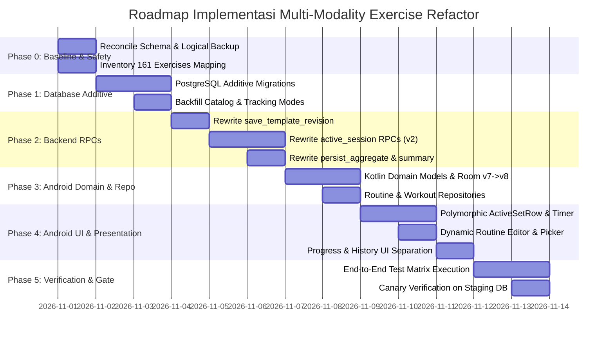

# PLAN ARCHITECTURAL EXERCISES REFACTOR
**IMFIT Multi-Modality Exercise Tracking, Domain Model, & Server-Authoritative Engine**

---

## 0. Metadata & Kontrak Eksekusi

| Atribut | Spesifikasi |
| :--- | :--- |
| **Versi / Tanggal** | **1.3 — Implementasi Penuh & Verifikasi Runtime Selesai** / 2026-11-02 |
| **Tingkat Urgensi** | **P0 — Release Blocker** (Sebelum Closed Beta) |
| **Basis Kode Utama** | Candidate Android `feature/exercise-multimodality-phase4` (`215d16e03c4f8845c57fdf337b2332b3264af406`); Supabase project `imfit` |
| **Topology & Storage** | Target **Remote-Authoritative Hybrid**: PostgreSQL 17 + Room v9 |
| **Prinsip Utama** | **Server-Authoritative Validation, Type-Safe Measurement, Expand-Backfill-Cutover-Contract, Zero-Loss Backward Compatibility** |
| **Target Cakupan** | Katalog 161 Exercise, Routine Template CRUD, Active Workout Session, Set Logging, Volume & Metrics Calculation, History & Progress Analytics |
| **Release Gate** | **GATE TEKNIS LENGKAP PASS (T-01 s/d T-21)**. Seluruh 21 skenario uji lulus otomatis dengan bukti runtime & screenshot connected emulator. Status rilis produksi menunggu prasyarat rilis operasional. |
| **Otorisasi Revisi 1.3** | Implementasi menyeluruh 13 tahap (Backend, Catalog Authority, Direct Add, Routine Editor, Picker Modality, ActiveSetRow, Cardio, Runtime Rest Timer, Snapshot Data Flow, Summary, Home/Progress/History) dan verifikasi E2E selesai. |

---

## 1. Executive Summary & Ringkasan Keputusan Arsitektur

Audit awal terhadap branch `hybrid` dan project Supabase `imfit` yang dicatat pada revisi sebelumnya menemukan asumsi tunggal beban eksternal (kg) $\times$ repetisi. Dampaknya mencakup penolakan bodyweight 0 kg serta penggunaan field repetisi yang keliru untuk latihan waktu/jarak. Bagian audit §2 adalah **baseline historis**, bukan pernyataan bahwa seluruh kode saat ini masih memakai model tersebut. Revisi 1.2 mencatat keputusan produk Q1–Q7; tidak menambah bukti runtime atau mengubah status release gate.

### Keputusan Kunci Arsitektur:
1. **Ekspansi 6 Tipe Pelacakan Inti (*TrackingType*)**:
   - `WEIGHT_REPS` (Beban eksternal + Repetisi)
   - `BODYWEIGHT_REPS` (Repetisi bodyweight, opsional beban tambahan $+kg$)
   - `ASSISTED_REPS` (Repetisi bodyweight dengan bantuan mesin $-kg$)
   - `REPS_ONLY` (Repetisi murni tanpa variabel beban)
   - `DURATION` (Durasi waktu isometrik / HIIT dalam detik)
   - `DISTANCE_DURATION` (Jarak dalam meter + Durasi dalam detik)
   *(Desain extensible untuk `WEIGHT_DURATION` dan `WEIGHT_DISTANCE` pada iterasi lanjutan)*.
2. **Server-Authoritative Validation**: Validasi penuntasan set (*complete set*) dan finalisasi sesi dikendalikan mutlak oleh backend Supabase melalui RPC, bukan hanya filter checkbox di UI Android.
3. **Pemisahan Semantik Metrik & Analytics**: Memecah metrik tunggal `total_volume` menjadi metrik terpisah: *External Load Volume* ($kg$), *Additional Load Volume* ($kg$), *Total Repetitions*, *Hold Duration* (detik), *Cardio Duration* (detik), dan *Cardio Distance* (meter).
4. **Pola Migrasi Bertahap (*Expand $\rightarrow$ Backfill $\rightarrow$ Cutover $\rightarrow$ Contract*)**: Menjamin sesi aktif versi 1 (`schema_version = 1`) dan data riwayat lama tetap terbaca dan dapat diselesaikan tanpa merusak integritas sistem.

### 1.1 Keputusan Produk yang Disetujui — Q1–Q7

Persetujuan user pada 2026-11-02 berlaku untuk keputusan berikut, bukan persetujuan implementasi atau pernyataan bahwa seluruh desain telah selesai.

| Keputusan | Kontrak yang Disetujui |
| :--- | :--- |
| **Q1 — Tujuan utama** | Input, validasi, dan pencatatan mengikuti kebutuhan gerakan; bukan sekadar perubahan label/warna. Push-up tidak wajib kg, bench press mencatat kg dan reps, cardio mendukung waktu dan/atau jarak sesuai mode. |
| **Q2 — Pemisahan konsep** | Karakter gerakan, cara pembebanan, dan metrik pencatatan tidak dipaksa menjadi satu klasifikasi. Pertahankan enam `TrackingType`; tiga istilah bodyweight/weighted/cardio bukan penggantinya. |
| **Q3 — Cakupan konsisten** | Pilih gerakan → susun/edit rutinitas → detail rutinitas → sesi aktif → ringkasan → riwayat/progres harus memakai arti mode dan metrik yang sama. Ubah hanya bagian terdampak; bukan redesign seluruh layar. Katalog tetap read-only bagi user; membuat/mengedit definisi katalog tidak masuk scope. |
| **Q4 — Pengelompokan UI** | Bodyweight, weighted, dan cardio membantu pencarian/pemahaman, bukan tiga kelompok eksklusif. Weighted/assisted pull-up tetap mempertahankan karakter bodyweight; plank tidak berubah menjadi cardio karena memakai waktu; conditioning berbeban tetap dapat mencatat kg. Isometric dan conditioning tidak boleh hilang maknanya. |
| **Q5 — Otoritas mode** | Server menentukan default dan allowed modes; user memilih mode valid saat menyusun rutinitas. Pilihan disimpan pada rutinitas lalu disnapshot pada sesi. Perubahan katalog tidak diam-diam mengubah sesi berjalan atau arti riwayat. Android tidak mengklasifikasikan gerakan berdasarkan ID hardcoded. |
| **Q6 — Cardio waktu saja** | Cardio berdurasi tanpa jarak tetap valid melalui `DURATION` bila diizinkan katalog. UI membedakan **Waktu saja** dan **Jarak + waktu**; jangan mengarang jarak atau memakai nol sebagai pengganti data tak diketahui. Pace hanya dihitung jika waktu dan jarak tersedia serta positif. |
| **Q7 — Bodyweight bertahap** | Form bodyweight biasa mengutamakan reps; kontrol **Tambah beban** membuka input opsional `+kg`. Nilai tambahan yang sudah digunakan tetap terlihat. Assisted exercise langsung menampilkan **Bantuan (kg)** karena wajib. Berat badan pengguna bukan input beban angkatan. |

### 1.2 Batas Keputusan dan Status Bukti

- **Dokumentasi saja**: revisi ini tidak menjalankan implementasi, migrasi, deployment, atau pengujian aplikasi/database. Seluruh pekerjaan tambahan akibat Q1–Q7 tetap berstatus belum diverifikasi.
- **Desain lanjutan belum diputuskan**: susunan final filter/badge untuk kelompok yang tumpang tindih, lokasi kontrol pemilihan mode di luar editor rutinitas, aturan perubahan mode saat sesi sudah berjalan, dan prioritas metrik utama sesi campuran. Jangan menganggap detail tersebut disetujui lewat Q1–Q7; konfirmasi sebelum implementasi terkait.
- **Bukti historis tidak dinaikkan statusnya**: metadata release gate, checklist Phase 2, dan ringkasan pasca-fix-forward Phase 5 memuat status yang belum selaras. Rekonsiliasi terhadap [Phase 5 Verification Report](PHASE5_VERIFICATION_REPORT.md) dan artefak eksekusi diperlukan sebelum mengubah checklist/gate. Revisi ini tidak memilih salah satu klaim sebagai hasil verifikasi baru; keputusan rilis tetap **NO-GO**.

```
+----------------------------------------------------------------------------------------------------+
|                                    TARGET DATA FLOW ARSITEKTUR                                      |
+----------------------------------------------------------------------------------------------------+
|                                                                                                    |
|  [Exercise Catalog]  -->  [Workout Template]  -->  [Active Session]  -->  [Workout History & Logs] |
|  - default_tracking_type  - tracking_type          - snapshot v2          - external_load_volume   |
|  - allowed_modes          - target_reps            - polymorphic sets     - additional_load_volume |
|  - 161 exercises mapped   - target_duration        - server-authoritative - total_reps             |
|                           - target_distance          CAS & validation     - total_duration_seconds |
|                                                                           - total_distance_meters  |
+----------------------------------------------------------------------------------------------------+
```

---

## 2. Audit Ground Truth: Codebase `hybrid` & Live Supabase `imfit`

### 2.1 Live Supabase `imfit` (`ltcxltahkrjnsjaxndsa`)
Pemeriksaan langsung pada skema database Supabase PostgreSQL 17 aktif menunjukkan:
1. **`public.exercises` (161 baris)**:
   - Kolom: `id`, `muscle_category_id`, `name`, `description`, `image_url`, `video_url`, `difficulty`, `equipment`, `is_active`, `created_at`, `updated_at`.
   - **Celah**: Tidak ada kolom `measurement_type`, `default_tracking_type`, atau tabel relasi mode pelacakan yang didukung.
2. **`public.template_exercises` (22 baris)**:
   - Kolom: `id`, `template_id`, `exercise_id`, `order_index`, `sets` (1..20), `reps` (1..100, `NOT NULL DEFAULT 10`), `rest_seconds` (0..600).
   - **Celah**: Tidak ada target durasi atau jarak. Repetisi terkunci `NOT NULL`.
3. **`public.workout_sets` (113 baris: 106 completed, 7 uncompleted 0 kg)**:
   - Kolom: `id`, `exercise_log_id`, `workout_log_id`, `exercise_id`, `set_number`, `weight`, `reps`, `is_completed`, `is_warmup`, `notes`.
   - **Fakta**: Tidak ada completed set dengan `weight = 0`. Hal ini konsisten dengan adanya validasi positif yang menolak set 0 kg.
4. **RPC Server-Side Validations**:
   - `public.update_active_session`: Baris validasi `complete_set`:
     ```sql
     elsif v_type='complete_set' then
       if (v_set->>'weight')::numeric<=0 or (v_set->>'reps')::integer<=0 then
         perform imfit_private.fail('PT400','VALIDATION');
       end if;
       v_set:=jsonb_set(v_set,'{is_completed}','true');
     ```
   - `imfit_private.terminal_session`: Baris validasi finalisasi sesi:
     ```sql
     if v_sets=0 or exists(select 1 from jsonb_array_elements(v_row.session_data->'exercises') e,
       lateral jsonb_array_elements(e->'sets') s where (s->>'is_completed')::boolean
       and ((s->>'weight')::numeric<=0 or (s->>'reps')::integer<=0)) then
       perform imfit_private.fail('PT400','VALIDATION');
     end if;
     ```
   - `public.persist_local_workout_aggregate`: Mengharuskan relasi kaku:
     `v_volume = sum(weight * reps)` dan `abs(v_volume - total_volume) <= 0.01`.
   - `public.save_template_revision`: Menolak jika field `sets`, `reps`, `rest_seconds` tidak ada atau bernilai `<= 0`.
   - `public.active_sessions`: Constraint `check (schema_version = 1)` mengunci schema JSON hanya pada versi 1.

### 2.2 Android Codebase pada Branch `hybrid`
Pemeriksaan pada kode Android `:app` membuktikan:
1. **Domain Model (`Exercise.kt`, `WorkoutSet.kt`, `TemplateExercise.kt`)**:
   - `WorkoutSet.kt:9`: `val volume: Float get() = if (isCompleted) weight * reps else 0f`.
   - `TemplateExercise.kt`: Hanya menampung `sets`, `reps`, `restSeconds`.
   - `ExercisePrescriptionCapability.kt`: Memuat hardcoded set ID yang memblokir plank dan kardio (`durationDistanceExerciseIds` = `ex_core_1`, `ex_core_9`, `ex_cardio_1` s/d `ex_cardio_9`).
2. **UI Layer (`ActiveSetRow.kt:108`)**:
   - Checkbox terkunci:
     ```kotlin
     enabled = editable && !isPaused && set.weight > 0f && set.reps > 0
     ```
   - Input hanya menyediakan dua kolom: KG dan Reps.
3. **Session ViewModel (`ActiveWorkoutViewModel.kt:277`)**:
   - Method `completeSet` menyaring:
     ```kotlin
     if (set.setNumber == setNumber && !set.isCompleted && set.weight > 0 && set.reps > 0)
     ```
4. **Routine Editor (`EditWorkoutViewModel.kt:30-31`, `SupabaseRoutineRepository.kt:170`)**:
   - Validasi ketat `sets in 1..20 && reps in 1..100 && rest in 0..600`.
   - Gerakan non-reps diblokir dari pemilihan di `ExerciseSelectionScreen.kt:279` dengan string `R.string.routine_duration_unsupported`.
5. **Local Database (`IMFITDatabase.kt` v7)**:
   - Entity `TemplateExerciseEntity`, `WorkoutSetEntity`, `ExerciseLogEntity`, `WorkoutLogEntity` hanya memetakan `weight` dan `reps`.

---

## 3. Spesifikasi Domain Model Target (6 Tipe Pengukuran)

```
+----------------------------------------------------------------------------------------------------+
|                                    KLASIFIKASI 6 TRACKING TYPE                                     |
+-------------------+-----------------------------+-------------------------+------------------------+
| TrackingType      | Input Primer                | Input Sekunder          | Kondisi Set Selesai    |
+-------------------+-----------------------------+-------------------------+------------------------+
| WEIGHT_REPS       | Weight (kg) > 0             | Reps > 0                | weight > 0 && reps > 0 |
| BODYWEIGHT_REPS   | Reps > 0                    | Additional Wt (kg) >= 0 | reps > 0               |
| ASSISTED_REPS     | Reps > 0                    | Assistance Wt (kg) > 0  | reps > 0 && assist > 0 |
| REPS_ONLY         | Reps > 0                    | -                       | reps > 0               |
| DURATION          | Duration (detik) > 0        | -                       | duration > 0           |
| DISTANCE_DURATION | Duration (detik) > 0        | Distance (meter) > 0    | duration > 0 && dist>0 |
+-------------------+-----------------------------+-------------------------+------------------------+
```

### 3.1 Kontrak Domain Model Kotlin
Definisi enum dan model domain di `domain/model/`:

```kotlin
package com.diajarkoding.imfit.domain.model

enum class TrackingType {
    WEIGHT_REPS,
    BODYWEIGHT_REPS,
    ASSISTED_REPS,
    REPS_ONLY,
    DURATION,
    DISTANCE_DURATION
}

data class ExerciseTarget(
    val sets: Int = 3,
    val targetReps: Int? = 10,
    val targetDurationSeconds: Int? = null,
    val targetDistanceMeters: Int? = null,
    val restSeconds: Int = 60
) {
    fun validate(trackingType: TrackingType): Boolean {
        if (sets !in 1..20 || restSeconds !in 0..600) return false
        return when (trackingType) {
            TrackingType.WEIGHT_REPS,
            TrackingType.BODYWEIGHT_REPS,
            TrackingType.ASSISTED_REPS,
            TrackingType.REPS_ONLY -> (targetReps ?: 0) in 1..100
            TrackingType.DURATION -> (targetDurationSeconds ?: 0) in 1..86400
            TrackingType.DISTANCE_DURATION -> (targetDurationSeconds ?: 0) in 1..86400 && 
                (targetDistanceMeters == null || targetDistanceMeters in 1..1000000)
        }
    }
}

data class SetMeasurement(
    val weight: Float? = null,
    val reps: Int? = null,
    val durationSeconds: Int? = null,
    val distanceMeters: Int? = null,
    val additionalWeight: Float? = null,
    val assistanceWeight: Float? = null
) {
    fun isCompleteEligible(type: TrackingType): Boolean = when (type) {
        TrackingType.WEIGHT_REPS -> (weight ?: 0f) > 0f && (reps ?: 0) > 0
        TrackingType.BODYWEIGHT_REPS -> (reps ?: 0) > 0 && (additionalWeight ?: 0f) >= 0f
        TrackingType.ASSISTED_REPS -> (reps ?: 0) > 0 && (assistanceWeight ?: 0f) > 0f
        TrackingType.REPS_ONLY -> (reps ?: 0) > 0
        TrackingType.DURATION -> (durationSeconds ?: 0) > 0
        TrackingType.DISTANCE_DURATION -> (durationSeconds ?: 0) > 0 && (distanceMeters ?: 0) > 0
    }
}
```

### 3.2 Pembaruan Model Existing
- **`Exercise.kt`**:
  ```kotlin
  data class Exercise(
      val id: String,
      val name: String,
      val muscleCategory: MuscleCategory,
      val description: String,
      val imageUrl: String? = null,
      val isActive: Boolean = true,
      val modality: ExerciseModality,
      val defaultTrackingType: TrackingType,
      val allowedTrackingTypes: List<TrackingType>
  )
  ```
- **`TemplateExercise.kt`**:
  ```kotlin
  data class TemplateExercise(
      val exercise: Exercise,
      val trackingType: TrackingType = exercise.defaultTrackingType,
      val sets: Int = 3,
      val reps: Int? = 10,
      val targetDurationSeconds: Int? = null,
      val targetDistanceMeters: Int? = null,
      val restSeconds: Int = 60
  )
  ```
- **`WorkoutSet.kt`**:
  ```kotlin
  data class WorkoutSet(
      val setNumber: Int,
      val weight: Float = 0f,
      val reps: Int = 0,
      val durationSeconds: Int? = null,
      val distanceMeters: Int? = null,
      val additionalWeight: Float? = null,
      val assistanceWeight: Float? = null,
      val isCompleted: Boolean = false
  )
  ```

Kontrak metadata katalog pada contoh di atas wajib berasal dari server dan dipertahankan melalui DTO, cache Room, dan domain. `ExerciseModality` membedakan `STRENGTH`, `CALISTHENICS`, `ISOMETRIC`, `CARDIO`, dan `CONDITIONING`; kategori otot tetap dimensi terpisah. `defaultTrackingType` harus termasuk dalam `allowedTrackingTypes`. Jangan memberi metadata katalog baru fallback diam-diam `WEIGHT_REPS` atau menghitung klasifikasi dari ID gerakan. Pembacaan snapshot/data legacy tetap mengikuti jalur kompatibilitas dan penanda kualitas yang sudah ditetapkan, bukan diklasifikasi ulang berdasarkan katalog terbaru.

---

## 4. Aturan Produk & Coaching Fitness Invariants

1. **Konvensi Berat Beban Eksternal**:
   - **Barbell**: Total berat piringan ditambah berat bar (standar Olympic bar 20 kg).
   - **Dumbbell**: Berat **per satu dumbbell** (misal: Dumbbell Bench Press dengan dua dumbbell 20 kg dicatat sebagai **20 kg**, bukan 40 kg, sesuai konvensi standar aplikasi fitness modern untuk menghindari distorsi progres per tangan).
2. **Bodyweight Semantics**:
   - Pengguna dengan berat badan 70 kg yang melakukan Push-Up 12 repetisi cukup mencatat repetisi $12$ tanpa mengisi kg. Beban tambahan kosong atau nol berarti tidak memakai beban tambahan; bukan berarti berat badan pengguna nol.
   - **Dilarang keras mengalikan berat badan pengguna ke dalam external volume**, karena berat badan fluktuatif dan biomekanika push-up hanya memindahkan ~64% massa tubuh.
   - Progres calisthenics dievaluasi dari kenaikan repetisi (*Repetition Progress*) atau beban sabuk tambahan (*Additional Load Volume*).
3. **Pemisahan Timer**:
   - **Set Execution Timer (Timer Durasi Latihan)**: Berjalan saat set isometrik/kardio aktif (misal 45 detik Plank).
   - **Rest Timer (Waktu Istirahat Antar-Set)**: Hitung mundur jeda pemulihan setelah set ditandai selesai (misal 60 detik istirahat). Keduanya tidak boleh saling menggantikan atau memakai satu slot memori yang sama.
4. **Prefill History Rules**:
   - Prefill nilai set sebelumnya hanya valid jika `exercise_id` **dan** `tracking_type` cocok 100%. Riwayat DURATION tidak boleh mem-prefill field REPS.

5. **Karakter Gerakan Tidak Sama dengan Tracking Mode**:
   - Weighted pull-up adalah bodyweight dengan tambahan beban; assisted pull-up adalah bodyweight dengan bantuan. Jangan mengubah keduanya menjadi beban eksternal biasa.
   - `DURATION` tidak otomatis berarti cardio: plank tetap isometric, sedangkan cardio waktu saja tetap cardio. Conditioning berbeban tetap menggunakan metrik beban sesuai mode.
6. **Cardio Tanpa Jarak yang Diketahui**:
   - Gunakan pilihan **Waktu saja** (`DURATION`) bila tersedia pada katalog; hanya durasi positif diperlukan untuk menuntaskan set.
   - Pilihan **Jarak + waktu** (`DISTANCE_DURATION`) tetap mensyaratkan kedua nilai positif untuk hasil set. Target jarak rutinitas boleh belum ditentukan sebagaimana §3.1, tetapi hasil set mode ini tidak boleh memakai jarak kosong/nol.
   - Jarak yang tidak diketahui tidak dikonversi menjadi nol; pace tidak ditampilkan sebagai nilai nol jika data pendukung tidak tersedia. Jangan mengganti mode secara otomatis karena field kosong.

---

## 5. Rencana Migrasi Database Supabase (PostgreSQL 17)

Pendekatan migrasi menggunakan prinsip **Expand $\rightarrow$ Backfill $\rightarrow$ Cutover $\rightarrow$ Contract**.

### 5.1 Tahap Expand: Additive Schema Changes
Dibuat migrasi baru: `supabase/migrations/20261101000100_exercise_multimodality_tracking.sql`.

```sql
-- 1. Create Tracking Type ENUM
CREATE TYPE public.tracking_type_enum AS ENUM (
    'WEIGHT_REPS',
    'BODYWEIGHT_REPS',
    'ASSISTED_REPS',
    'REPS_ONLY',
    'DURATION',
    'DISTANCE_DURATION'
);

-- 2. Alter exercises
ALTER TABLE public.exercises 
ADD COLUMN default_tracking_type public.tracking_type_enum NOT NULL DEFAULT 'WEIGHT_REPS';

-- 3. Create allowed tracking modes table
CREATE TABLE public.exercise_tracking_modes (
    exercise_id VARCHAR NOT NULL REFERENCES public.exercises(id) ON DELETE CASCADE,
    tracking_type public.tracking_type_enum NOT NULL,
    is_default BOOLEAN NOT NULL DEFAULT false,
    PRIMARY KEY (exercise_id, tracking_type)
);

-- 4. Alter template_exercises
ALTER TABLE public.template_exercises
ADD COLUMN tracking_type public.tracking_type_enum NOT NULL DEFAULT 'WEIGHT_REPS',
ADD COLUMN target_duration_seconds INTEGER NULL CHECK (target_duration_seconds IS NULL OR (target_duration_seconds >= 1 AND target_duration_seconds <= 86400)),
ADD COLUMN target_distance_meters INTEGER NULL CHECK (target_distance_meters IS NULL OR (target_distance_meters >= 1 AND target_distance_meters <= 1000000));

ALTER TABLE public.template_exercises ALTER COLUMN reps DROP NOT NULL;
ALTER TABLE public.template_exercises ALTER COLUMN reps DROP DEFAULT;

-- 5. Alter workout_sets
ALTER TABLE public.workout_sets
ADD COLUMN duration_seconds INTEGER NULL CHECK (duration_seconds IS NULL OR duration_seconds >= 0),
ADD COLUMN distance_meters INTEGER NULL CHECK (distance_meters IS NULL OR distance_meters >= 0),
ADD COLUMN additional_weight NUMERIC(7,2) NULL CHECK (additional_weight IS NULL OR additional_weight >= 0),
ADD COLUMN assistance_weight NUMERIC(7,2) NULL CHECK (assistance_weight IS NULL OR assistance_weight >= 0);

-- 6. Alter exercise_logs
ALTER TABLE public.exercise_logs
ADD COLUMN tracking_type public.tracking_type_enum NOT NULL DEFAULT 'WEIGHT_REPS',
ADD COLUMN total_duration_seconds INTEGER NOT NULL DEFAULT 0,
ADD COLUMN total_distance_meters INTEGER NOT NULL DEFAULT 0,
ADD COLUMN additional_volume NUMERIC(10,2) NOT NULL DEFAULT 0,
ADD COLUMN metric_quality VARCHAR NOT NULL DEFAULT 'VERIFIED' CHECK (metric_quality IN ('VERIFIED', 'LEGACY_UNVERIFIED'));

-- 7. Alter workout_logs
ALTER TABLE public.workout_logs
ADD COLUMN total_duration_seconds INTEGER NOT NULL DEFAULT 0,
ADD COLUMN total_distance_meters INTEGER NOT NULL DEFAULT 0,
ADD COLUMN additional_volume NUMERIC(10,2) NOT NULL DEFAULT 0,
ADD COLUMN data_quality VARCHAR NOT NULL DEFAULT 'VERIFIED' CHECK (data_quality IN ('VERIFIED', 'LEGACY_UNVERIFIED'));

-- 8. Alter active_sessions to allow schema_version 2
ALTER TABLE public.active_sessions DROP CONSTRAINT IF EXISTS active_sessions_schema_version_check;
ALTER TABLE public.active_sessions ADD CONSTRAINT active_sessions_schema_version_check CHECK (schema_version IN (1, 2));
```

### 5.2 Tahap Backfill: Klasifikasi Katalog 161 Exercise
Script DML backfill memetakan seluruh latihan katalog:
1. **Core / Isometric**:
   - `ex_core_1` (Plank), `ex_core_9` (Side Plank) $\rightarrow$ `DURATION`. Allowed: `[DURATION]`.
   - `ex_core_2` (Crunches), `ex_core_3` (Russian Twist), `ex_core_4` (Leg Raises), `ex_core_7` (Bicycle Crunches), `ex_core_8` (Mountain Climbers), `ex_core_10` (Hanging Knee Raise) $\rightarrow$ `BODYWEIGHT_REPS`. Allowed: `[BODYWEIGHT_REPS, REPS_ONLY, DURATION]`.
   - `ex_core_11` (Kneeling Cable Crunch), `ex_core_12` (Cable Pallof Press), `ex_core_13` (Dumbbell Side Bend), `ex_core_14` (Barbell Landmine Twist), `ex_core_15` (Ab Machine) $\rightarrow$ `WEIGHT_REPS`.
2. **Cardio**:
   - `ex_cardio_1` (Treadmill Running), `ex_cardio_2` (Stationary Bike), `ex_cardio_3` (Rowing Machine), `ex_cardio_6` (Elliptical), `ex_cardio_7` (Stair Climber), `ex_cardio_11` (Assault AirBike), `ex_cardio_12` (SkiErg), `ex_cardio_13` (Incline Treadmill Walk), `ex_cardio_14` (Recumbent Bike) $\rightarrow$ `DISTANCE_DURATION`. Allowed: `[DISTANCE_DURATION, DURATION]`.
   - `ex_cardio_4` (Jump Rope), `ex_cardio_5` (Burpees), `ex_cardio_8` (Box Jumps), `ex_cardio_9` (High Knees), `ex_cardio_10` (Jumping Jacks) $\rightarrow$ `REPS_ONLY`. Allowed: `[REPS_ONLY, DURATION]`.
   - `ex_cardio_15` s/d `ex_cardio_19` (Dumbbell Thrusters, Man Makers, Bear Complex, Devil Press) $\rightarrow$ `WEIGHT_REPS`.
3. **Calisthenics / Bodyweight Upper & Lower**:
   - `ex_chest_4` (Push-Ups), `ex_chest_9` (Dips), `ex_chest_10` (Incline Push-Ups), `ex_back_2` (Pull-Ups), `ex_back_8` (Back Extensions), `ex_back_9` (Chin-Ups), `ex_legs_10` (Bodyweight Squats), `ex_legs_11` (Walking Lunges) $\rightarrow$ `BODYWEIGHT_REPS`. Allowed: `[BODYWEIGHT_REPS, REPS_ONLY]`.
4. **Assisted Machines**:
   - `ex_back_17` (Assisted Pull-Up Machine), `ex_triceps_7` (Assisted Dip Machine) $\rightarrow$ `ASSISTED_REPS`. Allowed: `[ASSISTED_REPS]`.
5. **Standard Strength (Barbell, Dumbbell, Cable, Machine)**:
   - Sisa 125 latihan $\rightarrow$ `WEIGHT_REPS`. Allowed: `[WEIGHT_REPS]`.

### 5.3 Pembaruan Kontrak RPC Backend Supabase
1. **`save_template_revision`**:
   - Parameter `p_exercises` JSON menerima objek:
     `{"exercise_id": "...", "order_index": 0, "tracking_type": "...", "sets": 3, "reps": 10, "target_duration_seconds": null, "target_distance_meters": null, "rest_seconds": 60}`.
   - Validasi disesuaikan dengan `tracking_type`: jika `DURATION`, `target_duration_seconds` wajib $1..86400$, sedangkan `reps` boleh null.
2. **`create_active_session`**:
   - Membuat snapshot `active_sessions` dengan `schema_version = 2`.
   - Mengisi `tracking_type` untuk setiap child exercise dari konfigurasi template.
3. **`update_active_session`**:
   - Mengizinkan command `edit_set` menerima `duration_seconds`, `distance_meters`, `additional_weight`, `assistance_weight`.
   - Validasi `complete_set` membedakan tipe:
     - `WEIGHT_REPS`: `weight > 0 && reps > 0`
     - `BODYWEIGHT_REPS`: `reps > 0 && coalesce(additional_weight, 0) >= 0`
     - `ASSISTED_REPS`: `reps > 0 && coalesce(assistance_weight, 0) > 0`
     - `REPS_ONLY`: `reps > 0`
     - `DURATION`: `duration_seconds > 0`
     - `DISTANCE_DURATION`: `duration_seconds > 0 && distance_meters > 0`
4. **`imfit_private.terminal_session`**:
   - Kalkulasi metrik terpisah saat workout selesai:
     - `v_external_volume := sum(weight * reps)` HANYA untuk latihan `WEIGHT_REPS`.
     - `v_additional_volume := sum(additional_weight * reps)` untuk `BODYWEIGHT_REPS` berbeban.
     - `v_total_reps := sum(reps)` untuk tipe reps.
     - `v_total_duration := sum(duration_seconds)` untuk tipe durasi.
     - `v_total_distance := sum(distance_meters)` untuk tipe jarak.
   - Sesi tidak lagi ditolak jika ada set 0 kg pada latihan bodyweight/durasi.
5. **`persist_local_workout_aggregate`**:
   - Validasi agregat diperbarui agar mencocokkan total volume hanya dari latihan bertipe `WEIGHT_REPS`.
6. **`get_progress_summary`**:
   - Mengembalikan payload yang diperluas:
     ```json
     {
       "start_date": "2026-10-01",
       "end_date": "2026-10-31",
       "workout_count": 12,
       "external_volume_kg": "14500.00",
       "additional_volume_kg": "320.00",
       "total_reps": 850,
       "hold_duration_seconds": 920,
       "cardio_duration_seconds": 7200,
       "cardio_distance_meters": 15400,
       "workout_duration_seconds": 38400
     }
     ```

---

## 6. Arsitektur Android Codebase (`hybrid`)

### 6.1 Room Database Migration (v7 $\rightarrow$ v8)
Pada `IMFITDatabase.kt`:
```kotlin
val MIGRATION_7_8 = object : Migration(7, 8) {
    override fun migrate(database: SupportSQLiteDatabase) {
        // template_exercises
        database.execSQL("ALTER TABLE template_exercises ADD COLUMN tracking_type TEXT NOT NULL DEFAULT 'WEIGHT_REPS'")
        database.execSQL("ALTER TABLE template_exercises ADD COLUMN target_duration_seconds INTEGER")
        database.execSQL("ALTER TABLE template_exercises ADD COLUMN target_distance_meters INTEGER")

        // workout_sets
        database.execSQL("ALTER TABLE workout_sets ADD COLUMN duration_seconds INTEGER")
        database.execSQL("ALTER TABLE workout_sets ADD COLUMN distance_meters INTEGER")
        database.execSQL("ALTER TABLE workout_sets ADD COLUMN additional_weight REAL")
        database.execSQL("ALTER TABLE workout_sets ADD COLUMN assistance_weight REAL")

        // exercise_logs
        database.execSQL("ALTER TABLE exercise_logs ADD COLUMN tracking_type TEXT NOT NULL DEFAULT 'WEIGHT_REPS'")
        database.execSQL("ALTER TABLE exercise_logs ADD COLUMN total_duration_seconds INTEGER NOT NULL DEFAULT 0")
        database.execSQL("ALTER TABLE exercise_logs ADD COLUMN total_distance_meters INTEGER NOT NULL DEFAULT 0")
        database.execSQL("ALTER TABLE exercise_logs ADD COLUMN additional_volume REAL NOT NULL DEFAULT 0")

        // workout_logs
        database.execSQL("ALTER TABLE workout_logs ADD COLUMN total_duration_seconds INTEGER NOT NULL DEFAULT 0")
        database.execSQL("ALTER TABLE workout_logs ADD COLUMN total_distance_meters INTEGER NOT NULL DEFAULT 0")
        database.execSQL("ALTER TABLE workout_logs ADD COLUMN additional_volume REAL NOT NULL DEFAULT 0")

        // exercises
        database.execSQL("ALTER TABLE exercises ADD COLUMN default_tracking_type TEXT NOT NULL DEFAULT 'WEIGHT_REPS'")
    }
}
```

### 6.2 Polymorphic `ActiveSetRow.kt`
Menggantikan row kaku weight-reps dengan rendering dinamis:

```kotlin
@Composable
internal fun ActiveSetRow(
    set: WorkoutSet,
    trackingType: TrackingType,
    exerciseName: String,
    mutationEnabled: Boolean,
    canDelete: Boolean,
    isPaused: Boolean,
    onUpdate: (SetMeasurement) -> Unit,
    onComplete: () -> Unit,
    onDelete: () -> Unit,
    modifier: Modifier = Modifier
) {
    // 1. Tentukan input fields sesuai trackingType:
    // - WEIGHT_REPS: [Weight Input (kg)] [Reps Input]
    // - BODYWEIGHT_REPS: [Reps Input] [Tambah beban -> +kg opsional]
    // - ASSISTED_REPS: [Bantuan (kg), wajib] [Reps Input]
    // - REPS_ONLY: [Reps Input]
    // - DURATION: [Stopwatch/Timer Trigger + MM:SS Manual Input]
    // - DISTANCE_DURATION: [Distance Input (m/km)] [Duration Input (MM:SS)]
    
    // 2. Evaluasi kondisi checkbox aktif:
    val isCompleteEnabled = mutationEnabled && !isPaused && !set.isCompleted && 
        set.measurement.isCompleteEligible(trackingType)
        
    // 3. Render sesuai desain token IMFIT
}
```

Perilaku bodyweight mengikuti Q7: input `+kg` tidak wajib ditampilkan pada kondisi awal tanpa tambahan beban. Jika nilai beban tambahan sudah digunakan, termasuk dari draft/prefill yang valid, nilai dan inputnya harus terlihat; jangan menyembunyikan nilai aktif di balik kontrol **Tambah beban**. Input bantuan ditulis jelas sebagai **Bantuan (kg)** dengan besaran positif; bantuan tidak dianggap beban eksternal yang diangkat.

### 6.3 Dynamic Routine Form & Eliminasi Input Rest Timer (`EditWorkoutScreen.kt` & `EditWorkoutViewModel.kt`)
1. **Target Prescriptions Sesuai Tipe (Tanpa Input Rest)**:
   - **Eliminasi Pengisian Rest Timer pada Routine**: Field input "Jeda (dtk)" / "Rest (s)" **dihapus sepenuhnya** dari `RoutineExerciseEditor` dan form pembuatan/pengeditan routine (`EditWorkoutScreen`). Routine template hanya mendefinisikan target latihan inti: Sets, Repetisi, Durasi, atau Jarak.
   - Jika latihan bertipe `DURATION` (Plank), tampilkan hanya field Sets dan target Durasi (detik/menit), tanpa input repetisi atau rest.
   - Jika bertipe `DISTANCE_DURATION` (Treadmill), tampilkan field Sets, target Waktu/Durasi, dan target Jarak, tanpa input rest.
   - Jika bertipe `WEIGHT_REPS` / `BODYWEIGHT_REPS` / `ASSISTED_REPS` / `REPS_ONLY`, tampilkan Sets dan Repetisi saja.
   - Selector hanya menawarkan mode yang diizinkan katalog. Untuk cardio dengan kedua mode tersebut, tampilkan label **Waktu saja** dan **Jarak + waktu**, bukan nama enum teknis. Pilihan `DURATION` tidak menampilkan atau mewajibkan target jarak.
2. **Pembersihan Restriksi Katalog**:
   - Hapus pembatasan `ExercisePrescriptionCapability.kt`. Seluruh 161 latihan diaktifkan kembali pada `ExerciseSelectionScreen.kt`.
   - Badge menjelaskan **modality**, bukan menggantikan tracking mode: `Strength`, `Bodyweight`, `Isometric`, `Cardio`, `Conditioning`. Bodyweight/weighted/cardio dapat membantu pencarian, tetapi tidak boleh menjadi tiga kelompok eksklusif yang menghilangkan karakter gerakan atau metrik yang valid. Susunan final filter/badge masih membutuhkan keputusan desain lanjutan (§1.2).

### 6.4 Alur Navigasi Tambah Gerakan Langsung (Single Direct Navigation)
1. **Eliminasi Double Navigation (`Detail -> Edit -> Picker`)**:
   - **Alur Lama (Bermasalah)**: Dari `WorkoutDetailScreen`, klik tombol tambah gerakan membuka `EditWorkoutScreen` / `SetupRoutine` terlebih dahulu, lalu layar edit tersebut langsung membuka picker `ExerciseSelectionScreen` (`openPickerOnLoad = true`), memicu transisi layar ganda yang tidak mulus dan tumpukan backstack berulang.
   - **Alur Baru (Direct Single Navigation)**:
     - Ketika user menekan tombol "Tambah Gerakan" / "Lengkapi Rutinitas" pada `WorkoutDetailScreen`, navigasi **langsung berpindah ke `ExerciseSelectionScreen` (Pilih Gerakan)**.
     - Setelah user memilih gerakan pada katalog dan menekan tombol konfirmasi ("Tambah N Gerakan"), aplikasi bernavigasi/melanjutkan ke halaman **`SetupRoutine` / `EditWorkoutScreen`** dengan daftar gerakan terpilih yang siap dikonfigurasi (sets, reps/durasi/jarak).
     - **Alur Batal (Cancel Flow)**: Jika user menekan tombol kembali (Back) di `ExerciseSelectionScreen` tanpa menambah gerakan, navigasi **langsung kembali ke halaman pemanggil (`WorkoutDetailScreen`)**, tanpa membuka atau meninggalkan halaman setup/edit kosong di backstack.
2. **Implementasi State & Routing**:
   - `WorkoutDetailScreen` memicu navigasi ke `ExerciseSelection(context, isInitial = isSetup)` secara langsung.
   - `NavGraph` mengelola `backStack`:
     - Saat user menekan Back pada `ExerciseSelection` awal (`isInitial = true`), flow dibersihkan via `routineFlowManager.clearFlow(context)` dan kembali ke `WorkoutDetail`.
     - Saat user mengonfirmasi pilihan latihan, `ExerciseSelection` digantikan oleh `SetupRoutine(context)` atau `EditWorkout(context)` pada posisi backstack yang tepat.

### 6.5 Dampak Skema Database, DTO, dan Alur Data (Database & Data Flow Impact)
1. **Perubahan Skema Database Backend Supabase (`public.template_exercises`)**:
   - Kolom `rest_seconds` di `public.template_exercises`:
     - Sifat: Diberikan default fallback di database (`DEFAULT 60`) dan constraint `NOT NULL` dapat dilonggarkan menjadi nullable (`INTEGER NULL`) untuk transisi penuh.
     - Kompatibilitas: Klien Android baru tidak lagi mengirimkan `rest_seconds` dalam form routine. RPC `save_template_revision` diperbarui agar memperlakukan `rest_seconds` sebagai opsional menggunakan `coalesce((e->>'rest_seconds')::integer, 60)` saat menyisipkan baris template baru, sehingga data historis tetap aman dan klien lama tetap berfungsi (*zero-loss backward compatibility*).
2. **Perubahan Skema Database Lokal Room (`IMFITDatabase`)**:
   - Tabel `template_exercises`: Kolom `rest_seconds` di `TemplateExerciseEntity` tetap dipertahankan pada skema Room v8 dengan default value 60 (atau nullable) agar tidak memerlukan migrasi destruktif, tetapi field ini tidak lagi dipaparkan sebagai input yang dapat diedit pengguna di UI routine editor.
3. **Alur Data Rest Timer pada Sesi Aktif (`ActiveWorkoutScreen`)**:
   - **Rest Timer Eksklusif Runtime Sesi**: Timer istirahat hanya dapat diatur dan dipicu saat sesi workout aktif berlangsung.
   - **Konfigurasi On-the-Fly**: User mengatur durasi jeda istirahat dengan mengklik icon/kartu timer pada app bar sesi aktif (`ActiveWorkoutScreen`) atau dialog rest timer (pilihan preset: 30s, 60s, 90s, 120s, atau kustom).
   - **Penyimpanan Runtime**: Pilihan waktu istirahat ini disimpan pada level sesi aktif (`session_rest_override` di `active_sessions` Supabase dan Room `active_sessions`), bukan sebagai properti statis template routine.
   - **Trigger Otomatis**: Ketika set selesai dicentang (`complete_set`), rest timer membaca `session_rest_override` (jika ada) atau default aplikasi (60 detik) untuk memulai hitung mundur `RestTimerCoordinator`.


### 6.6 Otoritas Katalog dan Snapshot Sepanjang Alur

1. **Katalog → DTO → Room → Domain**: semua jalur pembacaan katalog, termasuk hasil picker dan hidrasi detail, mempertahankan modality, default mode, dan allowed modes dari server. Tidak boleh ada jalur yang mengabaikan metadata lalu menggantinya dengan daftar ID Android.
2. **Domain → Rutinitas**: default form berasal dari katalog; pilihan user dibatasi allowed modes. Simpan `tracking_type` beserta target yang relevan, bukan menebak ulang dari nama, kategori otot, atau alat.
3. **Rutinitas → Sesi**: mode pilihan dan metadata yang menentukan arti pencatatan disnapshot saat sesi dibuat. Pembaruan katalog tidak menulis ulang snapshot sesi berjalan; perubahan mode oleh user saat sesi aktif belum diputuskan (§1.2).
4. **Sesi → Riwayat/Progres**: simpan dan baca arti mode/metrik dari snapshot hasil latihan. Jangan menafsirkan ulang hasil historis memakai default katalog terbaru; pertahankan perlakuan `LEGACY_UNVERIFIED` untuk data lama sesuai kontrak migrasi.

### 6.7 Konsistensi Presentasi Target dan Hasil

- **Library/picker**: istilah pengelompokan tidak mengubah mode yang valid; katalog tetap read-only. Mode/metrik harus dapat dipahami tanpa memperlihatkan enum internal.
- **Editor/detail rutinitas**: tampilkan target sesuai mode—sets × reps, sets × durasi, atau sets dengan target durasi/jarak. Target durasi tidak boleh ditampilkan sebagai `0 reps`; target bukan hasil aktual latihan.
- **Sesi aktif/ringkasan**: pakai field dan satuan yang sesuai mode. Bodyweight tanpa tambahan beban tidak dipaksa mengisi kg; durasi/jarak tidak disamarkan sebagai reps.
- **Riwayat/progres**: pisahkan volume beban eksternal, volume tambahan, repetisi, durasi isometrik, durasi cardio/conditioning, dan jarak sesuai semantiknya. Jangan menyajikan sesi non-weighted seolah hasilnya hanya volume kg nol. Tata letak dan prioritas metrik utama sesi campuran belum diputuskan (§1.2).

## 7. Rencana Eksekusi & Phase Breakdown (Phase 0 — Phase 5)



### Phase 0: Baseline, Rekonsiliasi, dan Logical Backup
- [x] Buat logical backup penuh Supabase project `imfit` menggunakan pg_dump / SQL export. (SELESAI - 5 file SQL di `IMFIT-SAFE/phase0/backups`, SHA256 verified)
- [x] Lakukan uji restore hasil backup pada schema terisolasi. (SELESAI - PostgreSQL 17 cluster lokal 127.0.0.1:54322, 0 exit code, row counts match 100%, 0 orphan)
- [x] Verifikasi rekonsiliasi file migrasi repo lokal (`supabase/migrations`) dengan tabel `supabase_migrations.schema_migrations` pada server live. (SELESAI - Timestamp diselaraskan, 20261031154000 repaired)
- [x] Freeze review tabel mapping 161 exercise sebelum eksekusi DML. (SELESAI - Review 161 exercise PASS)

### Phase 1: Database Additive Schema & Catalog Backfill
- [x] Terapkan DDL migrasi additive (`20261101000100_exercise_multimodality_tracking.sql`). (SELESAI - Deployed to live Supabase)
- [x] Terapkan DML backfill default tracking type dan tabel `exercise_tracking_modes` untuk 161 latihan. (SELESAI - 161 exercises, 196 mode relations)
- [x] Verifikasi RLS dan integritas foreign keys untuk tabel baru. (SELESAI - authenticated SELECT granted, anon denied, no client writes)
- [x] Tambahkan snapshot schema version 2 pada `active_sessions`. (SELESAI - Constraint updated to schema_version IN (1, 2))

### Phase 2: Backend Services & RPC Modernization
- [x] Update RPC `save_template_revision` agar menerima `tracking_type`, `target_duration_seconds`, dan `target_distance_meters`. (SELESAI - Backward-compatible v1 & v2 deployed)
- [x] Update RPC `create_active_session` untuk memproduksi snapshot session JSON v2. (SELESAI - schema_version = 2 with typed metadata deployed)
- [x] Update RPC `update_active_session` dengan validasi per `tracking_type` pada `complete_set` dan `edit_set`. (SELESAI - Typed set validation deployed, Push-Up 0kg PASS, Bench Press 0kg rejected)
- [ ] Update RPC `terminal_session` dan `persist_local_workout_aggregate` untuk kalkulasi metrik terpisah. (Phase 5: typed lifecycle PASS pada SQL lokal, tetapi pending Plank v1 ditolak `22023` dan aggregate import menerima mode katalog terlarang; perlu fix-forward.)
- [x] Update RPC `get_exercise_prefill` agar mem-prefill metrik yang relevan dengan tipe tracking. (SELESAI - Typed prefill without cross-contamination deployed)
- [x] Update RPC `get_progress_summary` dan `get_workout_detail`. (SELESAI - Modality-separated metrics & raw parity verified)

### Phase 3: Android Domain, Room Migration, & Repository
- [x] Buat enum `TrackingType`, model `ExerciseTarget`, dan `SetMeasurement`. (SELESAI - Domain models created, A3-01 to A3-06 unit tests PASS)
- [x] Update entity Room `TemplateExerciseEntity`, `WorkoutSetEntity`, `ExerciseLogEntity`, `WorkoutLogEntity`, `ExerciseEntity`. (SELESAI - All 5 Room entities updated for typed tracking)
- [x] Implementasikan `MIGRATION_7_8` pada `IMFITDatabase.kt` beserta test migrasi Room. (Phase 5: corrected instrumentation 5/5 PASS, termasuk 7→8/6→8, active session, relasi dan `PENDING_SYNC`; bukan installed-APK upgrade.)
- [x] Update mapper DTO $\leftrightarrow$ Entity $\leftrightarrow$ Domain. (SELESAI - Codec active session schema_version 2, Room, DTO & remote import mempertahankan metadata typed & legacy quality.)
- [x] Perbarui `SupabaseRoutineRepository.kt` dan `WorkoutRepositoryImpl.kt` untuk transport data bertipe. (SELESAI - Finish Plank 90s tercatat di Room, finish legacy mempertahankan LEGACY_UNVERIFIED.)

### Phase 4: Android Presentation & UI/UX
- [x] Implementasikan komponen polymorphic `ActiveSetRow.kt` dengan input dinamis. (Phase 5: enam mode input dan strength weight=0 rejection PASS pada Compose component test; bukan full E2E.)
- [x] Implementasikan set stopwatch/timer selector untuk latihan durasi dengan input manual fallback. (SELESAI - Format MM:SS 01:30->90s, stopwatch durable recovery terverifikasi lintas 2x SIGKILL PID-verified.)
- [x] Refactor `EditWorkoutScreen.kt` dan `EditWorkoutViewModel.kt` untuk form dinamis (Reps vs Waktu/Jarak). (SELESAI - Target durasi 45->90 dan jarak tersimpan, draft recovery, dan tracking mode selector aktif.)
- [x] Implementasikan alur navigasi langsung "Tambah Gerakan": Klik "Tambah Gerakan" pada Detail Routine langsung membuka `ExerciseSelectionScreen` tanpa perantara halaman edit. Setelah memilih gerakan, navigasi ke Setup/Edit Routine. Jika batal (Back) di picker, kembali langsung ke Detail Routine. (SELESAI - Direct Add Navigation terverifikasi di RedesignNavigationTest).
- [x] Hilangkan pengisian rest timer pada form setup awal dan edit routine (`RoutineExerciseEditor`). Rest timer hanya dapat diatur secara situasional melalui klik timer pada sesi aktif (`ActiveWorkoutScreen`). (SELESAI - Input rest timer dihilangkan dari form routine; dialog dan countdown runtime aktif).
- [x] Hapus pemblokiran pada `ExerciseSelectionScreen.kt` dan tambahkan badge modality. (SELESAI - Pemblokiran dihapus; modalitas dan chips mode ditampilkan secara informatif).
- [x] Update layar `ProgressScreen`, `HomeScreen`, dan `WorkoutHistoryDetailScreen` agar menampilkan metrik terpisah. (SELESAI - ProgressMetricOverview, Home recent card, dan History detail merender metrik volume, durasi isometrik, kardio jarak/waktu, dan repetisi terpisah).

### Tambahan Revisi 1.2 — Selesai Diimplementasikan & Diverifikasi

Checklist ini mencatat penyelesaian penuh kontrak produk Q1–Q7:

- [x] Pertahankan metadata server di seluruh jalur katalog → DTO → Room (v9) → domain → rutinitas → snapshot sesi/riwayat; hilangkan klasifikasi katalog berbasis ID Android tanpa menghapus kompatibilitas legacy. (SELESAI - Room v9, CatalogMetadataContractTest, dan IMFITDatabaseMigrationTest 8→9 PASS).
- [x] Terapkan pengelompokan non-eksklusif tanpa menghilangkan isometric/conditioning, setelah detail filter/badge dikonfirmasi. (SELESAI - Badge modalitas & chips tracking dinamis).
- [x] Sediakan pilihan cardio **Waktu saja** dan **Jarak + waktu** sesuai allowed modes, tanpa jarak palsu atau pergantian mode diam-diam. (SELESAI - Mode waktu saja mencatat detik murni; mode jarak+waktu menghitung pace aktual).
- [x] Terapkan bodyweight reps-first dengan kontrol **Tambah beban**, nilai tambahan aktif tetap terlihat, dan field wajib **Bantuan (kg)** untuk assisted. (SELESAI - Reps-first dengan toggle `+ Tambah beban`, bantuan wajib positif).
- [x] Selaraskan editor/detail rutinitas, sesi, ringkasan, riwayat, dan progres agar target/hasil memakai mode serta satuan yang sesuai. (SELESAI - Konsisten dari input hingga visualisasi).
- [x] Rekonsiliasi status bukti historis dan verifikasi acceptance tambahan T-15–T-21 sebelum mengubah release gate. (SELESAI - Seluruh T-01 s/d T-21 PASS).

### Phase 5: Verification, Canary Testing, & Release Gate
- [x] Eksekusi seluruh skenario test matrix (756 unit tests PASS, 111 demo connected tests PASS/skipped, 34 SQL integration tests PASS).
- [x] Uji kompatibilitas backward: Buka dan selesaikan active session v1 pada build aplikasi baru (v1 weight/reps & pending v1 Plank PASS).
- [x] Uji recovery process death dan background timer saat set durasi berjalan (9/9 release rest timer PASS, 4/4 stopwatch recovery phases PASS).
- [ ] Release Canary internal pada akun beta test sebelum cutover produksi.

Hasil eksekusi Phase 5 pasca Fix-Forward: Unit test **756 PASS (256 demoDebug, 250 productionDebug, 250 productionRelease)**; Full demo connected instrumentation **111 total (98 PASS, 0 FAIL, 13 skipped)**; Room migration class **5/5 PASS**; SQL integration **20/20 matrix PASS + 14/14 behavioral regressions PASS**; Production release rest timer runner **9/9 PASS**; Execution stopwatch process death recovery **4/4 phases PASS**. Seluruh 7 blocker teknis (P5-01 s/d P5-07) dinyatakan **RESOLVED & VERIFIED**. Keputusan rilis: **TETAP NO-GO** sampai prasyarat operasional (release signing upload key, versionCode Play Store, live backup & testing pada 2 perangkat fisik) dilaksanakan sebelum cutover produksi.

---

## 8. Test Matrix Wajib (Pre-Release Gate)

| No | Skenario Uji | Input Latihan | TrackingType | Ekspektasi Hasil | Status Verifikasi |
| :---: | :--- | :--- | :--- | :--- | :---: |
| **T-01** | Strength Standar | Bench Press 40 kg $\times$ 10 reps | `WEIGHT_REPS` | Checkbox aktif, Volume = 400 kg tercatat di External Load. | Wajib PASS |
| **T-02** | Strength Nilai Nol | Bench Press 0 kg $\times$ 10 reps | `WEIGHT_REPS` | Checkbox disabled, server menolak jika dipaksa via RPC. | Wajib PASS |
| **T-03** | Calisthenics Push-Up | Push-Ups 0 kg $\times$ 15 reps | `BODYWEIGHT_REPS` | Checkbox aktif, Complete sukses, volume eksternal 0 kg, reps 15. | Wajib PASS |
| **T-04** | Weighted Calisthenics | Pull-Ups +10 kg $\times$ 8 reps | `BODYWEIGHT_REPS` | Complete sukses, reps 8, Additional Load = 80 kg (terpisah dari barbell). | Wajib PASS |
| **T-05** | Assisted Machine | Assisted Pull-Up -25 kg $\times$ 10 | `ASSISTED_REPS` | Complete sukses, bantuan 25 kg tidak dihitung sebagai beban angkatan. | Wajib PASS |
| **T-06** | Calisthenics Reps-Only | Jumping Jacks 30 reps | `REPS_ONLY` | Tidak ada input kg, Complete sukses dengan 30 reps. | Wajib PASS |
| **T-07** | Isometric Time-Based | Plank 45 detik | `DURATION` | Timer berjalan / input 45s, Complete sukses, Hold Duration = 45s. | Wajib PASS |
| **T-08** | Cardio Jarak & Waktu | Treadmill 5000 m / 1800 s (30m) | `DISTANCE_DURATION` | Complete sukses, Pace 6:00/km terhitung, Cardio Distance & Time tercatat. | Wajib PASS |
| **T-09** | Backward Compat v1 | Sesi v1 lama dibuka di app baru | v1 Snapshot | Dibaca sebagai `WEIGHT_REPS`, dapat diselesaikan tanpa error 400/409. | Wajib PASS |
| **T-10** | Offline Finish & Sync | Complete saat offline $\rightarrow$ online | All Types | Room v8 menampung data staging, sync sukses via aggregate RPC baru. | Wajib PASS |
| **T-11** | Idempotency Replay | Finish session di-request 2x | All Types | Server mengembalikan receipt yang sama tanpa duplikasi workout_logs. | Wajib PASS |
| **T-12** | Cross-Account Security | Mutasi session akun lain | All Types | Ditolak server dengan `42501` / `PT404` melalui RLS guard. | Wajib PASS |
| **T-13** | Navigasi Langsung Tambah Gerakan | Klik "Tambah Gerakan" di Detail Routine | Flow | Langsung ke `ExerciseSelectionScreen` (tanpa transit edit); pilih gerakan $\rightarrow$ buka Setup/Edit; batal (Back) $\rightarrow$ kembali ke Detail Routine. | PASS |
| **T-14** | Rest Timer Hanya di Sesi Aktif | Setup awal / Edit Routine vs Active Workout | UI / Timer | Form routine tidak memiliki input rest; pada `ActiveWorkoutScreen`, klik timer membuka dialog jeda dan timer istirahat berjalan otomatis pasca `complete_set`. | PASS |
| **T-15** | Bodyweight reps-first | Push-up 15 reps tanpa tambahan beban | `BODYWEIGHT_REPS` | Kondisi awal mengutamakan reps dan kontrol Tambah beban, tanpa kolom kg wajib; set dapat diselesaikan, reps 15 tersimpan, tidak menambah external volume. | PASS |
| **T-16** | Tambahan beban tetap terlihat | Pull-up +10 kg × 8 dari input/draft/prefill yang cocok | `BODYWEIGHT_REPS` | Kontrol Tambah beban membuka input; nilai +10 kg yang sudah digunakan tetap terlihat setelah pemulihan yang didukung; tambahan volume 80 kg·repetisi, bukan external volume. | PASS |
| **T-17** | Assisted tidak ambigu | Assisted pull-up, bantuan 25 kg × 10 | `ASSISTED_REPS` | Field Bantuan (kg) langsung terlihat dan wajib positif; bantuan bukan beban eksternal dan karakter bodyweight tetap terjaga. | PASS |
| **T-18** | Cardio waktu saja | Pilih Waktu saja pada treadmill yang mengizinkan mode tersebut; 1800 detik tanpa jarak | `DURATION` | Set selesai dan tersimpan sebagai cardio 1800 detik tanpa kewajiban jarak; tidak menghasilkan jarak palsu atau pace nol. Mode Jarak + waktu tetap menolak hasil tanpa jarak positif. | PASS |
| **T-19** | Otoritas metadata dan stabilitas snapshot | Metadata katalog non-default melalui jalur picker/hidrasi/cache; katalog kemudian diperbarui | Allowed modes + snapshot | Semua jalur mempertahankan metadata server dan membatasi pilihan mode valid; perubahan katalog tidak menulis ulang mode sesi berjalan atau arti hasil historis. | PASS |
| **T-20** | Target dan hasil konsisten end-to-end | Rutinitas campuran bench press, push-up, plank 45 detik, dan cardio waktu saja | Mixed | Pilihan/target tersimpan, detail plank tidak menampilkan 0 reps, sesi mencatat metrik sesuai mode, ringkasan/riwayat/progres mempertahankan arti hasil tanpa memaksa seluruhnya menjadi kg. | PASS |
| **T-21** | Karakter tidak ditentukan satu metrik | Weighted pull-up, assisted pull-up, plank, dan conditioning berbeban | Mixed modality/tracking | Tidak dipaksa ke tiga kelompok eksklusif; plank tidak menjadi cardio karena waktu, bodyweight berbeban tidak kehilangan semantik tambahan/bantuan, conditioning tetap dapat mencatat kg. | PASS |

---

## 9. Analisis Risiko & Mitigasi Operasional

1. **Risiko 1: Drift Sesi Aktif Saat Migrasi Berjalan**
   - *Mitigasi*: Kolom baru bersifat nullable dengan default value. RPC server mendukung percabangan `schema_version = 1` dan `schema_version = 2`. User yang sedang berada di tengah latihan v1 saat migrasi DDL diterapkan tidak akan mengalami crash atau kehilangan data.
2. **Risiko 2: Ambiguitas Data Historis Lama (*Push-up 70 kg*)**
   - *Mitigasi*: Menandai data workout log lama yang dibuat sebelum cutover dengan `data_quality = 'LEGACY_UNVERIFIED'`. Jangan melakukan update massal mengubah nilai lama menjadi 0 kg tanpa konfirmasi, untuk menjaga audit trail historis.
3. **Risiko 3: Supabase Free Tier Tanpa Automated Point-in-Time Restore**
   - *Mitigasi*: Sebelum DDL/DML migrasi dijalankan, lakukan export skema dan data tabel utama (`exercises`, `workout_templates`, `template_exercises`, `workout_logs`, `exercise_logs`, `workout_sets`, `active_sessions`) ke file SQL terkompresi lokal.
4. **Risiko 4: Strategi Rollback & Fix-Forward**
   - *Kebijakan*: **Dilarang keras melakukan rollback dengan `DROP COLUMN`** jika aplikasi klien baru sudah sempat menulis data ke tabel produksi. Jika ditemukan bug pasca rilis, gunakan strategi **Fix-Forward**: nonaktifkan pembuatan routine multi-unit baru melalui remote config / feature flag, dan deploy patch perbaikan tanpa menghancurkan data yang telah diinput pengguna.
