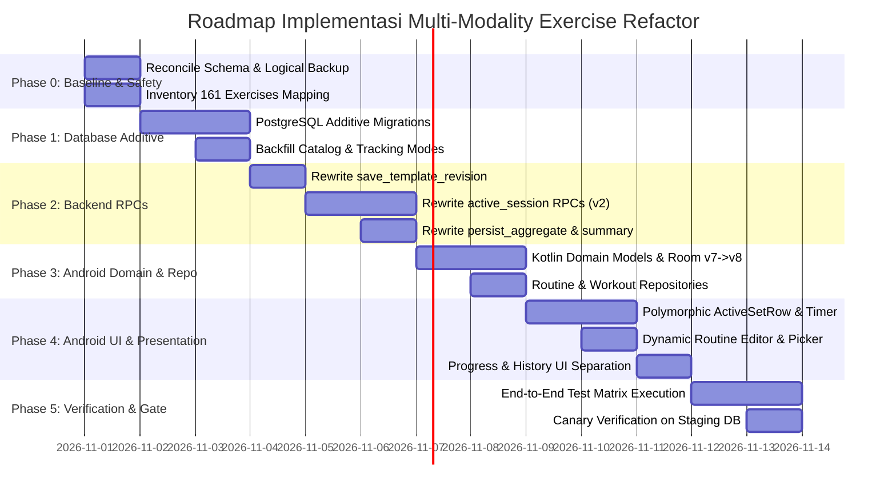

# PLAN ARCHITECTURAL EXERCISES REFACTOR
**IMFIT Multi-Modality Exercise Tracking, Domain Model, & Server-Authoritative Engine**

---

## 0. Metadata & Kontrak Eksekusi

| Atribut | Spesifikasi |
| :--- | :--- |
| **Dokumen** | `docs/plans/PLAN_ARCHITECTURAL_EXERCISES_REFACTOR.md` |
| **Versi / Tanggal** | **1.0 — Production-Ready Architectural Blueprint** / 2026-10-31 |
| **Tingkat Urgensi** | **P0 — Release Blocker** (Sebelum Closed Beta) |
| **Basis Kode Utama** | Git branch `hybrid` (Android `:app`) & Remote Supabase Project `imfit` (`ltcxltahkrjnsjaxndsa`) |
| **Topology & Storage** | **Remote-Authoritative Hybrid**: PostgreSQL 17 (Supabase Remote) + Room Database v8 (Local Cache/Staging pada branch `hybrid`) |
| **Prinsip Utama** | **Server-Authoritative Validation, Type-Safe Measurement, Expand-Backfill-Cutover-Contract, Zero-Loss Backward Compatibility** |
| **Target Cakupan** | Katalog 161 Exercise, Routine Template CRUD, Active Workout Session, Set Logging, Volume & Metrics Calculation, History & Progress Analytics |

---

## 1. Executive Summary & Ringkasan Keputusan Arsitektur

Audit teknis mendalam terhadap branch `hybrid` dan project aktif Supabase `imfit` membuktikan bahwa model pelacakan latihan saat ini **terkunci pada asumsi tunggal: beban eksternal (kg) $\times$ repetisi**. Hal ini memicu bug kritis P0 di mana gerakan bodyweight (Push-Up 0 kg) ditolak oleh UI dan server, serta gerakan berbasis waktu/jarak (Plank, Treadmill) terpaksa dinonaktifkan atau memakai field repetisi secara keliru.

### Keputusan Kunci Arsitektur:
1. **Ekspansi 6 Tipe Pelacakan Inti (*TrackingType*)**:
   - `WEIGHT_REPS` (Beban eksternal + Repetisi)
   - `BODYWEIGHT_REPS` (Repetisi bodyweight, opsional beban tambahan $+kg$)
   - `ASSISTED_REPS` (Repetisi bodyweight dengan bantuan mesin $-kg$)
   - `REPS_ONLY` (Repetisi murni tanpa variabel beban)
   - `DURATION` (Durasi waktu isometrik / HIIT dalam detik)
   - `DISTANCE_DURATION` (Jarak dalam meter + Durasi dalam detik)
   *(Desain extensible untuk `WEIGHT_DURATION` dan `WEIGHT_DISTANCE` pada iterasi lanjutan)*.
2. **Server-Authoritative Validation**: Validasi penuntasan set (*complete set*) dan finalisasi sesi dikendalikan mutlak oleh backend Supabase melalui RPC, bukan hanya filter checkbox di UI Android.
3. **Pemisahan Semantik Metrik & Analytics**: Memecah metrik tunggal `total_volume` menjadi metrik terpisah: *External Load Volume* ($kg$), *Additional Load Volume* ($kg$), *Total Repetitions*, *Hold Duration* (detik), *Cardio Duration* (detik), dan *Cardio Distance* (meter).
4. **Pola Migrasi Bertahap (*Expand $\rightarrow$ Backfill $\rightarrow$ Cutover $\rightarrow$ Contract*)**: Menjamin sesi aktif versi 1 (`schema_version = 1`) dan data riwayat lama tetap terbaca dan dapat diselesaikan tanpa merusak integritas sistem.

```
+----------------------------------------------------------------------------------------------------+
|                                    TARGET DATA FLOW ARSITEKTUR                                      |
+----------------------------------------------------------------------------------------------------+
|                                                                                                    |
|  [Exercise Catalog]  -->  [Workout Template]  -->  [Active Session]  -->  [Workout History & Logs] |
|  - default_tracking_type  - tracking_type          - snapshot v2          - external_load_volume   |
|  - allowed_modes          - target_reps            - polymorphic sets     - additional_load_volume |
|  - 161 exercises mapped   - target_duration        - server-authoritative - total_reps             |
|                           - target_distance          CAS & validation     - total_duration_seconds |
|                                                                           - total_distance_meters  |
+----------------------------------------------------------------------------------------------------+
```

---

## 2. Audit Ground Truth: Codebase `hybrid` & Live Supabase `imfit`

### 2.1 Live Supabase `imfit` (`ltcxltahkrjnsjaxndsa`)
Pemeriksaan langsung pada skema database Supabase PostgreSQL 17 aktif menunjukkan:
1. **`public.exercises` (161 baris)**:
   - Kolom: `id`, `muscle_category_id`, `name`, `description`, `image_url`, `video_url`, `difficulty`, `equipment`, `is_active`, `created_at`, `updated_at`.
   - **Celah**: Tidak ada kolom `measurement_type`, `default_tracking_type`, atau tabel relasi mode pelacakan yang didukung.
2. **`public.template_exercises` (22 baris)**:
   - Kolom: `id`, `template_id`, `exercise_id`, `order_index`, `sets` (1..20), `reps` (1..100, `NOT NULL DEFAULT 10`), `rest_seconds` (0..600).
   - **Celah**: Tidak ada target durasi atau jarak. Repetisi terkunci `NOT NULL`.
3. **`public.workout_sets` (113 baris: 106 completed, 7 uncompleted 0 kg)**:
   - Kolom: `id`, `exercise_log_id`, `workout_log_id`, `exercise_id`, `set_number`, `weight`, `reps`, `is_completed`, `is_warmup`, `notes`.
   - **Fakta**: Tidak ada completed set dengan `weight = 0`. Hal ini konsisten dengan adanya validasi positif yang menolak set 0 kg.
4. **RPC Server-Side Validations**:
   - `public.update_active_session`: Baris validasi `complete_set`:
     ```sql
     elsif v_type='complete_set' then
       if (v_set->>'weight')::numeric<=0 or (v_set->>'reps')::integer<=0 then
         perform imfit_private.fail('PT400','VALIDATION');
       end if;
       v_set:=jsonb_set(v_set,'{is_completed}','true');
     ```
   - `imfit_private.terminal_session`: Baris validasi finalisasi sesi:
     ```sql
     if v_sets=0 or exists(select 1 from jsonb_array_elements(v_row.session_data->'exercises') e,
       lateral jsonb_array_elements(e->'sets') s where (s->>'is_completed')::boolean
       and ((s->>'weight')::numeric<=0 or (s->>'reps')::integer<=0)) then
       perform imfit_private.fail('PT400','VALIDATION');
     end if;
     ```
   - `public.persist_local_workout_aggregate`: Mengharuskan relasi kaku:
     `v_volume = sum(weight * reps)` dan `abs(v_volume - total_volume) <= 0.01`.
   - `public.save_template_revision`: Menolak jika field `sets`, `reps`, `rest_seconds` tidak ada atau bernilai `<= 0`.
   - `public.active_sessions`: Constraint `check (schema_version = 1)` mengunci schema JSON hanya pada versi 1.

### 2.2 Android Codebase pada Branch `hybrid`
Pemeriksaan pada kode Android `:app` membuktikan:
1. **Domain Model (`Exercise.kt`, `WorkoutSet.kt`, `TemplateExercise.kt`)**:
   - `WorkoutSet.kt:9`: `val volume: Float get() = if (isCompleted) weight * reps else 0f`.
   - `TemplateExercise.kt`: Hanya menampung `sets`, `reps`, `restSeconds`.
   - `ExercisePrescriptionCapability.kt`: Memuat hardcoded set ID yang memblokir plank dan kardio (`durationDistanceExerciseIds` = `ex_core_1`, `ex_core_9`, `ex_cardio_1` s/d `ex_cardio_9`).
2. **UI Layer (`ActiveSetRow.kt:108`)**:
   - Checkbox terkunci:
     ```kotlin
     enabled = editable && !isPaused && set.weight > 0f && set.reps > 0
     ```
   - Input hanya menyediakan dua kolom: KG dan Reps.
3. **Session ViewModel (`ActiveWorkoutViewModel.kt:277`)**:
   - Method `completeSet` menyaring:
     ```kotlin
     if (set.setNumber == setNumber && !set.isCompleted && set.weight > 0 && set.reps > 0)
     ```
4. **Routine Editor (`EditWorkoutViewModel.kt:30-31`, `SupabaseRoutineRepository.kt:170`)**:
   - Validasi ketat `sets in 1..20 && reps in 1..100 && rest in 0..600`.
   - Gerakan non-reps diblokir dari pemilihan di `ExerciseSelectionScreen.kt:279` dengan string `R.string.routine_duration_unsupported`.
5. **Local Database (`IMFITDatabase.kt` v7)**:
   - Entity `TemplateExerciseEntity`, `WorkoutSetEntity`, `ExerciseLogEntity`, `WorkoutLogEntity` hanya memetakan `weight` dan `reps`.

---

## 3. Spesifikasi Domain Model Target (6 Tipe Pengukuran)

```
+----------------------------------------------------------------------------------------------------+
|                                    KLASIFIKASI 6 TRACKING TYPE                                     |
+-------------------+-----------------------------+-------------------------+------------------------+
| TrackingType      | Input Primer                | Input Sekunder          | Kondisi Set Selesai    |
+-------------------+-----------------------------+-------------------------+------------------------+
| WEIGHT_REPS       | Weight (kg) > 0             | Reps > 0                | weight > 0 && reps > 0 |
| BODYWEIGHT_REPS   | Reps > 0                    | Additional Wt (kg) >= 0 | reps > 0               |
| ASSISTED_REPS     | Reps > 0                    | Assistance Wt (kg) > 0  | reps > 0 && assist > 0 |
| REPS_ONLY         | Reps > 0                    | -                       | reps > 0               |
| DURATION          | Duration (detik) > 0        | -                       | duration > 0           |
| DISTANCE_DURATION | Duration (detik) > 0        | Distance (meter) > 0    | duration > 0 && dist>0 |
+-------------------+-----------------------------+-------------------------+------------------------+
```

### 3.1 Kontrak Domain Model Kotlin
Definisi enum dan model domain di `domain/model/`:

```kotlin
package com.diajarkoding.imfit.domain.model

enum class TrackingType {
    WEIGHT_REPS,
    BODYWEIGHT_REPS,
    ASSISTED_REPS,
    REPS_ONLY,
    DURATION,
    DISTANCE_DURATION
}

data class ExerciseTarget(
    val sets: Int = 3,
    val targetReps: Int? = 10,
    val targetDurationSeconds: Int? = null,
    val targetDistanceMeters: Int? = null,
    val restSeconds: Int = 60
) {
    fun validate(trackingType: TrackingType): Boolean {
        if (sets !in 1..20 || restSeconds !in 0..600) return false
        return when (trackingType) {
            TrackingType.WEIGHT_REPS,
            TrackingType.BODYWEIGHT_REPS,
            TrackingType.ASSISTED_REPS,
            TrackingType.REPS_ONLY -> (targetReps ?: 0) in 1..100
            TrackingType.DURATION -> (targetDurationSeconds ?: 0) in 1..86400
            TrackingType.DISTANCE_DURATION -> (targetDurationSeconds ?: 0) in 1..86400 && 
                (targetDistanceMeters == null || targetDistanceMeters in 1..1000000)
        }
    }
}

data class SetMeasurement(
    val weight: Float? = null,
    val reps: Int? = null,
    val durationSeconds: Int? = null,
    val distanceMeters: Int? = null,
    val additionalWeight: Float? = null,
    val assistanceWeight: Float? = null
) {
    fun isCompleteEligible(type: TrackingType): Boolean = when (type) {
        TrackingType.WEIGHT_REPS -> (weight ?: 0f) > 0f && (reps ?: 0) > 0
        TrackingType.BODYWEIGHT_REPS -> (reps ?: 0) > 0 && (additionalWeight ?: 0f) >= 0f
        TrackingType.ASSISTED_REPS -> (reps ?: 0) > 0 && (assistanceWeight ?: 0f) > 0f
        TrackingType.REPS_ONLY -> (reps ?: 0) > 0
        TrackingType.DURATION -> (durationSeconds ?: 0) > 0
        TrackingType.DISTANCE_DURATION -> (durationSeconds ?: 0) > 0 && (distanceMeters ?: 0) > 0
    }
}
```

### 3.2 Pembaruan Model Existing
- **`Exercise.kt`**:
  ```kotlin
  data class Exercise(
      val id: String,
      val name: String,
      val muscleCategory: MuscleCategory,
      val description: String,
      val imageUrl: String? = null,
      val isActive: Boolean = true,
      val defaultTrackingType: TrackingType = TrackingType.WEIGHT_REPS,
      val allowedTrackingTypes: List<TrackingType> = listOf(TrackingType.WEIGHT_REPS)
  )
  ```
- **`TemplateExercise.kt`**:
  ```kotlin
  data class TemplateExercise(
      val exercise: Exercise,
      val trackingType: TrackingType = exercise.defaultTrackingType,
      val sets: Int = 3,
      val reps: Int? = 10,
      val targetDurationSeconds: Int? = null,
      val targetDistanceMeters: Int? = null,
      val restSeconds: Int = 60
  )
  ```
- **`WorkoutSet.kt`**:
  ```kotlin
  data class WorkoutSet(
      val setNumber: Int,
      val weight: Float = 0f,
      val reps: Int = 0,
      val durationSeconds: Int? = null,
      val distanceMeters: Int? = null,
      val additionalWeight: Float? = null,
      val assistanceWeight: Float? = null,
      val isCompleted: Boolean = false
  )
  ```

---

## 4. Aturan Produk & Coaching Fitness Invariants

1. **Konvensi Berat Beban Eksternal**:
   - **Barbell**: Total berat piringan ditambah berat bar (standar Olympic bar 20 kg).
   - **Dumbbell**: Berat **per satu dumbbell** (misal: Dumbbell Bench Press dengan dua dumbbell 20 kg dicatat sebagai **20 kg**, bukan 40 kg, sesuai konvensi standar aplikasi fitness modern untuk menghindari distorsi progres per tangan).
2. **Bodyweight Semantics**:
   - Pengguna dengan berat badan 70 kg yang melakukan Push-Up 12 repetisi mencatat beban $0\text{ kg}$ (atau kosong), repetisi $12$.
   - **Dilarang keras mengalikan berat badan pengguna ke dalam external volume**, karena berat badan fluktuatif dan biomekanika push-up hanya memindahkan ~64% massa tubuh.
   - Progres calisthenics dievaluasi dari kenaikan repetisi (*Repetition Progress*) atau beban sabuk tambahan (*Additional Load Volume*).
3. **Pemisahan Timer**:
   - **Set Execution Timer (Timer Durasi Latihan)**: Berjalan saat set isometrik/kardio aktif (misal 45 detik Plank).
   - **Rest Timer (Waktu Istirahat Antar-Set)**: Hitung mundur jeda pemulihan setelah set ditandai selesai (misal 60 detik istirahat). Keduanya tidak boleh saling menggantikan atau memakai satu slot memori yang sama.
4. **Prefill History Rules**:
   - Prefill nilai set sebelumnya hanya valid jika `exercise_id` **dan** `tracking_type` cocok 100%. Riwayat DURATION tidak boleh mem-prefill field REPS.

---

## 5. Rencana Migrasi Database Supabase (PostgreSQL 17)

Pendekatan migrasi menggunakan prinsip **Expand $\rightarrow$ Backfill $\rightarrow$ Cutover $\rightarrow$ Contract**.

### 5.1 Tahap Expand: Additive Schema Changes
Dibuat migrasi baru: `supabase/migrations/20261101000100_exercise_multimodality_tracking.sql`.

```sql
-- 1. Create Tracking Type ENUM
CREATE TYPE public.tracking_type_enum AS ENUM (
    'WEIGHT_REPS',
    'BODYWEIGHT_REPS',
    'ASSISTED_REPS',
    'REPS_ONLY',
    'DURATION',
    'DISTANCE_DURATION'
);

-- 2. Alter exercises
ALTER TABLE public.exercises 
ADD COLUMN default_tracking_type public.tracking_type_enum NOT NULL DEFAULT 'WEIGHT_REPS';

-- 3. Create allowed tracking modes table
CREATE TABLE public.exercise_tracking_modes (
    exercise_id VARCHAR NOT NULL REFERENCES public.exercises(id) ON DELETE CASCADE,
    tracking_type public.tracking_type_enum NOT NULL,
    is_default BOOLEAN NOT NULL DEFAULT false,
    PRIMARY KEY (exercise_id, tracking_type)
);

-- 4. Alter template_exercises
ALTER TABLE public.template_exercises
ADD COLUMN tracking_type public.tracking_type_enum NOT NULL DEFAULT 'WEIGHT_REPS',
ADD COLUMN target_duration_seconds INTEGER NULL CHECK (target_duration_seconds IS NULL OR (target_duration_seconds >= 1 AND target_duration_seconds <= 86400)),
ADD COLUMN target_distance_meters INTEGER NULL CHECK (target_distance_meters IS NULL OR (target_distance_meters >= 1 AND target_distance_meters <= 1000000));

ALTER TABLE public.template_exercises ALTER COLUMN reps DROP NOT NULL;
ALTER TABLE public.template_exercises ALTER COLUMN reps DROP DEFAULT;

-- 5. Alter workout_sets
ALTER TABLE public.workout_sets
ADD COLUMN duration_seconds INTEGER NULL CHECK (duration_seconds IS NULL OR duration_seconds >= 0),
ADD COLUMN distance_meters INTEGER NULL CHECK (distance_meters IS NULL OR distance_meters >= 0),
ADD COLUMN additional_weight NUMERIC(7,2) NULL CHECK (additional_weight IS NULL OR additional_weight >= 0),
ADD COLUMN assistance_weight NUMERIC(7,2) NULL CHECK (assistance_weight IS NULL OR assistance_weight >= 0);

-- 6. Alter exercise_logs
ALTER TABLE public.exercise_logs
ADD COLUMN tracking_type public.tracking_type_enum NOT NULL DEFAULT 'WEIGHT_REPS',
ADD COLUMN total_duration_seconds INTEGER NOT NULL DEFAULT 0,
ADD COLUMN total_distance_meters INTEGER NOT NULL DEFAULT 0,
ADD COLUMN additional_volume NUMERIC(10,2) NOT NULL DEFAULT 0,
ADD COLUMN metric_quality VARCHAR NOT NULL DEFAULT 'VERIFIED' CHECK (metric_quality IN ('VERIFIED', 'LEGACY_UNVERIFIED'));

-- 7. Alter workout_logs
ALTER TABLE public.workout_logs
ADD COLUMN total_duration_seconds INTEGER NOT NULL DEFAULT 0,
ADD COLUMN total_distance_meters INTEGER NOT NULL DEFAULT 0,
ADD COLUMN additional_volume NUMERIC(10,2) NOT NULL DEFAULT 0,
ADD COLUMN data_quality VARCHAR NOT NULL DEFAULT 'VERIFIED' CHECK (data_quality IN ('VERIFIED', 'LEGACY_UNVERIFIED'));

-- 8. Alter active_sessions to allow schema_version 2
ALTER TABLE public.active_sessions DROP CONSTRAINT IF EXISTS active_sessions_schema_version_check;
ALTER TABLE public.active_sessions ADD CONSTRAINT active_sessions_schema_version_check CHECK (schema_version IN (1, 2));
```

### 5.2 Tahap Backfill: Klasifikasi Katalog 161 Exercise
Script DML backfill memetakan seluruh latihan katalog:
1. **Core / Isometric**:
   - `ex_core_1` (Plank), `ex_core_9` (Side Plank) $\rightarrow$ `DURATION`. Allowed: `[DURATION]`.
   - `ex_core_2` (Crunches), `ex_core_3` (Russian Twist), `ex_core_4` (Leg Raises), `ex_core_7` (Bicycle Crunches), `ex_core_8` (Mountain Climbers), `ex_core_10` (Hanging Knee Raise) $\rightarrow$ `BODYWEIGHT_REPS`. Allowed: `[BODYWEIGHT_REPS, REPS_ONLY, DURATION]`.
   - `ex_core_11` (Kneeling Cable Crunch), `ex_core_12` (Cable Pallof Press), `ex_core_13` (Dumbbell Side Bend), `ex_core_14` (Barbell Landmine Twist), `ex_core_15` (Ab Machine) $\rightarrow$ `WEIGHT_REPS`.
2. **Cardio**:
   - `ex_cardio_1` (Treadmill Running), `ex_cardio_2` (Stationary Bike), `ex_cardio_3` (Rowing Machine), `ex_cardio_6` (Elliptical), `ex_cardio_7` (Stair Climber), `ex_cardio_11` (Assault AirBike), `ex_cardio_12` (SkiErg), `ex_cardio_13` (Incline Treadmill Walk), `ex_cardio_14` (Recumbent Bike) $\rightarrow$ `DISTANCE_DURATION`. Allowed: `[DISTANCE_DURATION, DURATION]`.
   - `ex_cardio_4` (Jump Rope), `ex_cardio_5` (Burpees), `ex_cardio_8` (Box Jumps), `ex_cardio_9` (High Knees), `ex_cardio_10` (Jumping Jacks) $\rightarrow$ `REPS_ONLY`. Allowed: `[REPS_ONLY, DURATION]`.
   - `ex_cardio_15` s/d `ex_cardio_19` (Dumbbell Thrusters, Man Makers, Bear Complex, Devil Press) $\rightarrow$ `WEIGHT_REPS`.
3. **Calisthenics / Bodyweight Upper & Lower**:
   - `ex_chest_4` (Push-Ups), `ex_chest_9` (Dips), `ex_chest_10` (Incline Push-Ups), `ex_back_2` (Pull-Ups), `ex_back_8` (Back Extensions), `ex_back_9` (Chin-Ups), `ex_legs_10` (Bodyweight Squats), `ex_legs_11` (Walking Lunges) $\rightarrow$ `BODYWEIGHT_REPS`. Allowed: `[BODYWEIGHT_REPS, REPS_ONLY]`.
4. **Assisted Machines**:
   - `ex_back_17` (Assisted Pull-Up Machine), `ex_triceps_7` (Assisted Dip Machine) $\rightarrow$ `ASSISTED_REPS`. Allowed: `[ASSISTED_REPS]`.
5. **Standard Strength (Barbell, Dumbbell, Cable, Machine)**:
   - Sisa 125 latihan $\rightarrow$ `WEIGHT_REPS`. Allowed: `[WEIGHT_REPS]`.

### 5.3 Pembaruan Kontrak RPC Backend Supabase
1. **`save_template_revision`**:
   - Parameter `p_exercises` JSON menerima objek:
     `{"exercise_id": "...", "order_index": 0, "tracking_type": "...", "sets": 3, "reps": 10, "target_duration_seconds": null, "target_distance_meters": null, "rest_seconds": 60}`.
   - Validasi disesuaikan dengan `tracking_type`: jika `DURATION`, `target_duration_seconds` wajib $1..86400$, sedangkan `reps` boleh null.
2. **`create_active_session`**:
   - Membuat snapshot `active_sessions` dengan `schema_version = 2`.
   - Mengisi `tracking_type` untuk setiap child exercise dari konfigurasi template.
3. **`update_active_session`**:
   - Mengizinkan command `edit_set` menerima `duration_seconds`, `distance_meters`, `additional_weight`, `assistance_weight`.
   - Validasi `complete_set` membedakan tipe:
     - `WEIGHT_REPS`: `weight > 0 && reps > 0`
     - `BODYWEIGHT_REPS`: `reps > 0 && coalesce(additional_weight, 0) >= 0`
     - `ASSISTED_REPS`: `reps > 0 && coalesce(assistance_weight, 0) > 0`
     - `REPS_ONLY`: `reps > 0`
     - `DURATION`: `duration_seconds > 0`
     - `DISTANCE_DURATION`: `duration_seconds > 0 && distance_meters > 0`
4. **`imfit_private.terminal_session`**:
   - Kalkulasi metrik terpisah saat workout selesai:
     - `v_external_volume := sum(weight * reps)` HANYA untuk latihan `WEIGHT_REPS`.
     - `v_additional_volume := sum(additional_weight * reps)` untuk `BODYWEIGHT_REPS` berbeban.
     - `v_total_reps := sum(reps)` untuk tipe reps.
     - `v_total_duration := sum(duration_seconds)` untuk tipe durasi.
     - `v_total_distance := sum(distance_meters)` untuk tipe jarak.
   - Sesi tidak lagi ditolak jika ada set 0 kg pada latihan bodyweight/durasi.
5. **`persist_local_workout_aggregate`**:
   - Validasi agregat diperbarui agar mencocokkan total volume hanya dari latihan bertipe `WEIGHT_REPS`.
6. **`get_progress_summary`**:
   - Mengembalikan payload yang diperluas:
     ```json
     {
       "start_date": "2026-10-01",
       "end_date": "2026-10-31",
       "workout_count": 12,
       "external_volume_kg": "14500.00",
       "additional_volume_kg": "320.00",
       "total_reps": 850,
       "hold_duration_seconds": 920,
       "cardio_duration_seconds": 7200,
       "cardio_distance_meters": 15400,
       "workout_duration_seconds": 38400
     }
     ```

---

## 6. Arsitektur Android Codebase (`hybrid`)

### 6.1 Room Database Migration (v7 $\rightarrow$ v8)
Pada `IMFITDatabase.kt`:
```kotlin
val MIGRATION_7_8 = object : Migration(7, 8) {
    override fun migrate(database: SupportSQLiteDatabase) {
        // template_exercises
        database.execSQL("ALTER TABLE template_exercises ADD COLUMN tracking_type TEXT NOT NULL DEFAULT 'WEIGHT_REPS'")
        database.execSQL("ALTER TABLE template_exercises ADD COLUMN target_duration_seconds INTEGER")
        database.execSQL("ALTER TABLE template_exercises ADD COLUMN target_distance_meters INTEGER")

        // workout_sets
        database.execSQL("ALTER TABLE workout_sets ADD COLUMN duration_seconds INTEGER")
        database.execSQL("ALTER TABLE workout_sets ADD COLUMN distance_meters INTEGER")
        database.execSQL("ALTER TABLE workout_sets ADD COLUMN additional_weight REAL")
        database.execSQL("ALTER TABLE workout_sets ADD COLUMN assistance_weight REAL")

        // exercise_logs
        database.execSQL("ALTER TABLE exercise_logs ADD COLUMN tracking_type TEXT NOT NULL DEFAULT 'WEIGHT_REPS'")
        database.execSQL("ALTER TABLE exercise_logs ADD COLUMN total_duration_seconds INTEGER NOT NULL DEFAULT 0")
        database.execSQL("ALTER TABLE exercise_logs ADD COLUMN total_distance_meters INTEGER NOT NULL DEFAULT 0")
        database.execSQL("ALTER TABLE exercise_logs ADD COLUMN additional_volume REAL NOT NULL DEFAULT 0")

        // workout_logs
        database.execSQL("ALTER TABLE workout_logs ADD COLUMN total_duration_seconds INTEGER NOT NULL DEFAULT 0")
        database.execSQL("ALTER TABLE workout_logs ADD COLUMN total_distance_meters INTEGER NOT NULL DEFAULT 0")
        database.execSQL("ALTER TABLE workout_logs ADD COLUMN additional_volume REAL NOT NULL DEFAULT 0")

        // exercises
        database.execSQL("ALTER TABLE exercises ADD COLUMN default_tracking_type TEXT NOT NULL DEFAULT 'WEIGHT_REPS'")
    }
}
```

### 6.2 Polymorphic `ActiveSetRow.kt`
Menggantikan row kaku weight-reps dengan rendering dinamis:

```kotlin
@Composable
internal fun ActiveSetRow(
    set: WorkoutSet,
    trackingType: TrackingType,
    exerciseName: String,
    mutationEnabled: Boolean,
    canDelete: Boolean,
    isPaused: Boolean,
    onUpdate: (SetMeasurement) -> Unit,
    onComplete: () -> Unit,
    onDelete: () -> Unit,
    modifier: Modifier = Modifier
) {
    // 1. Tentukan input fields sesuai trackingType:
    // - WEIGHT_REPS: [Weight Input (kg)] [Reps Input]
    // - BODYWEIGHT_REPS: [+kg Extra Input (Opsional)] [Reps Input]
    // - ASSISTED_REPS: [-kg Assist Input] [Reps Input]
    // - REPS_ONLY: [Reps Input]
    // - DURATION: [Stopwatch/Timer Trigger + MM:SS Manual Input]
    // - DISTANCE_DURATION: [Distance Input (m/km)] [Duration Input (MM:SS)]
    
    // 2. Evaluasi kondisi checkbox aktif:
    val isCompleteEnabled = mutationEnabled && !isPaused && !set.isCompleted && 
        set.measurement.isCompleteEligible(trackingType)
        
    // 3. Render sesuai desain token IMFIT
}
```

### 6.3 Dynamic Routine Form (`EditWorkoutScreen.kt` & `EditWorkoutViewModel.kt`)
1. **Target Prescriptions Sesuai Tipe**:
   - Jika latihan bertipe `DURATION` (Plank), tampilkan field target durasi (detik/menit) dan hilangkan input repetisi.
   - Jika bertipe `DISTANCE_DURATION` (Treadmill), tampilkan input target waktu dan target jarak.
2. **Pembersihan Restriksi Katalog**:
   - Hapus pembatasan `ExercisePrescriptionCapability.kt`. Seluruh 161 latihan diaktifkan kembali pada `ExerciseSelectionScreen.kt`.
   - Icon / tag indikator tipe pelacakan ditampilkan pada kartu exercise di picker (misal badge: `Bodyweight`, `Waktu`, `Jarak`, `Beban`).

---

## 7. Rencana Eksekusi & Phase Breakdown (Phase 0 — Phase 5)



### Phase 0: Baseline, Rekonsiliasi, dan Logical Backup
- [ ] Buat logical backup penuh Supabase project `imfit` menggunakan pg_dump / SQL export.
- [ ] Lakukan uji restore hasil backup pada schema terisolasi.
- [ ] Verifikasi rekonsiliasi file migrasi repo lokal (`supabase/migrations`) dengan tabel `supabase_migrations.schema_migrations` pada server live.
- [ ] Freeze review tabel mapping 161 exercise sebelum eksekusi DML.

### Phase 1: Database Additive Schema & Catalog Backfill
- [ ] Terapkan DDL migrasi additive (`20261101000100_exercise_multimodality_tracking.sql`).
- [ ] Terapkan DML backfill default tracking type dan tabel `exercise_tracking_modes` untuk 161 latihan.
- [ ] Verifikasi RLS dan integritas foreign keys untuk tabel baru.
- [ ] Tambahkan snapshot schema version 2 pada `active_sessions`.

### Phase 2: Backend Services & RPC Modernization
- [ ] Update RPC `save_template_revision` agar menerima `tracking_type`, `target_duration_seconds`, dan `target_distance_meters`.
- [ ] Update RPC `create_active_session` untuk memproduksi snapshot session JSON v2.
- [ ] Update RPC `update_active_session` dengan validasi per `tracking_type` pada `complete_set` dan `edit_set`.
- [ ] Update RPC `terminal_session` dan `persist_local_workout_aggregate` untuk kalkulasi metrik terpisah.
- [ ] Update RPC `get_exercise_prefill` agar mem-prefill metrik yang relevan dengan tipe tracking.
- [ ] Update RPC `get_progress_summary` dan `get_workout_detail`.

### Phase 3: Android Domain, Room Migration, & Repository
- [ ] Buat enum `TrackingType`, model `ExerciseTarget`, dan `SetMeasurement`.
- [ ] Update entity Room `TemplateExerciseEntity`, `WorkoutSetEntity`, `ExerciseLogEntity`, `WorkoutLogEntity`, `ExerciseEntity`.
- [ ] Implementasikan `MIGRATION_7_8` pada `IMFITDatabase.kt` beserta unit test migrasi Room.
- [ ] Update mapper DTO $\leftrightarrow$ Entity $\leftrightarrow$ Domain.
- [ ] Perbarui `SupabaseRoutineRepository.kt` dan `WorkoutRepositoryImpl.kt` untuk transport data bertipe.

### Phase 4: Android Presentation & UI/UX
- [ ] Implementasikan komponen polymorphic `ActiveSetRow.kt` dengan input dinamis.
- [ ] Implementasikan set stopwatch/timer selector untuk latihan durasi dengan input manual fallback.
- [ ] Refactor `EditWorkoutScreen.kt` dan `EditWorkoutViewModel.kt` untuk form dinamis (Reps vs Waktu/Jarak).
- [ ] Hapus pemblokiran pada `ExerciseSelectionScreen.kt` dan tambahkan badge modality.
- [ ] Update layar `ProgressScreen`, `HomeScreen`, dan `WorkoutHistoryDetailScreen` agar menampilkan metrik terpisah.

### Phase 5: Verification, Canary Testing, & Release Gate
- [ ] Eksekusi seluruh skenario test matrix (Unit test, SQL integration test, Compose UI test).
- [ ] Uji kompatibilitas backward: Buka dan selesaikan active session v1 pada build aplikasi baru.
- [ ] Uji recovery process death dan background timer saat set durasi berjalan.
- [ ] Release Canary internal pada akun beta test sebelum cutover produksi.

---

## 8. Test Matrix Wajib (Pre-Release Gate)

| No | Skenario Uji | Input Latihan | TrackingType | Ekspektasi Hasil | Status Verifikasi |
| :---: | :--- | :--- | :--- | :--- | :---: |
| **T-01** | Strength Standar | Bench Press 40 kg $\times$ 10 reps | `WEIGHT_REPS` | Checkbox aktif, Volume = 400 kg tercatat di External Load. | Wajib PASS |
| **T-02** | Strength Nilai Nol | Bench Press 0 kg $\times$ 10 reps | `WEIGHT_REPS` | Checkbox disabled, server menolak jika dipaksa via RPC. | Wajib PASS |
| **T-03** | Calisthenics Push-Up | Push-Ups 0 kg $\times$ 15 reps | `BODYWEIGHT_REPS` | Checkbox aktif, Complete sukses, volume eksternal 0 kg, reps 15. | Wajib PASS |
| **T-04** | Weighted Calisthenics | Pull-Ups +10 kg $\times$ 8 reps | `BODYWEIGHT_REPS` | Complete sukses, reps 8, Additional Load = 80 kg (terpisah dari barbell). | Wajib PASS |
| **T-05** | Assisted Machine | Assisted Pull-Up -25 kg $\times$ 10 | `ASSISTED_REPS` | Complete sukses, bantuan 25 kg tidak dihitung sebagai beban angkatan. | Wajib PASS |
| **T-06** | Calisthenics Reps-Only | Jumping Jacks 30 reps | `REPS_ONLY` | Tidak ada input kg, Complete sukses dengan 30 reps. | Wajib PASS |
| **T-07** | Isometric Time-Based | Plank 45 detik | `DURATION` | Timer berjalan / input 45s, Complete sukses, Hold Duration = 45s. | Wajib PASS |
| **T-08** | Cardio Jarak & Waktu | Treadmill 5000 m / 1800 s (30m) | `DISTANCE_DURATION` | Complete sukses, Pace 6:00/km terhitung, Cardio Distance & Time tercatat. | Wajib PASS |
| **T-09** | Backward Compat v1 | Sesi v1 lama dibuka di app baru | v1 Snapshot | Dibaca sebagai `WEIGHT_REPS`, dapat diselesaikan tanpa error 400/409. | Wajib PASS |
| **T-10** | Offline Finish & Sync | Complete saat offline $\rightarrow$ online | All Types | Room v8 menampung data staging, sync sukses via aggregate RPC baru. | Wajib PASS |
| **T-11** | Idempotency Replay | Finish session di-request 2x | All Types | Server mengembalikan receipt yang sama tanpa duplikasi workout_logs. | Wajib PASS |
| **T-12** | Cross-Account Security | Mutasi session akun lain | All Types | Ditolak server dengan `42501` / `PT404` melalui RLS guard. | Wajib PASS |

---

## 9. Analisis Risiko & Mitigasi Operasional

1. **Risiko 1: Drift Sesi Aktif Saat Migrasi Berjalan**
   - *Mitigasi*: Kolom baru bersifat nullable dengan default value. RPC server mendukung percabangan `schema_version = 1` dan `schema_version = 2`. User yang sedang berada di tengah latihan v1 saat migrasi DDL diterapkan tidak akan mengalami crash atau kehilangan data.
2. **Risiko 2: Ambiguitas Data Historis Lama (*Push-up 70 kg*)**
   - *Mitigasi*: Menandai data workout log lama yang dibuat sebelum cutover dengan `data_quality = 'LEGACY_UNVERIFIED'`. Jangan melakukan update massal mengubah nilai lama menjadi 0 kg tanpa konfirmasi, untuk menjaga audit trail historis.
3. **Risiko 3: Supabase Free Tier Tanpa Automated Point-in-Time Restore**
   - *Mitigasi*: Sebelum DDL/DML migrasi dijalankan, lakukan export skema dan data tabel utama (`exercises`, `workout_templates`, `template_exercises`, `workout_logs`, `exercise_logs`, `workout_sets`, `active_sessions`) ke file SQL terkompresi lokal.
4. **Risiko 4: Strategi Rollback & Fix-Forward**
   - *Kebijakan*: **Dilarang keras melakukan rollback dengan `DROP COLUMN`** jika aplikasi klien baru sudah sempat menulis data ke tabel produksi. Jika ditemukan bug pasca rilis, gunakan strategi **Fix-Forward**: nonaktifkan pembuatan routine multi-unit baru melalui remote config / feature flag, dan deploy patch perbaikan tanpa menghancurkan data yang telah diinput pengguna.
