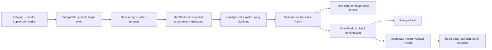

# PLAN ARCHITECTURAL EXERCISES REFACTOR

**IMFIT — Unifikasi input latihan, beban total, dan satu kontrak rutin/live tracking**

## 0. Metadata, status, dan batas revisi

| Atribut | Kontrak |
| --- | --- |
| Versi / tanggal | **1.4 / 2026-11-05** |
| Status | **T01–T10 tersedia di repository dan lulus verifikasi PostgreSQL terisolasi (2026-11-06); G01/G02 ditutup pada lingkup repository. Supabase live belum diperbarui; G03/G04 BLOCKED (§13). Android T12–T18 menunggu G04.** |
| Prioritas | Konsistensi data dan logging cepat; bukan penambahan mode atau fitur analytics. |
| Ruang lingkup | Katalog → UI Detail → Setup Form → rutin → sesi aktif → penyimpanan lokal/remote → ringkasan, riwayat, dan progres. |
| Basis yang diperiksa | Sumber Android `app/src/main`, model domain, Room **v9**, migrasi repository, serta inspeksi read-only Supabase live pada **2026-11-06** (§11). |
| Target versi | Payload sesi **v3** dan kontrak pengukuran **v3** sudah diimplementasikan pada SQL repository, belum deployed. Android/codec v3 dan Room **v10** masih target; Android tetap Room v9. |
| Otoritas | Server menentukan format katalog dan validasi; UI tidak memilih mode pencatatan. Snapshot mempertahankan makna data. |
| Gate | Status pengujian v1.3 **tidak berlaku untuk v1.4**. Implementasi harus memenuhi acceptance §10 sebelum cutover. |

Revisi ini menggantikan keputusan lama yang mempertahankan enam mode, selector **Waktu saja / Jarak + waktu**, bodyweight reps-first, serta pemisahan input beban tambahan/bantuan untuk data baru. Bukti dan hasil pengujian lama tetap historis: [Phase 5 Verification Report](PHASE5_VERIFICATION_REPORT.md). Angka kelulusan di laporan tersebut bukan bukti kontrak baru ini.

**Changelog:** v1.4 menyatukan Strength/bodyweight, memakai dynamic set rows pada setup/edit, menyimpan target/rest per baris, dan membatasi metrik cardio menurut profil/capability exercise. Default jumlah baris hanya diterapkan saat pertama ditambahkan; routine existing tidak direset. Revisi spesifikasi 2026-11-05 hanya dokumentasi. Implementasi/verifikasi terisolasi T01–T03 dicatat di §11; T04–T07 di §12; T08–T10 serta status gate terkini di §13. Tidak ada DDL live atau perubahan Android/canvas.

**Penyempurnaan audit eksternal P-01–P-11:** aturan kategori/profil yang sudah konsisten dipertahankan; lifecycle baris, status completion, timer/recovery, picker, statistik dan sync diperjelas pada bagian terkait. Semua tambahan adalah kontrak target, bukan bukti implementasi. Estimasi routine yang memuat Strength masih memerlukan keputusan produk (§7.1); jangan menganggap angka heuristik existing sebagai durasi pasti.

**Penyelarasan mockup UI/UX:** enam frame existing pen.dev menjadi referensi visual target (§2.1). Pembaruan visual dan pemeriksaan lebar 360/412 dilaporkan user; identitas keenam node dibaca melalui MCP tanpa mutasi. Perubahan desain tidak berarti source Android, Room atau Supabase sudah memenuhi kontrak v1.4.

## 1. Keputusan arsitektur yang mengikat

| Dimensi | Keputusan target |
| --- | --- |
| Kategori Strength | **Strength** mencakup latihan alat dan bodyweight. Bodyweight adalah variasi gerakan, bukan kategori UI atau workflow pencatatan tersendiri. Metadata `CALISTHENICS` lama dipetakan ke Strength pada kontrak baru; snapshot historis tetap dibaca sesuai versi asal. |
| Setup/edit Strength | Setiap baris horizontal: **Set → Beban (kg) → Reps → Rest (s)**. Tiga field input tetap sejajar; satu field domain `weightKg`, input langsung user, 0 kg sah. |
| Setup/edit Cardio dan Isometric | Setiap baris horizontal: **Set → Durasi (HH:MM:SS) → Rest (s)**. Dua field input; tanpa beban/reps. |
| Jumlah set | **Dihitung dari jumlah baris**, bukan field numerik manual. Semua jenis mendukung tambah/hapus baris, penomoran ulang, dan nilai independen. |
| Active Session | Strength: **Set → Beban (kg) → Reps**. Cardio/Isometric: **Set → Durasi (HH:MM:SS)**. Metrik tambahan hanya jika didukung exercise, di bawah durasi dalam set yang sama. |
| Rest | Target **per baris routine**, default 60 detik, rentang 0..600. Active menampilkan rest read-only per set dari target snapshot; timer/recovery memakai sumber yang sama. Bukan input/measurement hasil. |
| Mode pencatatan | Tidak ada selector/toggle/pengganti. Server menurunkan format dari kategori: Strength → `WEIGHT_REPS`; Cardio/Isometric → `DURATION`. `CONDITIONING` yang sudah ada tetap metadata deskriptif dengan format yang ditetapkan katalog, bukan pilihan user baru. |
| Profil cardio | `duration_only`, `distance_activity`, `equipment_metrics` adalah metadata internal kategori Cardio, bukan kategori utama atau pilihan mode baru. Seluruhnya memakai `DURATION`. |
| Metrik cardio | Field ditentukan `supportedMetrics` per exercise, bukan kategori Cardio saja. Supported tetap opsional; unsupported tidak dirender/tidak diisi. |
| Default baris baru | Strength/Isometric/cardio `duration_only`: 3; cardio `distance_activity`/`equipment_metrics`: 1. Berlaku saat pertama ditambahkan, tidak saat edit/recovery/perubahan metadata. |
| Target vs hasil | Routine menyimpan daftar target per set beserta rest; sesi menyimpan hasil per set yang dapat berbeda. Perubahan hasil tidak otomatis mengedit routine. |
| Kompatibilitas | Writer baru memakai dua format; reader/replay data lama tetap selama diperlukan. Tidak menghapus atau menafsir ulang data historis. |

### 1.1 Semantik satu field beban

- `weightKg` adalah angka beban yang ingin dicatat user, bukan hasil kalkulasi aplikasi. Dumbbell 20 kg → user mengisi **20**; tidak otomatis digandakan menjadi 40 kg.
- Pull-up dengan berat badan 70 kg dan plate 10 kg → user dapat mengisi **80** secara langsung. Tidak ada input komponen, penjumlahan otomatis, pengambilan berat badan profil, atau workflow bodyweight terpisah.
- Nilai **0 kg diperbolehkan**. Kosong tetap `null` pada draft, bukan nol otomatis; nilai harus tersedia sebelum set Strength selesai.
- Assisted tetap variasi Strength dengan satu angka beban yang dipilih user; tidak ada rumus wajib atau field bantuan baru. Rincian bantuan/additional weight historis tetap dipertahankan untuk pembacaan lama.
- Nilai yang tersimpan tidak berubah ketika berat badan profil berubah. Angka ini bukan estimasi biomekanik atau ukuran kerja mekanik.
- Volume hasil baru `Σ(weightKg × reps)` disebut **volume beban tercatat (kg·repetisi)**. Jangan menggabungkannya diam-diam dengan legacy external/additional volume yang memiliki konvensi berbeda.

## 2. Baseline repository dan perbedaan target

| Klaim yang diamati | Bukti repository | Status |
| --- | --- | --- |
| Domain masih memiliki enam enum `TrackingType`. | `app/src/main/java/com/diajarkoding/imfit/domain/model/TrackingType.kt:3-10` | Verified dari kode; bukan target v1.4. |
| `SetMeasurement.isCompleteEligible` membedakan enam validasi; `DISTANCE_DURATION` mewajibkan jarak. | `app/src/main/java/com/diajarkoding/imfit/domain/model/SetMeasurement.kt:3-18` | Verified dari kode. |
| Target belum menyimpan beban; memiliki reps, durasi, jarak, dan rest. | `app/src/main/java/com/diajarkoding/imfit/domain/model/ExerciseTarget.kt:3-20` | Verified dari kode. |
| `WorkoutSet` menggunakan `weight`, `additionalWeight`, `assistanceWeight`; pace membutuhkan waktu/jarak positif. | `app/src/main/java/com/diajarkoding/imfit/domain/model/WorkoutSet.kt:3-32` | Verified dari kode. |
| `TemplateExercise` memiliki `legacyRestSeconds` khusus replay immutable command lama. | `app/src/main/java/com/diajarkoding/imfit/domain/model/TemplateExercise.kt:3-26` | Verified dari kode. |
| Database lokal saat ini v9, bukan v7/v8. | `app/src/main/java/com/diajarkoding/imfit/data/local/database/IMFITDatabase.kt:26-38` | Verified dari kode. |
| Rest rutin merupakan metadata historis; RPC mempertahankan ownership, receipts, dan revision checks. | `supabase/migrations/20261102144339_routine_rest_runtime_contract.sql:1-68` | Verified dari SQL repository; deployment live tidak diperiksa. |
| Metadata modality terpisah dari tracking. | `app/src/main/java/com/diajarkoding/imfit/domain/model/ExerciseModality.kt:3-9` | Verified dari kode. |
| Android produksi memakai Room-first; start/mutasi/finish lokal, kemudian aggregate upload. | `app/src/production/java/com/diajarkoding/imfit/di/AppModule.kt:58`; `app/src/main/java/com/diajarkoding/imfit/data/repository/WorkoutRepositoryImpl.kt:147-173,248-368`; `app/src/main/java/com/diajarkoding/imfit/data/sync/SyncManager.kt:315-325` | Verified dari kode; tidak diganti menjadi remote-first. |
| Override rest lokal saat ini terpisah dari routine dan menerima 1..86399. | `app/src/main/java/com/diajarkoding/imfit/data/repository/WorkoutRepositoryImpl.kt:430-446` | Verified dari kode; target baru harus membaca rest routine, bukan mempertahankan override sesi sebagai sumber default. |
| `workout_sets.weight` dan `reps` lama NOT NULL dengan default 0; target durasi tidak cukup hanya menambah kolom baru. | `supabase/migrations/20260828130114_imfit_schema_baseline.sql:104-110` | Verified dari SQL repository; nullability perlu migrasi eksplisit. |
| Selector mode dan ekspansi beban merupakan state/callback, bukan label saja. | `app/src/main/java/com/diajarkoding/imfit/presentation/ui/workout/EditWorkoutScreen.kt:240-320`; `app/src/main/java/com/diajarkoding/imfit/presentation/ui/workout/EditWorkoutViewModel.kt:307-329`; `app/src/main/java/com/diajarkoding/imfit/presentation/ui/workout/ActiveSetRow.kt:68-74,152-180` | Verified dari kode. |
| Enam referensi UI/UX existing | `imfit-ui-ux/IMFIT.pen`: `eR0yE`, `njlmZ`, `Q1BGbI`, `MdoRQ`, `Of1nW`, `TXyaw`; pemetaan lengkap §2.1. | Identitas/nama node Verified melalui MCP read-only; revisi visual serta pemeriksaan lebar 360/412 adalah laporan user, bukan verifikasi runtime Android. |
| Set completed existing dikunci untuk edit/hapus; belum ada undo completion pada ViewModel yang diperiksa. | `app/src/main/java/com/diajarkoding/imfit/presentation/ui/workout/ActiveWorkoutViewModel.kt:282-365` | Verified dari kode; transisi koreksi completed di §4.2.1 masih direncanakan. |
| Timer menyimpan deadline monotonic, boot identity dan daftar set yang sudah memicu timer. | `app/src/main/java/com/diajarkoding/imfit/core/timer/RestTimerCoordinator.kt:23-55,129-136,190-217,251-278` | Verified dari kode; identitas timer existing masih dibentuk dari setNumber di `ActiveWorkoutViewModel.kt:349-352`. |
| Picker memakai exclusions, selected IDs, flow/result identity dan deduplikasi saat accept. | `app/src/main/java/com/diajarkoding/imfit/presentation/ui/exercise/ExerciseSelectionViewModel.kt:74-104,274-289`; `app/src/main/java/com/diajarkoding/imfit/presentation/ui/workout/EditWorkoutViewModel.kt:345-363`; `app/src/main/java/com/diajarkoding/imfit/presentation/ui/workout/RoutineFlowManager.kt:92-113` | Verified dari kode; §4.3 mengunci interpretasi membership vs penambahan. |
| Estimasi existing memakai durasi × set untuk tipe waktu dan 8 menit per exercise lainnya; tidak menjumlah rest. | `app/src/main/java/com/diajarkoding/imfit/presentation/ui/workout/WorkoutDetailViewModel.kt:196-205` | Verified dari kode; bukan formula final untuk array target v1.4. |
| Waktu aktif sesi mengurangi pause, tetapi durasi history existing memakai end−start. | `app/src/main/java/com/diajarkoding/imfit/domain/model/WorkoutSession.kt:44-53`; `app/src/main/java/com/diajarkoding/imfit/domain/model/WorkoutLog.kt:19-20` | Verified dari kode; dua konsep tidak boleh diberi arti yang sama (§7.1). |
| Finish lokal menyimpan hanya completed sets, memakai session ID sebagai workout ID, lalu menghapus active session dalam transaksi. | `app/src/main/java/com/diajarkoding/imfit/data/repository/WorkoutRepositoryImpl.kt:269-389` | Verified dari kode; target v3 harus mempertahankan stable set ID dan snapshot lengkap pada log yang dipersist. |
| Upload mengakui parent/children hanya setelah RPC sukses dan parent tidak berubah; kegagalan mempertahankan data lokal. | `app/src/main/java/com/diajarkoding/imfit/data/sync/SyncManager.kt:293-349`; `app/src/main/java/com/diajarkoding/imfit/data/sync/SyncWorker.kt:17-23` | Verified dari kode; bukan hasil uji offline v3. |
| Receipt server menggunakan workout ID dan menolak replay dengan payload berbeda. | `supabase/migrations/20261101000300_local_workout_legacy_provenance.sql:52-75` | Verified dari SQL repository; live DB tidak diperiksa. |

**Keselarasan desain terkini:** gunakan ulang keenam mockup existing pada §2.1, termasuk state inline; tidak menambah layar/workflow baru. Laporan user memperbarui bukti desain sebelumnya: Jumping Jacks pada `TXyaw` kini durasi saja, Bike memakai subset indikator, dan rest tampil read-only per set. Catatan lama bahwa Jumping Jacks masih menampilkan kelima metrik tidak lagi berlaku. Contoh jumlah set pada Edit adalah data tersimpan yang dipertahankan, bukan perintah mereset default.

Nama field, versi, batas baru, dan perubahan perilaku di §3–§10 adalah **kontrak target v1.4**. Subset database/backend T01–T10 sudah diimplementasikan/diverifikasi terisolasi (§11–§13), bukan keseluruhan kontrak atau deployment live. Struktur skema aktual harus direkonsiliasi dengan server sebelum DDL; jangan menjalankan ulang migrasi yang sudah tercatat.

### 2.1 Referensi mockup pen.dev dan traceability UI → data

Sumber canvas: [IMFIT.pen](../../../imfit-ui-ux/IMFIT.pen), workspace `imfit-ui-ux`. Gunakan node ID untuk membuka frame existing melalui Pencil/pen.dev. Nama frame di bawah dibaca langsung dengan MCP; nilai contoh/nama seperti “3 dipilih” bukan konstanta perilaku aplikasi.

| Layar / node ID | Nama frame existing | Kontrak UI target dari revisi mockup | Sumber data → alur dan persistence |
| --- | --- | --- | --- |
| Home — `eR0yE` | REF 01 · Home · Happy state / Hybrid | Volume legacy tetap terpisah dari volume beban tercatat baru. | `WorkoutLog`/agregat completed beserta versi/quality → presentasi seri/label terpisah (§7.1). `recorded_load_volume` baru tidak digabung dengan external/additional volume legacy; status pending/synced tidak menggandakan workout ID. |
| Detail Routine — `njlmZ` | Routine · Detail / Light | Ringkasan target berbeda, misalnya `3 set · 12/10/8 reps`; gambar/nama mengikuti komponen existing. | Array canonical `template_exercises.set_targets` → urutan reps/durasi untuk ringkasan (§3). Bukan hasil active/history atau satu scalar yang meratakan seluruh target. |
| Setup — `Q1BGbI` | REF 02 · Setup Awal Rutinitas · Happy state | Target/rest independen; tiga field Strength atau dua field durasi/rest tetap horizontal per baris. | Draft keyed `row_id` → `SaveCommand` → `save_template_revision` → array target atomik (§4.1/§6.1). Jumlah set turunan dari baris; perubahan baris tidak menyebar. |
| Edit — `MdoRQ` | REF 03 · Edit Rutinitas · Happy state | Baris/nilai tersimpan dipertahankan, termasuk rest **0**. | Load canonical array atau ekspansi legacy → durable draft → commit revisi baru. Missing/null berbeda dari 0; tidak menjalankan ulang default 3/1 atau rest 60 pada edit/recovery (§4.1/§8.2). |
| Picker — `Of1nW` | REF 04 · Pilih Gerakan · Happy state / 3 dipilih | Anggota existing dibedakan dari pilihan baru dan tidak dapat diduplikasi. **Tanpa label/badge Strength, Cardio, Conditioning, Isometric, atau badge kategori sejenis**; status existing/terpilih tetap. | `memberIds` dari draft dan `selectedNewIds` → selection result → `acceptSelection` (§4.3). Tidak ada write routine saat memilih; CTA hanya menghitung penambahan baru. Metadata format/profil/capability tetap dibawa DTO/draft walaupun tidak dirender sebagai badge. |
| Active — `TXyaw` | REF 05 · Sesi Aktif · Happy state / v1.4 unified inputs | Unified inputs; Jumping Jacks hanya durasi, Bike hanya indikator supported; **rest read-only per set**. | Metadata snapshot → field hasil sesuai capability; `target_row_id` → target dalam `set_targets`/`extra_set_targets` → label rest dan timer. Hasil → `mutateActiveSession` → Room → finish/aggregate sync (§4.2/§6/§7.2). Tidak menulis rest ke measurement hasil. |

**Aturan lintas frame:**

- Layout pada lebar canvas **360 dan 412** serta state inline dilaporkan telah disiapkan/diperiksa user. Reuse struktur tersebut; jangan memperlakukan laporan desain sebagai hasil Compose/device test. Implementasi nanti tetap menguji nilai panjang/error inline pada kedua lebar tanpa memecah field Rest ke baris terpisah.
- Error field, save pending/gagal, existing/selected, dan error sesi/sync memakai slot state inline existing. State berasal dari draft/ViewModel/hasil operasi; jangan membuat screen, route, workflow, tabel atau kolom baru hanya untuk merepresentasikan state visual.
- Rest active adalah label konfigurasi, misalnya **Rest 90 s** atau **Rest 0 s**, bukan text field. Countdown dapat menampilkan sisa 60 s dari rest 90 s tanpa mengubah label/target 90. Reorder/delete memilih sumber lewat identitas target, bukan index; tidak ada write DB karena label dirender.
- Penghapusan badge di Picker hanya perubahan presentasi. Jangan menghapus `modality`, `trackingType`, `trackingProfile`, `supportedMetrics` atau data kategori otot dari katalog/DTO/cache/snapshot; metadata tersebut tetap menentukan form, default, validasi dan analytics. Pencarian/filter existing tidak didesain ulang oleh revisi ini.
- Angka/nilai dummy mockup bukan default global atau hasil pengukuran yang harus ditulis. Source canonical routine, snapshot sesi dan completed results tetap dibedakan sebagaimana kontrak PLAN.


## 3. Komponen: UI Detail Routine

**Detail Revisi**

Setiap exercise card di daftar routine **hanya** memuat gambar/ilustrasi bila tersedia sesuai perilaku sekarang, nama exercise, dan ringkasan target tepat di bawah nama. Tidak mengubah sumber, fallback, pemuatan, atau mekanisme gambar yang sudah berjalan.

| Kategori | Contoh ringkasan |
| --- | --- |
| Strength | `3 x 12 reps` atau `4 x 8 reps` |
| Isometric | `3 set · 60 s` |
| Cardio | `1 set · 30 min` |

Jangan menampilkan beban, rest, mode, badge kategori tambahan, maupun metrik kardio dalam ringkasan card. Ringkasan Isometric memakai detik; Cardio memakai menit jika kelipatan menit, selain itu detik. Editor dan active session tetap `HH:MM:SS`. Tidak menambah layar detail exercise mandiri.

**Logika Data**

Card membaca jumlah dan nilai **daftar target baris** routine tersimpan, bukan scalar target tunggal atau hasil sesi. Target homogen tetap diringkas seperti tabel di atas; target berbeda dapat ditampilkan `3 set · 12/10/8 reps` atau `3 set · 60/90/60 s`, sesuai urutan baris. Tidak meratakan nilai berbeda menjadi target seragam. Save memperbarui ringkasan; batal tidak mengubahnya. Durasi tidak pernah ditampilkan sebagai `0 reps`.

Navigasi tambah gerakan tetap detail → picker langsung → setup/edit setelah konfirmasi. Back dari picker kembali ke detail tanpa draft setup kosong atau write database.

**Rasionalitas & Output**

Card cukup untuk memindai isi routine. Beban/rest tetap disimpan dan dapat diedit pada setup/edit, tetapi tidak menambah kepadatan informasi di daftar detail routine.

## 4. Komponen: Setup Form dan Active Session

### 4.1 Setup awal dan edit routine: dynamic set rows

**Detail Revisi**

Hapus field jumlah set numerik. Gunakan pola baris, aksi **Tambah set**, dan hapus existing; `setCount = setTargets.size`. Nilai setiap baris independen. Penomoran tampilan selalu 1..N menurut urutan tersisa, bukan identitas permanen baris.

| Set | Beban (kg) | Reps | Rest (s) |
| --- | ---: | ---: | ---: |
| Set 1 | 20 | 12 | 60 |
| Set 2 | 25 | 10 | 60 |
| Set 3 | 30 | 8 | 60 |

Strength, termasuk bodyweight: **Set → Beban (kg) → Reps → Rest (s)** pada satu baris horizontal. Pertahankan tiga field seperti `Q1BGbI`; Rest tidak dipindah ke bawah atau menjadi form tersendiri.

| Set | Durasi | Rest (s) |
| --- | --- | ---: |
| Set 1 | 00:01:00 | 60 |
| Set 2 | 00:01:00 | 60 |
| Set 3 | 00:01:00 | 60 |

Cardio/Isometric: **Set → Durasi (HH:MM:SS) → Rest (s)**, dua field dalam satu baris horizontal seperti `MdoRQ`. Durasi/rest boleh berbeda antarbaris; tidak ada beban/reps. Metrik cardio bukan input target routine.

| Exercise saat pertama ditambahkan | Default jumlah baris |
| --- | ---: |
| Strength termasuk bodyweight | 3 |
| Isometric | 3 |
| Cardio `duration_only` | 3 |
| Cardio `distance_activity` | 1 |
| Cardio `equipment_metrics` | 1 |

- Tambah baris membuat target baru yang independen dengan struktur yang sama dan **Rest 60 detik**. Tidak menyalin referensi mutable atau menerapkan perubahan ke seluruh baris.
- Default jumlah baris hanya saat exercise pertama ditambahkan ke routine. Edit/recovery membaca seluruh baris/nilai tersimpan, termasuk rest 0; jangan regenerate default saat recomposition atau metadata diperbarui.
- Identitas baris stabil selama edit; hapus satu baris hanya menghapus baris tersebut lalu menomori ulang baris tersisa tanpa mengubah nilainya. Draft boleh kosong setelah hapus terakhir; save memerlukan 1..20 baris mengikuti batas existing. Jangan otomatis menambahkan ulang tiga baris.
- Beban 0..1000 kg, reps target 1..100, rest 0..600; satu field `weightKg`, tanpa kalkulasi bodyweight. Beban default baru dapat 0 terlihat; draft kosong bukan 0 otomatis.
- Durasi input selalu `HH:MM:SS` (`00:00:00`), disimpan detik; menit/detik 00..59 dan total positif ≤86400. Target isometric relevan diprioritaskan; plank/sejenisnya tanpa target memakai `00:01:00`. Durasi cardio mengikuti target exercise/routine bila tersedia, selain itu user mengisi sebelum save.
- Tidak ada mode manual, selector profil, atau konfigurasi metrik oleh user.

**Logika Data**

Picker → metadata kategori/profil → inisialisasi baris sekali → edit baris berdasarkan identitas → validasi daftar → `save_template_revision` menyimpan daftar target utuh dan `sets` turunan bila diperlukan API existing. `sets` tidak boleh menjadi sumber independen; server menolak mismatch dengan panjang daftar. Save atomik mempertahankan nilai tiap baris. Error menjaga draft; batal tidak menulis perubahan.

**Lifecycle baris dan kegagalan save:**

| Aksi | State/persistence yang wajib | Contoh benar / kegagalan |
| --- | --- | --- |
| Tambah | Buat `row_id` baru sekali, append, isi default baris baru, lalu persist draft. Jangan membuat ulang ID baris lain. | `r1,r2,r3` → `r1,r2,r3,r4`; rest `r4=60`, nilai `r1..r3` tetap. |
| Edit | Update hanya `row_id` yang dituju; simpan raw input yang belum valid di draft, bukan ke routine canonical. | Target `r2` 45 kg/8/90 s → 47.5 kg/8/90 s; baris lain tidak berubah. |
| Hapus | Buang baris terpilih dari draft; nomor posisi dihitung ulang. ID yang dihapus tidak dipakai kembali oleh tambah berikutnya. | Hapus `r2` → `r1,r3`, nomor 1/2; `r3` tetap 50 kg/6/120 s. |
| Save/reload | Command menyimpan ID, urutan dan nilai seluruh array; RPC commit atomik, reload mengikuti array canonical yang diakui. | Reload `r1,r3` tetap dua baris yang sama, bukan tiga default baru. |
| Save gagal | Validasi lokal/server menjaga raw draft dan menyorot baris/field; revision conflict tidak menimpa canonical. Timeout/outcome unknown mempertahankan `SaveCommand` dan request ID existing untuk replay identik. | Respons terlambat tidak menghasilkan routine ganda; perubahan baru menunggu outcome command lama terselesaikan, bukan mengganti payload request yang sama. |

Gunakan `EditWorkoutViewModel` durable draft/`SavedStateHandle`, `SaveCommand`, dan `saveChanges` existing; perluas isi command untuk array, bukan membuat draft owner/service baru. Batal kembali ke canonical tanpa write. Draft setelah process death hanya dijamin untuk data yang telah disimpan oleh mekanisme state existing; jangan menjanjikan raw keystroke yang belum dipersist.

**Rasionalitas & Output**

Setup/edit mengikuti komponen existing, bukan satu target global yang menggandakan semua set. Jumlah, urutan dan target per set tetap konsisten setelah tambah/hapus/save/recovery.

### 4.2 Active Session, tambah set, dan timer

**Detail Revisi**

- Strength: **Set → Beban (kg) → Reps** setiap baris. Hapus **+ Tambah Beban**/`additionalWeightExpanded` dan pemisahan additional/assistance pada jalur baru; nilai beban/reps boleh berbeda antarset.
- Isometric: **Set → Durasi (HH:MM:SS)**, tanpa metrik tambahan; plank/sejenisnya fallback 60 detik jika belum ada target relevan.
- Cardio: **Set → Durasi (HH:MM:SS)**. `duration_only` tampil identik dengan Isometric; profil lain hanya menampilkan metrik yang didukung snapshot exercise, di bawah durasi dalam set yang sama (§5).
- Tidak ada field **input** rest hasil. Tampilkan rest **read-only per set** sesuai `TXyaw`, dari `restSeconds` target snapshot yang direferensikan `target_row_id`; sumber yang sama dipakai timer, bukan rest global exercise atau kolom measurement baru. Rest 0 tetap terlihat sebagai 0, bukan dianggap missing.
- Saat start, setiap baris target menjadi draft hasil dengan asosiasi identitas baris dan urutan yang sama. Target eksplisit per baris mengalahkan history; prefill hanya kompatibel exercise/format/versi/semantik dan tidak meratakan target berbeda.
- Tambah/hapus set memakai pola active session existing dan menjaga nilai set lain. Set tambahan memakai target exercise relevan jika tersedia; rest konfigurasi fallback 60 bila tidak memiliki baris routine asal. Ini state konfigurasi sesi, bukan field input hasil dan tidak otomatis mengubah routine.

**Logika Data**

Android tetap **Room-first**: `startWorkout` menyimpan daftar target/rest per baris dan metadata exercise sebagai snapshot; `updateSetMeasurement`/`completeSet` hanya mengubah hasil set yang dituju. Completion membekukan timer eksekusi lalu memicu rest dari target baris snapshot set tersebut. Finish menyimpan hasil/pending sync atomik; aggregate import memvalidasi ulang.

Rest 0 melewati countdown. State deadline/recovery timer tetap state sesi yang terpisah dari timer eksekusi dan hasil set. Edit routine setelah sesi dimulai tidak mengubah snapshot/timer sesi berjalan. Tidak menambah kolom measurement rest per set atau command override sesi baru. Override rest yang sudah ada pada sesi lama tetap dibaca sesuai versi asal; sesi baru memakai rest routine.

**Rasionalitas & Output**

Input per set tetap singkat dan konsisten, sementara routine menyediakan durasi istirahat. Hasil aktual, konfigurasi routine, serta state timer memiliki tanggung jawab terpisah.

### 4.2.1 Lifecycle hasil set dan completion

Ini **perilaku target v3**; existing `updateSetMeasurement` dan `removeSet` mengunci completed set, sedangkan `completeSet` hanya melakukan transisi belum-selesai → selesai.

- Set hasil mempunyai `set_id` stabil (UUID) yang dipersist saat dibuat; gunakan sebagai `WorkoutSetEntity.id` saat finish. `target_row_id` menunjuk konfigurasi snapshot, `set_number` hanya posisi tampilan. Jangan lagi membentuk identitas hasil/timer dari index atau nomor yang dapat berubah.
- Saat start, buat tepat satu draft hasil per target. Snapshot `set_targets` routine awal tetap immutable. Pada tambah active, append hanya konfigurasi tambahan ke `extra_set_targets` JSON sesi (awal `[]`), dengan `row_id` baru/rest 60 dan hasil `set_id` baru. Beban/reps/durasi mengikuti default relevan, bukan hasil/metric set terakhir; routine tidak bertambah.
- Hapus hanya set **belum selesai** dan sisakan minimal satu hasil per exercise sesuai guard existing. Buang konfigurasi tambahan yang tak direferensikan dari `extra_set_targets`, tetapi jangan menghapus target routine awal dari `set_targets`. Nomor hasil diurutkan ulang, ID/asosiasi/nilai/status hasil lain tetap; hapus completed ditolak sampai undo eksplisit. Target awal yang hasilnya dihapus tetap tersedia sebagai bukti rencana awal, bukan hasil completed.
- Edit hanya draft; completed tetap read-only. Aksi **Batal selesai** pada kontrol completion existing direncanakan mengubah `is_completed=false` tanpa menghapus angka; setelah itu user dapat edit/hapus. Sesi final tidak diedit lewat layar active.
- Complete memvalidasi hasil sesuai snapshot, membekukan stopwatch, lalu commit `is_completed=true` ke Room. Nilai wajib invalid → tetap draft, error pada field, tidak memulai rest. Double tap/replay pada set yang sudah selesai adalah no-op.
- Batal selesai mengurangi completed count dan seluruh statistik hasil seketika setelah commit, menghentikan timer hanya jika timer itu milik set yang dibatalkan, serta mempertahankan nilai untuk koreksi. Complete ulang memvalidasi lagi; tidak menggandakan hasil atau menambah completion count dua kali.
- `completedSets = count(is_completed=true)` dihitung dari state yang tercommit, bukan counter yang di-increment terpisah. Edit/delete/undo menghitung ulang agregat; hasil sesi tidak pernah menulis ulang target routine.
- Saat paused, finishing/cancelling, atau mutasi set yang sama masih berlangsung, kunci mutasi/completion. Error transaksi mengembalikan UI ke state Room terakhir, mempertahankan raw input yang belum berhasil disimpan untuk retry, dan tidak menyalakan timer seolah commit berhasil.

**Contoh:** hasil `a/b/c` berasal dari target `r1/r2/r3`, nilai 40/10, 45/8, 50/6. Hapus draft `b` → hasil `a/c` bernomor 1/2 dengan nilai dan asosiasi `r1/r3` tetap. Complete `c` → completed 1, reps 6, volume 300; undo → completed/reps/volume kontribusi `c` kembali 0, nilai 50/6 tetap terlihat.

### 4.2.2 Rest per set dan recovery

- Complete target rest 60/90/120 memicu masing-masing durasi itu; tidak membaca override global sesi baru. `RestTimerCoordinator` existing tetap satu countdown aktif: complete set lain menggantikan countdown sebelumnya, bukan menumpuk timer paralel.
- Rest **0** tidak membuat countdown/alarm; hentikan countdown sebelumnya agar tidak terasosiasi keliru dengan set yang baru selesai. Set tambahan active memakai rest 60 pada konfigurasi snapshot sesinya, tanpa field hasil rest.
- Timer memakai identitas `(session.id, exercise.id, set_id)` stabil. Pertahankan deduplikasi `startedSetIds` existing: replay complete maupun complete ulang setelah undo **tidak mengulang timer yang pernah dimulai untuk set itu**; status/angka hasil tetap dapat dikoreksi. Undo menghentikan countdown yang cocok, tidak menghentikan timer set lain.
- Persist completion dan **pemicu rest pending** pada JSON active session dalam transaksi Room yang sama. Pemicu memuat stable set ID, waktu completion, deadline monotonic asal dan boot identity; ini metadata runtime, bukan measurement atau tabel baru. Coordinator memprosesnya memakai store/deadline existing, lalu menandai handled; recovery mengulang proses secara idempotent bila aplikasi mati di antara commit completion dan penyimpanan timer.
- Perluas codec/reconcile existing agar memakai deadline pemicu yang sudah tersimpan, **bukan `now + rest` saat recovery**. Ini perubahan target; `start` existing saat ini membentuk deadline dari waktu panggil. Bila store timer sudah memuat set itu, jangan mulai ulang. Pemicu superseded/undo/rest 0/finish/cancel tidak boleh membangkitkan timer lama.
- Reopen pada boot yang sama: sisa `max(0, ceil((deadlineElapsedMs-nowElapsedMs)/1000))`. Rest 90, aplikasi tertutup setelah 20 detik dan dibuka 10 detik kemudian → sekitar 60 detik tersisa, bukan 90.
- Deadline lewat → expired sesuai kebijakan coordinator, tanpa restart atau suara ganda. Boot tidak cocok/tidak diketahui atau session/owner sudah tidak valid → cancel/cleanup, jangan menebak deadline dari wall clock. Pertahankan kebijakan existing untuk alert terlambat (`RestTimerRecoveryPolicy.MAX_ALERT_LATENESS_MS`), notification failure dan retry; jangan mengubahnya menjadi jaminan delivery Android.
- Gagal timer store/scheduling tidak membatalkan hasil set yang sudah committed. Tampilkan error timer/recovery, pertahankan pemicu untuk retry yang memakai deadline asal, dan jangan menghapus sesi. Finish/cancel membersihkan timer setelah outcome lokal yang sah; kegagalan transaksi finish tidak boleh menghapus hasil aktif.

### 4.3 Exercise Picker: anggota routine vs pilihan tambahan

**Existing yang digunakan:** `ExerciseSelectionViewModel.initialize(excludedIds, selectionContextId)`, `selectedExercises`, `toggleExercise`; `RoutineFlowManager.updateSelection`/`acknowledgeResult`; `EditWorkoutViewModel.acceptSelection` dan durable draft. Picker tetap jalur pemilihan, bukan writer routine.

**Presentasi sesuai `Of1nW`:** hapus label/badge kategori/modalitas Strength, Cardio, Conditioning, Isometric dan sejenisnya dari row picker. Pertahankan status **sudah ditambahkan** dan **terpilih** sebagai state interaksi yang berbeda, bukan badge kategori. Metadata exercise tetap melewati selection result/draft untuk menentukan input setelah pemilihan; user tidak memilih mode dan tidak perlu melihat enum/profil internal.

1. Bentuk `memberIds` dari semua exercise dalam **draft editor saat ini** (atau canonical detail bila belum ada editor), termasuk penambahan yang belum disimpan. Anggota existing dikecualikan dari hasil picker atau ditampilkan disabled dengan status sudah ditambahkan; tidak dimasukkan ke `selectedExercises`.
2. `selectedNewIds` adalah pilihan unik yang belum termasuk `memberIds`. Label/count/enable konfirmasi mengikuti **jumlah penambahan baru**, bukan total anggota routine. Reset pilihan hanya mengosongkan pilihan baru, bukan menghapus anggota routine.
3. Konfirmasi mengirim ordered selection snapshot dengan owner/routine/flow/result ID existing. `acceptSelection` memfilter ulang ID duplikat/anggota, menginisialisasi target hanya untuk exercise baru, mempersist draft lalu acknowledge result. Replay result ID tidak menambahkan exercise/baris default dua kali.
4. Tidak ada RPC save saat toggle/filter/confirm picker; penambahan baru menjadi canonical hanya setelah user menyimpan setup/edit. Kembali dari picker ke editor mempertahankan nama routine, target/rest/ID/urutan seluruh baris draft sebelumnya.
5. Back tanpa confirm membatalkan pilihan picker pada kunjungan itu, bukan membuang draft editor. Pada direct-add dari Detail tanpa editor, kembali langsung ke Detail seperti §3. Reopen picker memakai konteks/selection state existing yang valid, tetapi exclusions dihitung ulang dari draft agar anggota tidak terpilih kembali.
6. Hydration exercise gagal/tidak aktif/missing → tetap di picker dengan retry, jangan append placeholder atau menghapus draft. Result dari owner/flow/routine lain atau account berubah ditolak; tidak bocor ke routine lain. Save revision conflict tetap ditangani editor, bukan picker.

**Contoh benar:** draft memiliki Bench Press, Push-Ups, Plank dengan target yang sudah diedit. Pilih Treadmill → tombol **Tambah 1 Gerakan**, bukan Tambah 4; konfirmasi menghasilkan empat anggota dan hanya target Treadmill yang baru. Back tanpa konfirmasi tetap tiga anggota beserta target semula; double confirm/replay tetap hanya satu Treadmill.

## 5. Komponen: klasifikasi dan metrik cardio per exercise

**Detail Revisi**

Cardio tetap kategori utama dengan input wajib durasi. Profil berikut hanya metadata pencatatan/default, bukan `TrackingType` baru atau pilihan mode user.

| Profil | Contoh | Metrik yang dapat didukung | Default baris baru |
| --- | --- | --- | ---: |
| `duration_only` | Jumping jacks, high knees, mountain climbers, burpees berbasis waktu | Tidak ada; `supportedMetrics=[]` | 3 |
| `distance_activity` | Jogging outdoor, jalan santai, outdoor cycling | Jarak, kecepatan; lap bila relevan | 1 |
| `equipment_metrics` | Treadmill, sepeda statis, elliptical, rowing machine berindikator | Subset indikator alat: kalori, jarak, kecepatan, lap, incline bila relevan | 1 |

### 5.1 Metadata dan rendering field

Gunakan metadata exercise existing yang diperluas secara sederhana: domain `trackingProfile` dan `supportedMetrics`; wire/storage `tracking_profile` dan `supported_metrics`. Satu profil dan daftar key metric cukup; tidak ada tabel/service baru, nama exercise hardcoded, atau konfigurasi capability manual oleh user.

| Exercise (contoh metadata) | Profil | Supported metrics |
| --- | --- | --- |
| Jumping Jacks | `duration_only` | `[]` |
| Outdoor Jogging | `distance_activity` | `[distance, speed, laps]` bila lap relevan |
| Stationary Bike | `equipment_metrics` | `[calories, distance, speed]` |
| Treadmill berindikator lengkap | `equipment_metrics` | `[calories, distance, speed, laps, incline]` |

Contoh tersebut bukan asumsi semua alat memiliki seluruh indikator. Elliptical/rowing/bike lain mendeklarasikan subset yang benar-benar relevan. Incline tidak ditampilkan untuk distance activity atau alat tanpa dukungan. `duration_only` tidak menampilkan satu pun dari lima metrik, termasuk kalori.

| Key metadata | Field UI | Unit | Field hasil yang direncanakan |
| --- | --- | --- | --- |
| `calories` | Kalori | kcal | `calories_kcal`, desimal nullable |
| `distance` | Jarak | km | `distance_meters`, desimal nullable; konversi km di boundary |
| `speed` | Kecepatan | km/h | `speed_kph`, desimal nullable |
| `laps` | Lap / Rep | Jumlah | `lap_reps`, integer nullable; bukan reps Strength |
| `incline` | Incline | % | `incline_percent`, desimal nullable |

Renderer mengiterasi urutan key tabel di atas yang terdapat pada `supportedMetrics`; tidak merender field unsupported. Isometric tidak mempunyai profil cardio atau optional metrics. Tambah exercise baru cukup melalui metadata katalog tervalidasi, tanpa percabangan UI berdasarkan nama/ID/jenis alat.

### 5.2 Logika Data

1. Snapshot menyimpan kategori, profil dan daftar supported metrics. Profil menentukan default awal; daftar metrics menentukan field hasil yang ditampilkan. Keduanya tidak mengubah durasi sebagai input utama.
2. Setiap metric supported tetap **opsional**; durasi positif saja dapat complete. Unsupported wajib null/tidak dikirim pada hasil baru, bukan disembunyikan sambil menyimpan angka aktif.
3. Kosong → null/tidak tercatat, bukan 0 otomatis. Kalori/jarak/speed nonnegatif, lap/rep integer nonnegatif; incline boleh negatif untuk decline. Nol eksplisit sah bila metric didukung. Semua angka finite dan sesuai tipe penyimpanan.
4. Durasi dan metric opsional tetap satu objek/row set; tambah set tidak membuat exercise atau row khusus metric. Nilai antarset independen.
5. Clear → null eksplisit; PATCH omitted → tidak diubah. Draft/recovery dan round-trip Room/finish/sync/read-back menjaga seluruh nilai yang tercatat.
6. Tidak mengisi otomatis kalori, jarak dari speed × durasi, atau speed dari jarak. Pace hanya jika durasi/jarak positif. `lap_reps` tidak menjadi total reps Strength.
7. Update metadata katalog tidak menulis ulang snapshot aktif/riwayat atau mereset routine. Nilai legacy di luar capability baru tetap dapat dibaca pada versi asal; jangan dihapus karena renderer baru menyembunyikan field.

**Rasionalitas & Output**

Jumping jacks tetap sesingkat Isometric; jogging dapat mencatat jarak tanpa alat; indikator treadmill tidak bocor ke semua Cardio. Satu renderer memakai metadata, tanpa workflow/mode baru.

## 6. Komponen: DB Schema dan kontrak pengukuran

### 6.1 Bentuk kanonis dan penamaan

**Detail Revisi**

Gunakan tabel katalog, routine, sesi dan log existing; **tidak menambah tabel, service atau layer**. Perluas metadata exercise dan konfigurasi routine untuk kebutuhan yang kini eksplisit: profil/capability cardio dan target per baris. Format internal tetap dua, bukan tiga profil sebagai mode pencatatan baru.

Satu field domain **`weightKg`** dipetakan ke key API/SQL existing **`weight`** pada hasil dan key `weight` di objek target baris. `setTargets` adalah daftar konfigurasi, berbeda dari daftar hasil `sets` sesi. Tidak mempertahankan scalar target global baru yang berkompetisi dengan nilai per baris.

| Lokasi | Perubahan yang direncanakan |
| --- | --- |
| Katalog / DTO / Room | Metadata domain `trackingProfile`/`supportedMetrics`, wire/SQL `tracking_profile TEXT NULL` dan `supported_metrics TEXT[]`. Cardio wajib salah satu profil §5; non-cardio profil null/list kosong. Room menyimpan list lewat codec existing. Tidak memakai tabel capability terpisah. |
| `template_exercises` | Tambahkan `set_targets JSONB` berupa array terurut dan penanda versi; Room menyimpan array melalui serialized column. Tiap objek: `row_id`, `set_number`, `weight`, `reps`, `duration_seconds`, **`rest_seconds`**. Field tidak relevan null. `sets` existing hanya cache turunan panjang array; scalar reps/durasi/rest lama tetap read/replay legacy, bukan sumber baru atau nilai yang meratakan array. |
| Snapshot sesi | Simpan `set_targets` routine awal immutable dan `extra_set_targets` konfigurasi tambahan active, tanpa menyalin seluruh target awal dua kali. `target_row_id` hasil merujuk tepat satu target dalam gabungan keduanya pada exercise terkait; ID lintas kedua list tidak boleh bertabrakan. Metadata kategori/profil/metrics/versi dibekukan; pemicu rest pending/deadline/recovery tetap metadata runtime JSON, bukan measurement. |
| `workout_sets` | Field `id` existing menerima UUID `set_id` yang sudah dipersist pada sesi, bukan ID baru dari index saat finish. Gunakan `weight` untuk `weightKg`; tambah nullable `target_row_id TEXT`, `calories_kcal NUMERIC(12,2)`, `speed_kph NUMERIC(12,2)`, `lap_reps INTEGER`, `incline_percent NUMERIC(5,2)`; jarak `NUMERIC(12,2)`. Target ID harus ada pada snapshot exercise terkait; nomor urut bukan FK. Tidak ada rest hasil. |
| Nullability hasil | Longgarkan NOT NULL pada `weight`/`reps` agar hasil durasi baru menyimpan null. Pertahankan nilai/default legacy selama transisi; insert baru mengisi null eksplisit untuk field tidak relevan. Strength tetap membutuhkan angka beban, termasuk 0. |
| Log hasil / agregat | Persist array target dan metadata snapshot pada `input_defaults` exercise log existing dengan encoding berversi; jangan hanya menyimpan key prefill scalar yang kehilangan target individual. Reader tetap mendukung key legacy. Pertahankan quality/provenance; volume baru berlabel volume beban tercatat dan tidak overwrite legacy external/additional volume. Tidak perlu agregat baru untuk semua detail mesin. |
| Room / DTO / codec / sync | Mirror daftar target beserta stable row IDs, profil/metrics, versi dan field hasil nullable. Key prefill/defaults serta equality importer mempertimbangkan urutan/nilai tiap baris dan metadata. Preserve metrik hasil, null, dan presisi jarak termasuk total jarak. |

Marker routine/result `measurement_version=3` tersedia dalam migration T04–T07 (§12); payload sesi, writer aggregate, dan reader/sync server v3 tersedia dalam migration T08–T10 (§13), seluruhnya **belum deployed**. Android writer/codec v3 dan Room v10 **belum diterapkan**. Field baru nullable pada histori; tidak ada default 3 atau promosi data lama. Versi/quality lama tetap sesuai bukti asal.

**Batas existing/target persistence:** routine canonical tetap remote-authoritative melalui `SupabaseRoutineRepository`/`save_template_revision`; **Room-first berlaku untuk sesi dan hasil**, bukan alasan membuat mirror/writer routine baru. Penyesuaian entity Room routine hanya untuk representasi/recovery legacy yang memang tersedia. Pada sesi v3, array target dan hasil dipersist bersama di `ActiveSessionEntity.sessionDataJson`.

`input_defaults` v3 pada wire berupa **objek JSON**, berisi `schema_version=3`, `set_targets` awal, `extra_set_targets` (boleh `[]`), kategori/format dan metadata cardio snapshot. Room TEXT menyimpan serialisasi objek sekali; DTO sync memakai `JsonElement`, bukan JSON double-encoded. Key prefill diturunkan dari target routine awal, bukan hasil atau extra sets. Reader membedakan objek v3, object legacy server dan primitive key legacy Android; key lama tanpa array lengkap tidak dianggap snapshot v3.

Setiap jalur decode memeriksa versi. Versi eksplisit yang tidak didukung/JSON rusak mempertahankan record mentah dan menampilkan error recovery; jangan membuat sesi kosong, menghapus record, atau fallback ke Strength/default 3. Field baru v3 wajib hadir sesuai kontraknya; field yang tidak relevan boleh null. Default lama hanya berlaku pada jalur legacy yang dikenali. Server dan Room menguji null/0, decimal, ID dan urutan yang sama; belum ada klaim migration/live parity sampai verifikasi implementasi.

**Batas presentasi/persistence:** badge kategori yang dihapus di Picker tidak menghapus metadata katalog atau memerlukan migrasi tersendiri. Status existing/selected diturunkan dari membership/pilihan draft, bukan kolom kategori baru. Label rest read-only Active diturunkan dari target snapshot, bukan field `rest_seconds` pada `workout_sets`; rencana field/schema v3 di atas tidak berubah hanya karena penambahan label visual.

Pertahankan meter sebagai satuan storage existing; UI menampilkan km dan mengonversi di boundary. Beban/kalori/speed/incline/jarak hingga dua desimal; lap/rep integer nonnegatif. Representasi numerik harus mempertahankan presisi dan menolak nilai non-finite. Jangan menyimpan string bersatuan atau melakukan kalkulasi komponen beban.

**Kontrak array target:** identitas `row_id` unik dalam exercise routine dan tetap saat nilai diedit/baris lain dihapus. `set_number` adalah posisi 1..N yang diperbarui sesudah tambah/hapus; bukan kunci edit atau identitas hasil. Save menyimpan array dan `sets = jsonb_array_length(set_targets)` dalam transaksi yang sama; server menolak duplikasi ID, penomoran/count mismatch, format tidak relevan, atau array di luar 1..20. UI tidak memaparkan cache `sets` sebagai field input. Jangan menambah `target_weight_kg`/rest global v3 yang menduplikasi sumber per baris.

**Validasi metadata:** `duration_only` wajib list kosong; `distance_activity` hanya subset `[distance, speed, laps]`; `equipment_metrics` hanya subset `[calories, distance, speed, laps, incline]` yang relevan dengan exercise. Duplikat/key asing ditolak. Non-cardio tidak memiliki capability cardio. Nilai unknown/missing pada katalog baru harus direkonsiliasi sebelum dipakai untuk target baru, bukan fallback universal yang menampilkan kelima field. Snapshot lama tetap readable tanpa dipaksa ke capability baru.

### 6.2 Invariant konfigurasi dan hasil

**Logika Data**

| Kategori / aspek | Routine dan snapshot konfigurasi | Hasil per set |
| --- | --- | --- |
| Strength | 1..20 target baris; default pertama 3. Setiap baris punya beban 0..1000, reps 1..100, rest 0..600/default 60. | `weightKg` tersedia 0..1000; reps 1..1000 sesuai batas hasil existing; durasi/metrik cardio null. |
| Isometric | 1..20 target baris; default pertama 3. Durasi tiap baris positif ≤86400; plank/sejenisnya fallback 60; rest default 60. | Durasi positif; weight/reps/metrik cardio null. |
| Cardio | 1..20 target baris; default pertama 3 untuk `duration_only`, 1 untuk dua profil lain. Durasi/rest per baris, tidak wajib metrik alat di setup. | Durasi positif; hanya supported metrics yang boleh terisi dan semuanya opsional. |
| Rest | Routine target baris → snapshot target baris → timer set terkait. | Bukan input atau measurement hasil; tidak memakai satu rest global untuk semua baris. |
| Draft | Boleh belum lengkap selama editing. | Validasi nilai wajib sebelum save target/complete; kosong bukan nol otomatis. |
| Legacy | Baca/replay sesuai versi asal. | Additional/assistance lama tidak otomatis dijumlahkan ke beban baru. |

UI, ViewModel, repository dan RPC sepakat mengenai array, format/null/rentang dan capability. SQL CHECK bersyarat versi menjaga data lama; RPC memvalidasi struktur/urutan array, profil dan metric hasil sesuai snapshot. Nilai wajib completed set memakai `IS NOT NULL`; metric supported tidak menjadi wajib. Field unsupported terisi pada payload baru ditolak, bukan diam-diam dibuang. Snapshot menentukan makna hasil, bukan katalog terbaru.

**Rasionalitas & Output**

Satu field beban dan dua pola input cukup; versi melindungi arti histori. Konfigurasi rest dan hasil set tidak dicampur.

### 6.3 Contoh payload kanonis

Fragmen ini bukan envelope RPC lengkap; identitas exercise, request ID, revision/version dan ownership guard tetap mengikuti kontrak existing. `row_id` contoh merupakan identitas stabil baris. `sets` pada target adalah output turunan, bukan input user. Field `weight` memetakan domain `weightKg`; durasi wire dalam detik.

Target Strength dengan tiga nilai berbeda; Rest tetap di masing-masing baris:

```json
{"measurement_version":3,"tracking_type":"WEIGHT_REPS","sets":3,"set_targets":[{"row_id":"s1","set_number":1,"weight":20,"reps":12,"duration_seconds":null,"rest_seconds":60},{"row_id":"s2","set_number":2,"weight":25,"reps":10,"duration_seconds":null,"rest_seconds":75},{"row_id":"s3","set_number":3,"weight":30,"reps":8,"duration_seconds":null,"rest_seconds":90}]}
```

Target Isometric, durasi berbeda antarbaris; default baru boleh seragam 60 sebelum diedit:

```json
{"measurement_version":3,"tracking_type":"DURATION","sets":3,"set_targets":[{"row_id":"i1","set_number":1,"weight":null,"reps":null,"duration_seconds":60,"rest_seconds":60},{"row_id":"i2","set_number":2,"weight":null,"reps":null,"duration_seconds":90,"rest_seconds":60},{"row_id":"i3","set_number":3,"weight":null,"reps":null,"duration_seconds":60,"rest_seconds":60}]}
```

Metadata cardio `duration_only`; tidak ada field metrik yang dirender:

```json
{"modality":"CARDIO","tracking_type":"DURATION","tracking_profile":"duration_only","supported_metrics":[]}
```

Metadata jogging outdoor dengan lap relevan:

```json
{"modality":"CARDIO","tracking_type":"DURATION","tracking_profile":"distance_activity","supported_metrics":["distance","speed","laps"]}
```

Metadata treadmill yang memang mendukung kelima indikator:

```json
{"modality":"CARDIO","tracking_type":"DURATION","tracking_profile":"equipment_metrics","supported_metrics":["calories","distance","speed","laps","incline"]}
```

Target treadmill baru: satu baris awal, dapat ditambah tanpa mengubah profil:

```json
{"measurement_version":3,"tracking_type":"DURATION","sets":1,"set_targets":[{"row_id":"t1","set_number":1,"weight":null,"reps":null,"duration_seconds":1800,"rest_seconds":60}]}
```

Hasil Strength baris kedua; timer membaca rest 75 dari snapshot `s2`, tanpa field rest hasil:

```json
{"measurement_version":3,"set_id":"00000000-0000-4000-8000-000000000002","target_row_id":"s2","set_number":2,"tracking_type":"WEIGHT_REPS","weight":25,"reps":10,"duration_seconds":null,"is_completed":true}
```

Hasil Jumping Jacks `duration_only`; semua key metrik unsupported tidak dikirim:

```json
{"measurement_version":3,"set_id":"00000000-0000-4000-8000-000000000003","target_row_id":"j1","set_number":1,"tracking_type":"DURATION","weight":null,"reps":null,"duration_seconds":60,"is_completed":true}
```

Hasil jogging pada set yang sama; lap supported tetapi tidak diisi:

```json
{"measurement_version":3,"set_id":"00000000-0000-4000-8000-000000000004","target_row_id":"o1","set_number":1,"tracking_type":"DURATION","weight":null,"reps":null,"duration_seconds":1800,"distance_meters":5000,"speed_kph":10,"lap_reps":null,"is_completed":true}
```

Hasil treadmill dengan kelima metrik dalam satu set; UI jarak 5 km:

```json
{"measurement_version":3,"set_id":"00000000-0000-4000-8000-000000000005","target_row_id":"t1","set_number":1,"tracking_type":"DURATION","weight":null,"reps":null,"duration_seconds":1800,"calories_kcal":300,"distance_meters":5000,"speed_kph":10,"lap_reps":12,"incline_percent":2.5,"is_completed":true}
```

Hasil sepeda pada set tambahan dengan konfigurasi sesi `b2`; metadata contoh bike mendukung kalori/jarak/speed, speed kosong:

```json
{"measurement_version":3,"set_id":"00000000-0000-4000-8000-000000000006","target_row_id":"b2","set_number":2,"tracking_type":"DURATION","weight":null,"reps":null,"duration_seconds":1200,"calories_kcal":150,"distance_meters":6000,"speed_kph":null,"is_completed":true}
```

## 7. Komponen: RPC, snapshot, dan alur routine/live tracking

**Detail Revisi**

Android tetap Room-first: `WorkoutRepositoryImpl.startWorkout`, mutasi set, `finishWorkout`, lalu `SyncManager` → `persist_local_workout_aggregate`. Tidak memindahkan setiap input ke round-trip server. RPC sesi server tetap mengikuti kontrak yang sama.

| Jalur | Kontrak implementasi mendatang |
| --- | --- |
| `save_template_revision` | Simpan array atomik, jumlah turunan, ID/urutan/format/rest, dengan receipt/ownership/revision existing. Client lama tanpa array hanya boleh memutasi routine legacy; request scalar baru ke routine v3 ditolak agar target heterogen tidak hilang. Replay receipt request lama tetap identik. |
| `create_active_session` / start lokal | Snapshot array target/rest dan metadata profil/metrics. Buat satu hasil draft per target, dengan stable target association. Tidak regenerate default 3/1 saat start/edit routine existing. |
| `update_active_session` / mutasi lokal | Edit hanya set yang dituju; tambah/hapus menjaga identitas/nilai set lain dan penomoran. Metric hanya didukung snapshot dan tetap opsional. Timer memakai rest target baris terkait; tidak ada input hasil rest atau mode/override baru. |
| `imfit_private.terminal_session` | Validasi ulang completed set sesuai versi, simpan hasil/snapshot dan agregat atomik; draft belum selesai tidak dihitung. |
| `persist_local_workout_aggregate` | Perubahan mendatang pada definisi efektif `20261101000300_local_workout_legacy_provenance.sql` melalui migrasi baru. Validasi/persist hasil per set, capability snapshot, target association, versi, dan metrik yang terisi; payload replay tetap immutable. |
| `get_exercise_prefill` | Target eksplisit per baris diutamakan; history kompatibel tidak boleh menimpa atau meratakan array. Metric history harus didukung snapshot. Jangan otomatis mengubah additional weight legacy menjadi beban baru. |
| `get_workout_detail`, `get_progress_summary`, read-back | Pertahankan unit/metrik per set. Jarak opsional pada `DURATION` cardio baru ikut agregasi; volume baru tidak dicampur legacy external/additional volume. |

**Logika Data**



- Pertahankan CAS/revision routine dan RPC sesi, transaksi Room serta idempotensi upload. Jangan mengubah pending payload dengan request/workout ID yang sama.
- Routine/katalog yang diperbarui tidak mengubah snapshot aktif. Tidak ada aksi mengganti mode pencatatan di tengah sesi.
- `recorded_load_volume = Σ(weightKg × reps)` untuk completed Strength baru; volume legacy tetap terpisah. Durasi dikelompokkan menurut kategori; durasi sesi bukan jumlah durasi set/rest.
- Jarak cardio baru dijumlahkan dari tiap set `DURATION`, bukan hanya `DISTANCE_DURATION` lama. Lap/rep bukan total reps Strength. Tidak menambah analytics semua metrik opsional.
- Direct-add, `addDefaultSet`, draft `SavedStateHandle`, snapshot picker, command immutable, key `ExerciseInputDefaults`, codec dan equality `RemoteSnapshotImporter` menjaga field/versi yang sama. Tidak memotong cardio multi-set menjadi satu set.

**Rasionalitas & Output**

Routine menyediakan target/rest; sesi menyimpan hasil per set. Retry, recovery, sync dan history mempertahankan data tanpa workflow baru.

### 7.1 Summary, statistik, dan estimasi routine

**Kontrak sumber:** Routine Detail/Home card routine membaca konfigurasi canonical terakhir yang diakui; editor boleh menampilkan preview draft, tetapi bukan statistik hasil. Active membaca snapshot/hasil **Room yang committed**. Summary, Home hasil terakhir dan History membaca `WorkoutLog` beserta log/set hasil yang sama; satu workout pending dan salinan remote ber-ID sama tidak boleh dihitung dua kali.

Misalkan `R` adalah target routine/snapshot awal immutable (`set_targets`, **tanpa** `extra_set_targets`), `A` hasil set yang masih ada di sesi aktif, dan `C` subset hasil dengan `is_completed=true`. Semua agregat hasil berikut memakai `C`, bukan target, nilai prefill, atau draft yang belum selesai. Hapus/tambah active tidak mengubah bukti jumlah target awal `R`.

| Metrik | Formula/sumber target v3 | Aturan tampilan dan perubahan |
| --- | --- | --- |
| Jumlah exercise | Routine: jumlah anggota unik; Active: jumlah exercise snapshot yang masih ada; final: jumlah exercise log dengan minimal satu completed set, sesuai filtering finish existing. | Label sesuai konteks; bukan jumlah kartu picker yang terpilih. |
| Jumlah target set | `count(R)` dari array target tersimpan; subtotal per exercise = panjang array. | Tambah/hapus routine mengubah target count. Tambah active mengubah `count(A)`, bukan target routine. History legacy tanpa snapshot penuh tidak boleh menebak target awal dari completed count. |
| Completed sets | `count(C)`; denominator progress active = `count(A)`. Final `WorkoutLog.totalSets` adalah completed count, bukan target count. | Undo mengurangi; complete ulang mengembalikan satu kontribusi. Set tak selesai tidak menambah statistik hasil. |
| Total reps Strength | `Σ reps` completed format `WEIGHT_REPS` unified Strength, termasuk gerakan berpola Strength yang masih mempunyai metadata deskriptif conditioning. | Lap/rep cardio dan legacy reps berdimensi lain tidak dicampur. |
| Volume beban tercatat | `Σ(weightKg × reps)` completed kontrak v3 `WEIGHT_REPS`, satuan kg·repetisi. | 0 kg sah; volume baru tidak dijumlahkan dengan legacy external/additional volume. Pisahkan seri/label per semantik. |
| Durasi Cardio | `Σ duration_seconds` completed snapshot kategori `CARDIO`. | Semua profil ikut, independent dari optional metrics. |
| Durasi Isometric | `Σ duration_seconds` completed snapshot kategori `ISOMETRIC`. | Tidak digabung ke cardio hanya karena sama-sama `DURATION`. Conditioning berdurasi tetap subtotal deskriptif tersendiri, bukan diklasifikasikan ulang. |
| Jarak Cardio | Jumlah `distance_meters` yang benar-benar tercatat pada completed Cardio; km untuk UI = meter/1000. | Semua null → tidak tercatat (`—`/null), bukan jarak 0 palsu. Nol eksplisit yang didukung tetap nilai tercatat; tidak menghitung dari speed. |
| Durasi sesi | Final `endTime−startTime`; active padanan `now−startTime`. Ini elapsed keseluruhan termasuk rest, perpindahan dan pause. | `WorkoutLog.durationMinutes` existing merupakan floor(ms/60000). Nilai ini **bukan** jumlah durasi Cardio/Isometric atau countdown rest. |
| Waktu aktif tanpa pause | `WorkoutSession.actualElapsedMs = now−start−totalPaused−pauseBerjalan`, konsep existing yang berbeda. | Jika ditampilkan oleh stopwatch active, label/interpretasinya Waktu aktif; jangan mengirimnya sebagai durasi sesi gross di Home/History. History lama tidak punya pause lengkap untuk merekonstruksinya. |
| Estimasi durasi routine | Formula/asumsi di bawah, dari target per baris, bukan hasil sesi. | Nilai perkiraan, tidak disimpan sebagai hasil aktual. |

**Fixture statistik yang benar:** routine berisi satu exercise Strength dengan target 40×10, 45×8, 50×6; satu Plank 60 s; satu Cardio 1800 s. Strength dua set pertama, Plank, dan Cardio selesai; cardio mencatat 5000 m. Tambah satu draft set cardio 300 s tanpa complete. Target awal 5, hasil active 6, progress **4/6**; completed 4; reps Strength 18; volume **760 kg·repetisi**; durasi Isometric 60 s, Cardio 1800 s, jarak 5 km. Set Strength ketiga/draft cardio tidak masuk agregat. Sesi start→finish 2400 s dengan pause 300 s menghasilkan durasi sesi 40 menit; waktu aktif 35 menit, bukan dua nama untuk metrik yang sama.

**Estimasi routine — keputusan dan batas bukti:**

- Existing `WorkoutDetailViewModel.estimatedDuration` = `ceil((Σ targetDurationSeconds×sets untuk tipe waktu + 480 detik per exercise lainnya)/60)`, tanpa rest. Angka 480 merupakan heuristic existing, bukan durasi eksekusi Strength yang terukur atau keputusan baru.
- Untuk routine target durasi seluruhnya, formula target v1.4: `E_seconds = Σ duration_target_per_baris + Σ rest_baris_yang_diikuti_baris_berikutnya`; `E_minutes = ceil(E_seconds/60)`. Urutan melintasi exercise; rest baris terakhir sesi dikecualikan. Asumsi: setiap target dilakukan sekali; tidak memasukkan setup alat, warm-up, perjalanan, pause atau cooldown.
- Contoh tiga target durasi 60/90/60 dengan rest 60/60/120: `E=60+90+60+60+60=330 s`, tampil **perkiraan 6 menit**, bukan waktu aktual.
- **TODO/VERIFY — belum final:** belum ada model/keputusan terverifikasi untuk waktu eksekusi target Strength (tempo/repetisi/transisi). Routine campuran/Strength tidak boleh menampilkan subtotal durasi atau angka 8 menit per exercise seolah estimasi lengkap yang akurat. Sampai formula disetujui, tampilkan `—`/estimasi belum tersedia; tidak mengarang seconds-per-rep atau menambah form tempo. Audit dokumentasi tidak menyetujui heuristic baru.
- Data invalid/unknown legacy tidak dipaksa menjadi nol; tampilkan ketidaktersediaan sesuai metrik. Seluruh surface memakai snapshot versi/quality yang sama, bukan klasifikasi katalog terkini untuk menghitung ulang histori.

### 7.2 Persistensi sesi, recovery, finish dan sinkronisasi

Gunakan `ActiveSessionEntity`, `WorkoutRepositoryImpl.mutateActiveSession/getActiveSessionForTimer/finishWorkout`, `SyncManager`, `SyncScheduler`, `SyncWorker`, dan receipt aggregate existing. Tidak menambah tabel/service sinkronisasi baru.

| Tahap | Data/outcome yang wajib dipertahankan | Gagal / recovery |
| --- | --- | --- |
| Selama latihan | Tiap mutasi committed ke `active_sessions.session_data_json` beserta ID/urutan hasil, array target, metadata snapshot, completion dan state pause/stopwatch. Publish state berhasil sesudah commit. | Kegagalan write tidak diterjemahkan menjadi keberhasilan UI; state Room terakhir tetap canonical, raw input bisa di-retry. |
| Reopen/process death | Restore session owner/ID sama melalui codec berversi; jangan start sesi baru atau regenerate target/default. Reconcile execution stopwatch serta rest lewat identitas/deadline §4.2.2. | Account lain tidak mengakses sesi; data korup/versi unknown dipertahankan dengan error recovery, bukan dihapus. Keystroke yang belum committed tidak dijanjikan pulih. |
| Finish | Minimal satu completed set. Simpan `WorkoutLogEntity`, `ExerciseLogEntity` dan `WorkoutSetEntity` atomik sebagai `PENDING_SYNC`/`CREATE`; gunakan `session.id` sebagai workout ID dan stable set IDs yang telah tersimpan. Hapus active row hanya dalam transaksi berhasil yang sama. | Nol completed → tetap active dengan pesan. Transaksi gagal → rollback parent/children/delete; sesi tetap tersedia, finish dapat diulang dengan identitas yang sama. |
| Snapshot hasil | Hanya completed results masuk final metrics; exercise tanpa completed set tidak menjadi performed exercise. `input_defaults` log yang disimpan memuat snapshot target/config lengkap exercise itu, bukan hasil yang dianggap target. | Bila seluruh snapshot routine awal tidak tersedia pada hasil lama, target count awal ditandai tidak tersedia, bukan direkonstruksi dari completed results. |
| Upload | Setelah commit lokal, enqueue scheduler existing untuk owner. `SyncManager.syncWorkoutAggregate` mengirim aggregate utuh, tidak upload parent/child terpisah atau membuat workout ID baru. | Internet terputus tidak membatalkan finish lokal. Worker existing mengembalikan `Result.retry()` untuk retryable failure; jadwal aktual mengikuti WorkManager, bukan jaminan retry tepat waktu. |
| Ack/retry | Server menerima `persist_local_workout_aggregate` secara atomik dengan receipt workout ID; payload identik → receipt sama. Tandai parent/children SYNCED hanya setelah RPC ack dan `markAsSyncedIfUnchanged` berhasil. | Ack hilang → retry ID/payload sama. Payload berbeda ditolak `IDEMPOTENCY_MISMATCH`; parent berubah saat upload → jangan menandai versi baru seolah sudah ack. |
| Rejection/pull | Validation/ownership error mempertahankan aggregate lokal, menandai status gagal sesuai mekanisme existing dan menampilkan kebutuhan penanganan; jangan rewrite data agar lolos. Import memakai `RemoteSnapshotImporter` tanpa menimpa pending local changes. | Re-auth/retry hanya pada owner yang sama. Tidak loop payload invalid sebagai workout baru, dan tidak menggandakan pending lokal ketika row remote ber-ID sama ditemukan. |

**Perlindungan immutable:** setelah finish, parent/children pending beserta snapshot/versi/unit membentuk payload tetap untuk replay. Upgrade codec/metadata tidak boleh menambah key/default/null atau menghitung ulang snapshot pada payload lama yang sedang menunggu ack. Kunci koreksi active setelah finish; koreksi history/import bukan perluasan scope tugas ini. Default snapshot target adalah bukti konfigurasi saat latihan, bukan lookup ke routine terbaru.

**Contoh benar:** user finish offline → hasil segera dapat dibaca di History lokal berstatus pending dan active session tidak dibuat ulang. Online → aggregate tersinkron; jika server sudah commit tetapi respons terputus, retry mengembalikan receipt workout yang sama. Home dan History hanya memiliki satu workout dengan ID sesi asal.

## 8. Komponen: kompatibilitas dan rencana migrasi

**Detail Revisi**

Bagian ini adalah urutan rollout, bukan bukti deployment live. Persiapan dan verifikasi terisolasi T01–T10 tercatat di §11–§13. Pertahankan **Expand → Backfill terukur → Cutover → Contract**, backup/restore, RLS, receipts dan larangan rollback destruktif.

### 8.1 Expand

1. Rekonsiliasi skema repository/live dan backup/restore terisolasi sebelum implementasi. Jangan mengedit atau menjalankan ulang migrasi yang telah diterapkan.
2. Rencanakan metadata `tracking_profile`/`supported_metrics` di exercise existing, array `set_targets` di routine existing, field hasil nullable dan versi. Sesuaikan nullability weight/reps serta presisi jarak tanpa mengubah histori. Tidak perlu tabel capability atau tabel target set terpisah.
3. Backend/reader menerima v3 sebelum writer baru. Schema sesi mendukung 1/2/3 selama transisi; sesi lama tetap selesai/replay. Room 9→10 mempertahankan PK/FK, sync status, command immutable, null dan nilai existing; tanpa destructive fallback.
4. Scalar `sets/reps/durasi/rest` lama diekspansi **N baris dengan nilai asal yang sama**, ID baris deterministik/stabil, dan rest termasuk 0 dipertahankan. Jika sudah ada target individual, gunakan seluruh nilai/urutan asal, bukan ekspansi scalar. Target beban tak diketahui tetap null, bukan tebakan. Persist array baru ketika routine disimpan via kontrak baru; payload pending lama tidak dimutasi. Kontrak runtime-only perlu diperbarui pada implementasi nanti agar timer membaca rest tiap baris snapshot.
5. Backfill profil/capability katalog melalui mapping yang direview per exercise, bukan inferensi nama/ID dalam UI. Metadata menentukan field/default baru, **tidak mengubah jumlah/nilai baris routine existing**. Katalog baru yang belum memiliki metadata valid tidak diberi fallback lima metrik universal; histori/sesi lama tetap readable.

### 8.2 Pemetaan data lama

| Data asal | Perlakuan kompatibilitas |
| --- | --- |
| Bodyweight / `CALISTHENICS` | Katalog/konfigurasi baru menggunakan Strength. Snapshot historis tetap versi/kategori asal, tanpa rewrite histori. |
| `BODYWEIGHT_REPS`, `ASSISTED_REPS`, `REPS_ONLY` | Untuk konfigurasi baru yang diklasifikasikan Strength, pakai `WEIGHT_REPS` dan pertahankan reps relevan; target beban unknown menunggu angka user saat edit. Jika kategori baru Cardio/Isometric, perlukan target durasi sesuai aturan baris berikut, bukan menganggap semua `REPS_ONLY` sebagai Strength. |
| `WEIGHT_REPS` lama | Angka historis utuh; saat dipakai sebagai target tampilkan untuk konfirmasi. Jangan menggandakan dumbbell/menambah berat badan otomatis. |
| `DISTANCE_DURATION` cardio | Histori tetap terbaca. Hasil baru berdurasi dengan jarak opsional per set; setup baru tidak mewajibkan target jarak. |
| Cardio reps-only tanpa waktu | Pertahankan data lama, minta durasi valid pada konfigurasi berikutnya; jangan mengubah reps menjadi detik. |
| Isometric tanpa target relevan | Default target/draft baru 60 detik; hasil historis tidak diubah. Target tersimpan yang relevan diprioritaskan. |
| Routine existing, termasuk cardio multi-set | Pertahankan jumlah/nilai/urutan baris. Scalar lama diekspansi sesuai jumlah asal, bukan default profil; array individual tidak diratakan. |
| Rest routine existing | Pertahankan rest asal tiap baris, termasuk 0; fallback 60 hanya jika tidak tersedia. Sesi baru menyalin per baris; override sesi lama mengikuti versi asal sampai selesai. |
| Sesi/pending operation lama | Payload/versi asal sampai selesai/replay. Jangan menyisipkan field/null yang mengubah identitas payload immutable. |

Seluruh enam format legacy (`WEIGHT_REPS`, `BODYWEIGHT_REPS`, `ASSISTED_REPS`, `REPS_ONLY`, `DURATION`, `DISTANCE_DURATION`) tetap dibaca/difinalisasi oleh validator versi asal; tidak di-relabel massal ke dua format baru. Unknown weight/additional/assistance tidak dijumlahkan, dikurangi, atau diganti berat badan profil saat ini. Rest target lama bukan bukti waktu istirahat aktual; rest yang hilang hanya mendapat default pada konfigurasi baru, bukan measurement histori yang diciptakan.

`row_id` hasil ekspansi legacy dibentuk deterministik dari identitas routine/exercise dan posisi asal, lalu dipersist saat konversi diakui; reload draft tidak menghasilkan ID acak baru. Stable result IDs/receipts legacy yang sudah ada tetap utuh. Bila konversi array gagal validasi, pertahankan record/revisi asal dan minta koreksi field terkait sebelum save baru; jangan sebagian menghapus/mengonversi baris atau mempromosikan `LEGACY_UNVERIFIED`.

### 8.3 Cutover dan Contract

Writer baru menghasilkan kontrak sederhana setelah backend siap; reader/replay legacy tetap sesuai kebutuhan nyata. Rollout mengikuti mekanisme existing, tidak menambah service minimum-version baru.

Migrasikan caller/UI/mapper/serializer/prefill/sync/history terdampak bersama-sama. Reader/kolom historis dipertahankan selama dibutuhkan; jangan menghapus enum, hasil atau receipt lama tanpa jalur baca lossless.

Request scalar dari client lama ke routine yang sudah memakai array v3 harus ditolak oleh RPC (pesan update aplikasi/kontrak tidak didukung), bukan meratakan array. Pengecualian hanya replay identik request yang receiptnya sudah ada; receipt tersebut tidak melakukan write ulang. Ini guard versi pada RPC existing, bukan service/gate baru. Sesi/pending upload lama tetap boleh selesai melalui jalur versi asal.

Kegagalan setelah writer baru → fix-forward, bukan drop kolom, downgrade lossy, atau reset database user. `LEGACY_UNVERIFIED` tidak otomatis menjadi verified karena schema upgrade.

**Logika Data**

Versi membedakan makna angka baru/lama pada struktur existing. Routine, snapshot aktif dan hasil tetap terpisah; migrasi tidak mengarang beban total, durasi atau metrik yang tidak tercatat.

**Rasionalitas & Output**

Kompatibilitas mengikuti Room-first, schema sesi legacy, scalar target lama, pending sync dan replay. Capability cukup metadata pada exercise dan snapshot existing; tidak perlu arsip metadata/service baru.

## 9. Peta implementasi dan risiko

### 9.1 Area implementasi mendatang

| Komponen | Area / simbol existing | Output yang harus selaras |
| --- | --- | --- |
| UI Detail | `WorkoutDetailScreen`, `RoutineExerciseRow` | Gambar existing, nama, ringkasan target routine saja. |
| Setup/edit | `EditWorkoutScreen`, `RoutineExerciseEditor`, `EditWorkoutViewModel`, `RoutineFlowManager` | Baris horizontal 3/2 field, tambah/hapus, ID stabil, jumlah turunan, tanpa mode; draft/command menyimpan array target/rest. |
| Active | `ActiveSetRow`, `ActiveWorkoutComponents`, `ActiveWorkoutViewModel` | Unified inputs existing; metric subset menurut metadata, tambah/hapus mempertahankan hasil lain; label rest read-only dan timer dari target baris yang sama (`TXyaw`, §2.1). |
| Domain/persistence | `ExerciseTarget`, `TemplateExercise`, `SetMeasurement`, `WorkoutSet`, `ExerciseInputDefaults`, `IMFITDatabase`, entity/codec | Daftar target per set, metadata profile/metrics, weightKg tunggal, target association, versi/null/presisi; migrasi lossless. |
| Backend/sync | `SupabaseRoutineRepository`, `WorkoutRepositoryImpl`, `SyncManager`, `RemoteSnapshotImporter`, DTO/RPC | Array atomik/jumlah turunan, validasi metadata snapshot, hasil per set dan rest association round-trip; receipt/ownership/provenance tetap. |
| Picker | `ExerciseSelectionScreen`, `ExerciseSelectionViewModel`, `RoutineFlowManager` | Row tanpa badge kategori/modalitas; status existing/selected dan CTA penambahan baru dipertahankan (`Of1nW`). Metadata tetap ikut selection result, bukan dibuang bersama badge. |
| Summary/history/progress | Presentation/read-back existing | Unit/makna sesuai snapshot; tidak memperluas fitur analytics. |

### 9.2 Risiko dan mitigasi

| Risiko | Keputusan |
| --- | --- |
| Bodyweight tetap workflow tersendiri | Satu Strength, satu beban, tanpa rumus profil/toggle tambahan. |
| Baris saling mengubah nilai atau tertukar saat hapus | State per stable row ID; nomor hanya posisi. Persist urutan/ID/nilai utuh; server memeriksa jumlah turunan. |
| Rest target tidak dipakai timer set terkait | Snapshot rest per target baris dan asosiasi hasil → target; tidak memakai rest global exercise. |
| Default/classification mereset edit routine | Default 3/1 hanya first insert; edit/recovery/migrasi scalar mempertahankan jumlah/nilai asal. |
| Metrik alat bocor ke seluruh Cardio | Renderer/validator memakai profil dan supported metrics snapshot, bukan kategori Cardio atau nama alat saja. |
| Metrik hilang setelah finish/sync | Preserve field supported yang tercatat, null, snapshot capability dan versi; perubahan katalog tidak menghapus histori. |
| Histori berubah arti | Versi/snapshot; tidak otomatis menjumlah beban, menggandakan dumbbell atau mengubah reps menjadi detik. |
| Drift routine/hasil | Target/hasil terpisah; sesi memakai snapshot. |
| Duplikasi/akun silang | Pertahankan receipt, CAS, transaction, FK dan ownership/RLS existing. |

## 10. Acceptance dan pemeriksaan konsistensi

### 10.1 Acceptance dokumentasi

- [x] Setup/edit tidak memakai field jumlah set numerik; jumlah mengikuti baris dinamis.
- [x] Semua jenis mendukung tambah/hapus set; nomor mengikuti urutan baris tersisa.
- [x] Setiap baris punya nilai independen, identitas stabil, dan perubahan tidak memengaruhi baris lain.
- [x] Strength setup/edit: Set → Beban → Reps → Rest, tiga field horizontal; Rest tidak dipindah ke bawah.
- [x] Cardio/Isometric setup/edit: Set → Durasi → Rest, dua field horizontal, tanpa beban/reps.
- [x] Rest default 60 detik per baris; rest existing termasuk 0 dipertahankan.
- [x] Default 3 baris Strength/Isometric/`duration_only`; 1 baris `distance_activity`/`equipment_metrics`.
- [x] Default hanya first insert; edit/recovery/perubahan klasifikasi tidak mereset routine existing.
- [x] Active Strength tetap Set → Beban → Reps, tanpa + Tambah Beban.
- [x] Active Isometric tetap Set → Durasi; default plank relevan 60 detik.
- [x] Active Cardio tetap Set → Durasi; rest tampil read-only per set dari target snapshot, bukan input/measurement hasil.
- [x] Cardio `duration_only` tidak menampilkan metrik tambahan, sama seperti Isometric.
- [x] `distance_activity` hanya menawarkan subset jarak/speed/lap yang relevan, tanpa kalori/incline.
- [x] `equipment_metrics` hanya menawarkan indikator supported; incline tidak universal.
- [x] Supported metrics tetap opsional, kosong berarti tidak tercatat; unsupported tidak dirender.
- [x] Metrik tetap atribut set yang sama; tidak ada mode manual atau konfigurasi metric oleh user.
- [x] Metadata mendukung exercise baru tanpa percabangan UI berdasarkan nama/ID.
- [x] Array target, snapshot, timer, payload dan kompatibilitas historis konsisten.
- [x] Completion/undo/delete membedakan draft, completed dan hasil final; agregat hanya hasil tercommit.
- [x] Rest pending/deadline/recovery dideduplikasi berdasarkan stable set ID, bukan nomor posisi.
- [x] Picker memisahkan anggota routine dari pilihan baru dan tidak melakukan write prematur.
- [x] Keenam mockup pen.dev dipetakan ke sumber data/persistence; state inline existing dipakai tanpa layar/workflow baru.
- [x] Picker tanpa label/badge kategori/modalitas; status existing/selected tetap, metadata internal tidak dihapus.
- [x] Statistik memiliki sumber/formula lintas surface; estimasi Strength yang belum final ditandai eksplisit.
- [x] Finish offline dan retry mempertahankan workout ID, snapshot dan payload immutable.
- [x] Card detail tetap gambar/nama/ringkasan target saja, termasuk target heterogen.
- [x] Referensi enam node canvas dicatat read-only; laporan layout 360/412 dibedakan dari verifikasi runtime. Tidak ada source code, UI, DB, schema atau artefak implementasi diubah.

Checkbox menunjukkan cakupan **spesifikasi dokumentasi**, bukan implementasi atau pengujian aplikasi.

### 10.2 Kriteria verifikasi implementasi mendatang

**Seluruh skenario di bawah belum dijalankan terhadap implementasi v3.** Audit P-11 memperluas skenario A-01–A-15 existing menjadi lima aspek yang dapat diamati; A-16–A-21 hanya menutup celah completion/recovery/picker/statistik/sync/estimasi. Kelulusan validasi dokumen bukan kelulusan aplikasi, Room migration, RPC atau Supabase live.

| ID / Audit | Kondisi awal | Tindakan user/sistem | Hasil UI yang diharapkan | Hasil data yang diharapkan | Gagal / edge case material |
| --- | --- | --- | --- | --- | --- |
| A-01 / P-02 | Routine tiga target ber-ID r1/r2/r3. | Tambah r4, hapus r2, save lalu reload. | Tiga baris bernomor 1..3; tidak ada input jumlah manual. | Urutan r1/r3/r4; ID/nilai r1/r3 tetap, r4 ID baru, `sets=3`. | Hapus terakhir menghasilkan draft kosong; save diblokir, bukan otomatis membuat tiga baris. |
| A-02 / P-01,P-02 | Setup/edit mengikuti `Q1BGbI`/`MdoRQ`; canvas 360/412 sesuai laporan desain. | Buka/edit tiap baris, tampilkan raw input panjang dan error inline pada kedua lebar implementasi. | Tiga field Strength atau dua field durasi/rest tetap horizontal; state inline tidak membutuhkan layar baru; tanpa mode manual. | Format internal tetap `WEIGHT_REPS`/`DURATION`; field tidak relevan null, raw draft tidak berubah karena layout. | Recomposition/rotasi/error tidak memindah Rest, mereset nilai atau mengubah target; laporan layout mockup bukan bukti lulus device test. |
| A-03 / P-02,P-04 | Target r1=40/10/60, r2=45/8/90, r3=50/6/120. | Edit hanya beban r2 ke 47.5, save, reload. | Hanya r2 berubah; nilai/urutan lainnya tetap. | Array memuat nilai masing-masing dan rest independen; stable row IDs tidak diregenerasi. | Validasi gagal mempertahankan raw draft; timeout save mempertahankan command/request ID untuk replay, bukan payload baru. |
| A-04 / P-01,P-02 | Exercise baru lima jenis default §4.1; routine existing alat punya tiga baris/rest 0. | Tambah exercise baru, lalu buka edit existing. | Default baru 3/3/3/1/1; existing tetap tiga dan rest 0. | Default hanya first insert; recovery/edit tidak overwrite count/nilai existing. | Metadata baru tidak mereset array yang sudah disimpan; unknown profile tidak diberi fallback lima metric. |
| A-05 / P-01,P-05 | Sesi mengikuti `TXyaw`, dengan target rest berbeda per set termasuk 0. | Edit hasil/tambah set; baca label rest dan jalankan timer. | Unified inputs tanpa input Rest/+ Tambah Beban; rest read-only per set menunjukkan nilai snapshot, termasuk 0. | Hasil berubah hanya pada field measurement; label tidak menulis rest hasil atau mengubah target routine. | Countdown yang berkurang tidak menimpa label target rest; paused/finishing/cancelling mengunci mutasi. |
| A-06 / P-03 | Jumping Jacks/burpees waktu memiliki `duration_only`, list kosong. | Isi durasi positif lalu complete. | Hanya durasi, sama seperti Isometric; tidak ada lima metric alat. | Satu hasil completed; metric unsupported null/omitted. | Durasi 0/null ditolak; payload baru dengan metric unsupported terisi ditolak, bukan disembunyikan. |
| A-07 / P-03 | Outdoor jogging mendukung distance/speed/laps. | Isi durasi, biarkan ketiga metric kosong, complete. | Hanya tiga optional metrics itu; tanpa kalori/incline; complete berhasil. | Ketiganya null, tidak ada distance/speed/pace palsu. | Key asing/calories/incline terisi ditolak; nilai lap pecahan ditolak. |
| A-08 / P-03,P-04 | Treadmill full dan bike mendukung calories/distance/speed saja. | Isi indikator yang tersedia pada satu set masing-masing; finish/read-back. | Treadmill dapat lima field, bike tidak menampilkan lap/incline. | Nilai tersimpan pada row set terkait dan bertahan sync. | Supported kosong tetap sah; alat lain mengikuti subset metadata, bukan nama/if-else UI. |
| A-09 / P-03,P-04 | Cardio mempunyai nilai distance dan metric supported lain kosong. | Clear distance; PATCH yang tidak menyertakan speed; simpan. | Clear menjadi tidak tercatat; speed yang sudah ada tetap. | Explicit null menghapus distance, omission tidak mengubah speed; nol eksplisit bukan null. | Nilai negatif pada metric nonnegatif/non-finite ditolak; lap/rep tidak masuk reps Strength. |
| A-10 / P-05,P-06 | Target r1/r2/r3 rest 60/90/120; hasil a/b/c sesuai target. | Hapus draft b, lalu complete c yang kini bernomor 2. | Dua baris; c nilainya tetap, timer 120 sesuai r3. | ID c/target r3 tetap; timer key memakai stable set ID, bukan nomor 2. | Completed c tidak dapat dihapus sebelum undo; penomoran tidak mengubah set lain atau target routine. |
| A-11 / P-04,P-09 | Sesi memiliki hasil/target/optional metrics yang sudah committed. | Process death, reopen akun sama; katalog kemudian berubah. | Sesi yang sama pulih dengan angka/urutan/status sebelumnya, bukan halaman default baru. | Array/ID/metadata snapshot, target association dan pause/stopwatch tetap; katalog baru tidak rewrite snapshot. | JSON rusak/versi unsupported → error recovery, record mentah dipertahankan; akun lain tidak mendapat data sesi. |
| A-12 / P-04,P-10 | Routine legacy N=2 scalar dan history/pending enam format lama. | Baca/konversi routine ke editor baru; save hasil konfirmasi. | Dua baris nilai asal, bukan default 3/1; histori tetap semantik lama. | Ekspansi ID deterministik; pending payload/receipt, rest 0, quality legacy dan additional/assistance tidak berubah. | Scalar write baru client lama ke routine v3 ditolak; replay receipt lama tetap no-op; tidak menebak total bodyweight/detik dari reps. |
| A-13 / P-01,P-03 | Target plank unknown atau existing 90 s; dumbbell user 20 kg; cardio input 5 km. | Buka/tambah set dan simpan pengukuran. | Plank unknown 00:01:00, existing 00:01:30; beban tetap 20; jarak UI km. | Durasi detik, distance 5000 m, weight 20 tanpa penggandaan/profil. | Unknown bukan perintah rewrite histori; parser menolak menit/detik >59 dan waktu melampaui batas. |
| A-14 / P-02,P-08 | Routine target homogen lalu heterogen tersimpan. | Buka Detail/Home routine; edit target, batal atau save. | Gambar existing/nama/ringkasan target saja; heterogen tidak diratakan. | Canonical berubah hanya setelah save ack; ringkasan tidak mengambil hasil history/prefill. | Read sesudah save gagal → tampil error/stale state yang jelas, bukan sukses palsu atau reset target. |
| A-15 / P-04,P-09 | Dua akun, revision/session version lama, dan workout ID ber-receipt. | Coba mutasi akun lain, save stale revision, replay payload identik lalu berbeda. | Error sesuai konteks; draft/hasil lokal tidak hilang. | Ownership/CAS menolak overwrite; replay identik receipt sama; berbeda ditolak tanpa log/set baru. | Account change membatalkan context flow; parent berubah saat upload tidak ditandai synced oleh ack versi lama. |
| A-16 / P-05 | Draft hasil stable ID x, nilai 40/10; target routine tetap. | Complete → undo → edit 45/8 → complete lagi. | Read-only saat selesai; count 1→0→1; angka tetap saat undo lalu dapat diedit. | Satu hasil ID x, final reps 8/volume 360; target routine tidak berubah. | Double tap/replay no-op; nilai wajib invalid atau write Room gagal tidak menaikkan count/memulai timer. |
| A-17 / P-06,P-09 | Rest 90 dimulai; boot sama, 30 s sudah berlalu. | Reopen, atau matikan proses antara completion commit dan timer store. | Sekitar 60 s tersisa; tidak reset 90. Rest 0 tidak menampilkan countdown. | Pemicu pending diproses idempotent dengan deadline asal; undo/recomplete tidak menggandakan trigger. | Reboot/owner/session invalid cancel; expired tidak restart; kegagalan timer store menjaga hasil dan pemicu untuk retry. |
| A-18 / P-07 | Draft berisi Bench Press/Push-Ups/Plank; Picker `Of1nW` tidak menampilkan badge kategori/modalitas. | Pilih Treadmill, confirm dua kali; ulang dengan Back tanpa confirm. | Existing dibedakan dari selected baru; Tambah 1 Gerakan, bukan 4; tanpa badge Strength/Cardio/Conditioning/Isometric; Back menjaga draft. | Satu Treadmill setelah accept; metadata format/profil/metrics tetap dibawa, tanpa RPC save hingga editor disimpan. | Duplicate/result replay no-op; hydration gagal memakai state inline/retry tanpa placeholder/draft hilang; context akun lain ditolak. |
| A-19 / P-05,P-08 | Fixture §7.1 dan Home `eR0yE` memiliki hasil legacy serta kontrak baru. | Baca active, finish, Home/History; undo sebelum finish pada variasi fixture. | Active 4/6; Home memisahkan volume legacy dari volume tercatat baru; durasi sesi/Waktu aktif dibedakan. | Agregat completed memakai versi/semantik masing-masing; satu workout ID, tidak menjumlah legacy external/additional ke volume baru. | Semua jarak null → tidak tercatat; exercise tanpa completed bukan performed final; undo menghitung ulang kontribusi, bukan mengubah target. |
| A-20 / P-09 | Minimal satu completed set; koneksi offline atau respons server akan hilang. | Finish, reopen History, online dan retry upload identik. | Finish lokal berhasil/pending terlihat; kemudian synced; hanya satu workout di Home/History. | Parent/children pending atomik, ID=ID sesi; active row dihapus hanya pada commit sukses; ack receipt sama tanpa duplikasi. | Finish tanpa completed tetap active; transaksi gagal rollback; network gagal tetap pending, server validation gagal tidak menghapus data/mengganti ID. |
| A-21 / P-08 | Routine durasi 60/90/60 s, rest 60/60/120; variasi mengandung Strength. | Hitung estimasi dan bandingkan durasi sesi aktual. | Durasi-only perkiraan 6 menit; Strength/mixed `—` sampai formula disetujui, bukan angka pasti 8 menit. | Subtotal 330 s mengecualikan rest terakhir; tidak disimpan sebagai workout duration aktual. | Target invalid/unknown tidak dipaksa nol; asumsi tempo/transisi Strength tetap TODO/VERIFY, tidak dibuat formula tanpa persetujuan. |

## 11. Implementasi T01–T03 — 2026-11-06

**Batas hasil:** implementasi SQL repository dan smoke PostgreSQL terisolasi selesai; **deployment live ditahan**. Tidak mengubah Android, Room v9, routine, sesi, hasil historis, receipt, atau writer v3. Checklist berikut bukan tanda bahwa keseluruhan acceptance §10 telah terpenuhi.

- [x] **T01 — Rekonsiliasi database:** inspeksi live read-only, perbandingan migration ledger/RPC/schema/Room v9, backup SQL katalog, dan restore terisolasi.
- [x] **T02 — Migrasi katalog:** kolom serta validasi kategori/format/profil/capability dalam `supabase/migrations/20261106000100_exercise_catalog_capabilities.sql`.
- [x] **T03 — Backfill katalog:** fixture Cardio eksplisit serta normalisasi Strength dalam migration yang sama; snapshot historis tidak di-update.
- [ ] **Deployment live:** selesaikan gate di §11.5 sebelum apply. Tidak ada migration repair, DDL/DML katalog, atau perubahan role live pada pengerjaan ini.

### 11.1 Rekonsiliasi live / repository / Room

Server live yang dibaca: project `ltcxltahkrjnsjaxndsa`, PostgreSQL **17.6**. Ledger berisi **19** migration repository sampai `20261101000200_backend_rpc_multimodality_modernization.sql`; tidak ada versi live-only. Dua migration lama repository belum tercatat:

| Migration belum diterapkan | Perubahan yang belum tersedia pada RPC live |
| --- | --- |
| `20261101000300_local_workout_legacy_provenance.sql` | `persist_local_workout_aggregate`: provenance payload tanpa tracking eksplisit dan validasi legacy/mixed transport. |
| `20261102144339_routine_rest_runtime_contract.sql` | `save_template_revision` public/private dan `create_active_session`: rest routine dipertahankan, runtime rest dipisahkan. |
| `20261106000100_exercise_catalog_capabilities.sql` | Migration baru T02/T03: metadata, backfill dan constraint katalog. |

Seluruh **56** definisi fungsi `public`/`imfit_private` live dibandingkan dengan baseline repository yang direkonstruksi sampai ledger live. Tidak ditemukan perbedaan isi setelah mengabaikan baris komentar dan trailing whitespace; ini perbandingan definisi, bukan pembuktian ekivalensi SQL secara umum.

Perbandingan **87** kolom pada tujuh tabel relevan menemukan **20** perbedaan baseline fisik: typmod `VARCHAR` live lebih ketat, numeric live (`workout_sets.weight NUMERIC(6,2)`, `exercise_logs.total_volume NUMERIC(10,2)`), `exercise_logs.total_sets/total_reps` live nullable, serta serial live versus identity repository pada `muscle_categories.id`. Ini dicatat, bukan dinormalisasi diam-diam. Weight/reps hasil live tetap NOT NULL, distance masih integer, profile/metrics dan array target belum ada.

Trigger katalog live hanya `update_exercises_updated_at` → `update_updated_at_column`; tidak ada trigger katalog yang menulis ulang histori. RLS katalog aktif; `authenticated` hanya SELECT; `postgres`/`service_role` memiliki hak tulis katalog. `exercise_tracking_modes` tetap berfungsi sebagai allow-list legacy RPC.

Room tetap **v9** (`IMFITDatabase.kt`, exported `app/schemas/com.diajarkoding.imfit.data.local.database.IMFITDatabase/9.json`): belum menyimpan profile/metrics, array target/ID baris, association hasil, nullable weight/reps atau metrik mesin baru. Codec sesi masih 1/2, writer masih 2. Perubahan 9→10, DTO/cache/projection RPC dan cutover writer bukan T01–T03. SDK catalog mengabaikan unknown fields; penambahan kolom tidak berarti metadata sudah sampai ke UI.

Query rekonsiliasi yang dapat dipakai ulang: `supabase/operations/exercise_catalog_reconcile.sql`. CLI `migration list --linked` dan `db query --linked` gagal pada izin alter role `cli_login_postgres`; pembacaan berhasil melalui endpoint Management API `database/query` dengan `read_only=true`. Tidak mengubah role untuk melewati kegagalan CLI.

### 11.2 Backup sebelum DDL

Generator read-only: `supabase/operations/exercise_catalog_backup.sql`. Satu transaksi repeatable-read menghasilkan SQL data-only untuk **8 kategori otot, 161 exercise dan 196 relasi mode**, dengan kolom eksplisit dan nilai timestamp asli.

Backup lokal di luar Git: `C:/Users/SMMA-Softeng/IMFIT-SAFE/exercise-catalog-20261106/`:

- `catalog-data.sql` — **124177 byte**, SHA-256 `68d14e0a4edb9442e57e640d3b2ad018cc5597524d37ace66861e499ca7982f3`.
- `live-functions.sql` / `live-functions.json` — definisi fungsi/RPC sebelum perubahan; JSON juga menyimpan ACL fungsi.
- `live-ledger.json`, `live-columns.json`, `live-column-shapes.json` — bukti baseline.
- `isolated-verification.json` — keluaran verifikasi SQL.

Restore `catalog-data.sql` dijalankan ke tabel katalog **kosong** pada baseline terisolasi; equality PostgreSQL seluruh field exercise termasuk timestamp dan seluruh relasi mode lulus. Format timestamp Management API berbeda secara tekstual dari JSON PostgreSQL, sehingga equality diperiksa setelah cast kembali ke tipe kolom, bukan membandingkan string waktu mentah.

**Batas backup:** ini backup data katalog dan definisi fungsi, **bukan full disaster-recovery dump** auth/storage/data user/seluruh schema. SQL restore bukan rollback in-place ke produksi; kolom/constraint baru tidak dihapus olehnya. Backup seluruh database dan restore terisolasinya tetap gate deployment untuk rangkaian DDL/RPC yang lebih luas. Jangan menyimpan backup data user atau credential di Git.

### 11.3 Kontrak dan mapping katalog

Satu migration atomik menambahkan `tracking_profile TEXT NULL` dan `supported_metrics TEXT[] NOT NULL DEFAULT '{}'`. Helper immutable `imfit_private.exercise_supported_metrics_valid(TEXT[])` dan CHECK `exercises_catalog_capabilities_check` menolak key asing, duplikat, NULL member/list, array multidimensi dan lower-bound nonstandar. Profil/cardinality/capability mengikuti §5/§6; `distance_activity` dan `equipment_metrics` tetap boleh list kosong. Non-cardio wajib profile null/list kosong.

CHECK dibuat `NOT VALID` hanya selama tahap internal migration, kemudian backfill dan `VALIDATE CONSTRAINT` selesai **sebelum transaksi commit**. Tidak memisahkan T02/T03 menjadi dua deployment yang meninggalkan katalog lama tidak valid. Apply via migration runner atau `psql --single-transaction`.

Fixture memuat seluruh **12** exercise live ber-modality Cardio; ID/nama diverifikasi terhadap hasil live. Perbedaan ID/nama/modality, termasuk Cardio tambahan yang belum dipetakan, membatalkan seluruh transaksi:

| ID | Exercise live | Profil | Supported metrics |
| --- | --- | --- | --- |
| `ex_cardio_1` | Treadmill Running | `equipment_metrics` | calories, distance, speed, incline |
| `ex_cardio_2` | Stationary Bike | `equipment_metrics` | calories, distance, speed |
| `ex_cardio_3` | Rowing Machine | `equipment_metrics` | calories, distance |
| `ex_cardio_4` | Jump Rope | `duration_only` | kosong |
| `ex_cardio_6` | Elliptical Trainer | `equipment_metrics` | calories, distance |
| `ex_cardio_7` | Stair Climber | `equipment_metrics` | calories |
| `ex_cardio_9` | High Knees | `duration_only` | kosong |
| `ex_cardio_10` | Jumping Jacks | `duration_only` | kosong |
| `ex_cardio_11` | Assault AirBike Sprint | `equipment_metrics` | calories, distance, speed |
| `ex_cardio_12` | SkiErg Machine | `equipment_metrics` | calories, distance |
| `ex_cardio_13` | Incline Treadmill Power Walk | `equipment_metrics` | calories, distance, speed, incline |
| `ex_cardio_14` | Recumbent Bike Cycling | `equipment_metrics` | calories, distance, speed |

Subset alat dipilih konservatif dari jenis exercise; katalog tidak menyebut model console alat, sehingga bukan klaim audit perangkat fisik. Tidak mengasumsikan lap atau incline pada semua alat. Tidak ada exercise outdoor dalam 12 Cardio live, sehingga tidak membuat exercise `distance_activity` palsu; profil tersebut tetap tervalidasi dan diuji.

Seluruh **20 CALISTHENICS** dipetakan ke `STRENGTH/WEIGHT_REPS` hanya di katalog; Strength existing dengan default assisted/bodyweight juga dinormalisasi ke `WEIGHT_REPS`. `CONDITIONING` tetap deskriptif: lima exercise berbeban tetap `WEIGHT_REPS`, empat exercise `REPS_ONLY` menjadi `DURATION` untuk konfigurasi baru. Burpees, Box Jumps, Smith Machine Bar Hops dan Mountain Climbers tidak direklasifikasi kategori otot/modality secara spekulatif.

Mode canonical ditambahkan ke `exercise_tracking_modes` dengan `ON CONFLICT DO NOTHING`; **tidak ada mode legacy dihapus**. Relasi ini tetap menerima enam format payload lama, bukan daftar pilihan mode baru untuk user. Tidak ada perubahan nilai/jumlah set routine atau versi histori.

### 11.4 Verifikasi yang dijalankan

Engine terisolasi: Docker `postgres:17`, PostgreSQL **17.11**, dengan bootstrap auth/storage minimal untuk menjalankan migration repository; bukan stack Supabase/Android end-to-end. Baseline direkonstruksi sampai ledger live, typmod/nullability relevan disesuaikan dengan live, backup katalog direstore, lalu dua migration repository yang tertinggal diterapkan **hanya secara lokal** sebelum migration T02/T03.

| Pemeriksaan aktual | Hasil |
| --- | --- |
| Restore SQL katalog baseline | PASS; equality typed seluruh field exercise dan mode legacy. |
| Smoke migration dengan routine/bodyweight active snapshot/history/set/receipt nonkosong | PASS; snapshot sembilan tabel sebelum/sesudah identik, termasuk template children, active JSON, workout/exercise logs, sets, template-write/operation/local-workout receipts. |
| Hasil katalog dan constraint | PASS; 138 Strength, 2 Isometric, 12 Cardio, 9 Conditioning; CHECK validated; tidak ada mode legacy hilang. |
| `supabase/tests/exercise_catalog_capabilities.sql` | PASS; positive/negative profile/capability/category/format, malformed arrays, NULL, legacy allow-list dan write sebagai `service_role` (`UPDATE 1`). Semua fixture rollback. |
| `supabase/tests/phase2_verification_regressions.sql` | PASS; seluruh **14** kasus legacy lifecycle/import/provenance/ownership/permissions/receipt replay. |
| `supabase/tests/routine_rest_contract.sql` | PASS; rest omitted/0/existing, runtime independence, replay dan invalid rest. |
| Negative migration dengan nama Cardio berubah | PASS; drift ditolak, psql exit 3 yang diharapkan; rollback meninggalkan nol kolom baru dan tanpa CHECK baru. |
| Android/Room v10/UI dan deployment live | NOT_TESTED / NOT_APPLIED; tidak diubah oleh T01–T03. |

Script SQL dijalankan melalui `docker exec -i imfit-exercises-t01-20261106 psql -X -v ON_ERROR_STOP=1 -U postgres`; migration dibungkus transaksi. Container/database smoke bersifat sementara, bukan dependency aplikasi.

### 11.5 Gate deployment yang masih berlaku

1. Rekonsiliasi dua versi repository yang tertinggal, tanpa mengedit/menjalankan ulang migration yang sudah recorded. Jangan menandai migration applied hanya agar ledger terlihat sinkron.
2. Sediakan backup penuh untuk rangkaian deployment dan buktikan restore terisolasi; backup katalog §11.2 tidak menggantikannya.
3. Tutup risiko kontrak snapshot sebelum mengaktifkan katalog baru: RPC existing `get_workout_detail` masih fallback metadata null ke katalog sekarang; `get_template_detail` fallback tracking null dan membaca modality katalog. `persist_local_workout_aggregate` bahkan pada repository terbaru masih mengambil modality katalog, bukan modality pending snapshot. **Tidak melakukan historical UPDATE saja belum menjamin makna legacy saat read/upload tidak berubah.** Ini perlu penyelesaian pada kontrak RPC/snapshot berikutnya sebelum cutover.
4. Selaraskan projection katalog/DTO/Room dan kontrak routine/session v3 sebelum writer/UI baru diaktifkan. T01–T03 tidak menambah shim atau mengklaim dukungan v3 yang belum tersedia.
5. Pada apply resmi, ambil backup/reconciliation terbaru dan gunakan runner atomik. Drift fixture membatalkan transaksi; perbarui mapping berdasarkan katalog aktual, bukan fallback universal atau penghapusan data.


## 12. Implementasi T04–T07 dan deployment gates — 2026-11-06

**Status:** T04–T07 implemented dan verified pada repository/PostgreSQL terisolasi; G01/G02 selesai untuk lingkup yang diminta. **G03/G04 tetap BLOCKED. Tidak ada apply/repair ledger/DDL/DML live.** Android, Room v10, sesi v3, aggregate upload v3 dan analytics/read-back hasil v3 belum diimplementasikan oleh tahap ini.

### 12.1 Migration dan invariant

| Task | Migration baru | Kontrak yang diterapkan |
| --- | --- | --- |
| T04 | `20261106000200_routine_set_targets.sql` | `template_exercises.set_targets JSONB NULL`, marker `measurement_version SMALLINT NULL`, dan marker parent pada `workout_templates`. NULL tetap legacy, 3 hanya konversi eksplisit; seluruh scalar lama dipertahankan. Marker parent tetap 3 setelah child terakhir dihapus. |
| T05 | `20261106000300_routine_target_validation.sql` | Helper `imfit_private.validate_set_targets_v3` dan trigger tabel: 1–20 row, ID nonkosong/unik, nomor sesuai posisi 1..N, field relevan/null, Strength 0–1000 kg/reps 1–100, durasi 1–86400 s, rest integer 0–600, beban maksimal dua desimal. |
| T06 | `20261106000400_workout_results_v3.sql` | Weight/reps nullable dengan default legacy tetap; distance `NUMERIC(12,2)`; tambahan `target_row_id`, calories/speed `NUMERIC(12,2)`, lap integer, incline `NUMERIC(5,2)` dan marker result nullable. Metric nullable/finite; kalori/speed/jarak/lap nonnegatif, decline sah. Tidak menulis ulang data/versi lama. |
| T07 | `20261106000500_routine_revision_targets_v3.sql` | Writer array atomik, reader routine canonical, receipt/CAS/ownership tetap; scalar writer tidak dapat memutasi routine v3. Session RPC menolak routine v3 sampai T08 tersedia, bukan meratakan target ke v2. PostgREST schema cache mendapat NOTIFY sesudah migration. |

Helper target dipakai RPC dan trigger yang memvalidasi write tabel nyata, termasuk update kolom lain pada row v3. `sets` tidak menjadi sumber independen: RPC menurunkannya dari panjang array; `sets` yang disertakan wajib sama. Trigger menolak mismatch dan menurunkan nilai ketika `sets` NULL sebelum constraint NOT NULL diperiksa.

Target v3 memerlukan tepat key `row_id`, `set_number`, `weight`, `reps`, `duration_seconds`, `rest_seconds`. Strength memerlukan weight/reps dan duration null; format DURATION memerlukan duration serta weight/reps null. Tidak menerima field metrik alat di target routine. Semua nilai/ID/urutan target disimpan sebagai array asli, bukan ringkasan scalar.

Pada konversi existing child, scalar reps/rest/duration/distance lama **tidak ditimpa** oleh baris pertama atau rata-rata. Child v3 baru memakai scalar placeholder legacy yang tidak berwenang atas target; reader/writer baru memakai array. Target association hasil ke snapshot dan capability hasil tetap memerlukan validator/writer T08/T09; schema T06 tidak diklaim membuktikan hubungan JSON tersebut.

### 12.2 Kontrak `save_template_revision`

Public/private RPC menggunakan **satu signature sembilan argumen**, menggantikan signature delapan argumen; argumen terakhir **`p_measurement_version INTEGER DEFAULT NULL`**:

- Caller legacy tetap dapat memakai delapan positional argumen atau delapan named parameter existing. Tidak ada overload/alias writer tambahan. NULL mempertahankan persis bentuk payload receipt lama, **tanpa menyisipkan key versi null**.
- Writer v3 mengirim `p_measurement_version=3`, termasuk save routine kosong atau delete. Ini membedakan writer baru dari scalar writer meskipun daftar exercise kosong.
- Child v3 menerima `exercise_id`, `order_index`, `set_targets`; `sets`, `tracking_type`, `measurement_version` boleh disertakan hanya jika konsisten. Format canonical ditentukan katalog. Scalar target/rest/distance dalam child v3 ditolak agar tidak ada sumber kedua.
- Reader `get_template_detail` mengembalikan marker parent/child, seluruh `set_targets`, `sets` turunan dan field legacy existing. Tracking null pada routine legacy dibaca sebagai kontrak historis `WEIGHT_REPS`, bukan default katalog terbaru.
- Request replay diperiksa sebelum validasi baru/guard writer/CAS. Receipt template juga tetap berwenang jika operation receipt sudah tidak ada. Replay identik mengembalikan JSON receipt lama tanpa perubahan canonical, timestamp, revision atau pembuatan operation receipt pengganti. Payload berbeda pada request ID sama ditolak `PT409/IDEMPOTENCY_MISMATCH`.
- Parent masih memakai lock request/owner/template, ownership, explicit removed identities dan revision existing. Stale revision → `PT409/REVISION_CONFLICT`; resource owner lain tetap tidak tersedia.
- Request scalar **baru** ke parent v3, termasuk parent yang sudah kosong, ditolak `PT409/CONTRACT_NOT_SUPPORTED`; replay scalar yang sudah memiliki receipt tetap sukses tanpa mutasi.

`create_active_session` masih writer schema 2. Sesudah ownership/revision dan replay checks, parent/child v3 ditolak `PT409/CONTRACT_NOT_SUPPORTED`. Guard ini mencegah kehilangan target heterogen, **bukan implementasi T08**. Jangan deploy/aktifkan routine writer v3 sebagai end-to-end sebelum sesi/readers yang dibutuhkan kompatibel.

### 12.3 G01 — rekonsiliasi efektif dan urutan apply

Live read-only preflight `supabase/operations/architectural_deployment_preflight.sql` **PASS** pada baseline asli. Semua 15 body RPC yang didefinisikan `20261101000200` cocok dengan live. Empat body yang diganti dua migration tertinggal berbeda dari live: `persist_local_workout_aggregate`, public/private `save_template_revision`, dan `create_active_session`. Jadi kedua migration memang belum efektif; tidak cukup/benar melakukan metadata repair.

Urutan sesudah gate deployment terpenuhi:

1. `20261101000300_local_workout_legacy_provenance.sql`
2. `20261102144339_routine_rest_runtime_contract.sql`
3. `20261105000100_legacy_snapshot_metadata.sql`
4. `20261106000100_exercise_catalog_capabilities.sql`
5. `20261106000200_routine_set_targets.sql`
6. `20261106000300_routine_target_validation.sql`
7. `20261106000400_workout_results_v3.sql`
8. `20261106000500_routine_revision_targets_v3.sql`

Jangan ulang `20261101000200`. Preflight sengaja mengunci baseline pristine dan harus gagal sesudah partial deployment, bukan dipakai sebagai post-deploy health check.

**Transaksi:** migration rest existing memiliki `BEGIN`/`COMMIT` sendiri. Jangan menggabungkan seluruh file dan ledger insert di satu outer transaction secara buta: COMMIT internal akan mengakhiri outer transaction. Runner harus menangani statement transaksi secara sadar dan mencatat tiap migration atomik. File historical tidak diubah. Pada rehearsal terisolasi, file rest dijalankan dengan transaksinya sendiri; seluruh migration baru dijalankan dalam transaksi masing-masing. Runner deployment live belum dieksekusi.

### 12.4 G02 — metadata snapshot legacy dibekukan

`20261105000100_legacy_snapshot_metadata.sql` mengganti `get_workout_detail`, `persist_local_workout_aggregate`, `imfit_private.terminal_session` dan `imfit_private.prefill`, tanpa historical UPDATE:

- Missing tracking pada v1 → `WEIGHT_REPS` historis; explicit null/unknown/type salah ditolak pada writer, bukan fallback katalog.
- Modality snapshot eksplisit yang valid tetap disimpan/dibaca, termasuk `CALISTHENICS` setelah katalog menjadi Strength. Missing/null modality tetap unknown/null.
- Lookup receipt mendahului validasi baru; receipt replay lama tetap sama JSON maupun teks.
- Allow-list mode legacy, validator measurement, ownership, CAS dan provenance tetap berlaku. Tidak melonggarkan typed upload menjadi sembarang mode.
- Prefill tetap menentukan format konfigurasi **baru** dari katalog, tetapi tracking null pada **histori** berarti `WEIGHT_REPS`, bukan wildcard. Kecocokan format historis wajib sebelum source HISTORY; guard fingerprint `input_defaults` legacy dan kompatibilitas typed yang sudah ada tetap dipertahankan. Ini bukan implementasi prefill array T10.
- Sync/history/summary/progress yang diperiksa sudah memakai snapshot/agregat tersimpan dan tidak memerlukan replacement tambahan untuk G02.

Regresi `supabase/tests/legacy_snapshot_metadata.sql` **gagal dengan definisi asli** (`Frozen metadata, metrics or provenance changed: history_null`) dan **lulus dengan migration G02**. Kedua skenario memakai PostgreSQL terisolasi, bukan mutasi live.

### 12.5 Bukti runtime dan regresi

Seluruh tujuh script berikut lulus pada PostgreSQL **17.11** terisolasi, dengan fixture rollback:

| Script / skenario | Hasil exercised |
| --- | --- |
| `routine_target_validation_v3.sql` | Batas 1/20 row, weight 0/1000, reps/duration/rest boundaries, duplicate ID dengan nomor tetap contiguous, bentuk/tipe/null/precision/field relevance. |
| `routine_revision_targets_v3.sql` | Save/read target heterogen, konversi tanpa overwrite scalar, row ID surviving delete/add, rollback invalid child, count mismatch, ownership/CAS, old/new receipt replay, empty routine sticky version, direct-table invariant dan guard sesi. |
| `workout_results_v3.sql` | Nullable hasil, explicit zero versus clear/null, decimal meters, decline, finite/nonnegative metrics, target identity dan default legacy. |
| `legacy_snapshot_metadata.sql` | Snapshot history/import/finalization, unknown metadata, CALISTHENICS setelah katalog berubah, prefill format/fingerprint compatibility, malformed payload, provenance dan receipt JSON/text equality. |
| `exercise_catalog_capabilities.sql` | Validasi profil/capability, malformed arrays, legacy mode retention dan service-role write. |
| `phase2_verification_regressions.sql` | Seluruh **14** kasus kompatibilitas lifecycle/import/provenance/ownership/permissions/replay existing. |
| `routine_rest_contract.sql` | Rest existing/omitted/0, runtime independence, replay dan invalid rest. |

Smoke terpisah dari suite: panggil RPC sebagai authenticated, **COMMIT** routine Strength/Cardio dengan target berbeda, lalu baca melalui proses/koneksi psql baru. ID, urutan, weight 0/37.5, reps 12/8, durasi 45/90, rest termasuk 0 serta jumlah turunan bertahan. Fixture committed smoke dihapus sesudah proof.

Sebelum seluruh migration baru, dibuat fixture nonkosong routine, active session, workout/exercise logs, sets, dan receipt. Sesudah migration, seluruh nilai kolom lama pada **sembilan tabel** identik; tambahan field baru tetap null pada histori. Tidak menganggap perubahan representasi angka `0`→`0.00` sebagai perubahan nilai.

Bukti keluaran: `C:/Users/SMMA-Softeng/IMFIT-SAFE/routine-v3-20261106/t04-t07-verification.json`. PostgreSQL dibootstrap dengan auth/storage minimal dan katalog hasil backup asli; **bukan** full Supabase stack/HTTP PostgREST/Android test. Tidak ada build Android atau claim Room v10.

### 12.6 G03/G04 — blocker dan prasyarat yang tersisa

**G03 live BLOCKED.** Credential Supabase yang tersedia hanya token Management API, bukan login/password PostgreSQL berizin untuk unfiltered `pg_dump`. Endpoint backup mengembalikan daftar kosong, PITR disabled; tidak ada full logical backup untuk diunduh. DNS direct DB gagal; session pooler IPv4 port 5432 reachable tetapi password tidak tersedia. Transaction pooler 6543 bukan jalur dump snapshot. Tidak mereset password, mengubah role live, atau menebak credential.

Tool nyata: `supabase/operations/full_database_backup_restore.py`. Backup memakai snapshot read-only, unfiltered `pg_dump` custom format, schema/globals/role/grant/sequence/receipt evidence; password DB diminta lewat prompt lokal, tidak melalui argv atau Git. Role passwords dan Storage object bytes bukan isi backup logical ini. Restore memerlukan image PostgreSQL 17 dengan extension/version source yang cocok, termasuk `pg_graphql 1.5.11` dan `supabase_vault 0.3.1`; kegagalan izin/extension/fidelity tidak diabaikan.

Tool sudah dieksekusi pada **sumber PostgreSQL lokal disposable**, melalui SSL → export snapshot → pg_dump/pg_dumpall → isolated pg_restore. Schema dan seluruh **47 manifest records** cocok, termasuk dua receipt, tiga item, dua sequence, owner/grant/default privilege/membership/index/view. Ini bukti tool berfungsi, **bukan full backup Supabase live**. Container/volume/password scaffold smoke dihapus. Artefak dan blocker evidence berada di `C:/Users/SMMA-Softeng/IMFIT-SAFE/full-database-20261106/` dengan ACL terbatas.

Contoh menjalankan backup setelah credential tersedia (jangan mengirim password lewat chat):

```sh
python supabase/operations/full_database_backup_restore.py backup --host aws-1-ap-south-1.pooler.supabase.com --user postgres.ltcxltahkrjnsjaxndsa
```

Lalu gunakan subcommand `restore --backup-directory <backup-yang-selesai> --image <image-kompatibel>` dan wajib memperoleh `RESTORE_FIDELITY_PASSED` untuk **backup live** sebelum G03 dicentang.

**G04 NOT DEPLOYED:** G03 belum PASS. Kekurangan kontrak active-session/aggregate/read-back v3 pada saat §12 ditulis sudah ditutup di repository oleh T08–T10 (§13), bukan oleh deployment live. Schema routine/result baru tidak boleh dianggap aman untuk live cutover hanya karena SQL terisolasi lulus. Jangan menjalankan `db push` seluruh pending migration atau mengaktifkan Android writer v3 dalam status ini.

## 13. Implementasi T08–T10 dan status gate — 2026-11-06

**Status:** T08–T10 **IMPLEMENTED + VERIFIED ISOLATED**, bukan DEPLOYED. G03 belum PASS; G04/T11 tetap BLOCKED. T12–T18 menunggu G04 sesuai urutan eksekusi; tidak ada perubahan source Android, migrasi Room v10, atau aktivasi writer Android v3.

### 13.1 Migration dan kontrak server

| Migration | Implementasi |
| --- | --- |
| `20261106000600_active_session_v3.sql` | Validator snapshot/result v3, mutator command sesi, pembentukan snapshot, dan insert aggregate bersama. Tambahkan marker versi/recorded load pada parent log; lebarkan agregat jarak tanpa mengubah versi histori. |
| `20261106000610_active_session_v3_lifecycle.sql` | Upgrade `create_active_session`, `update_active_session`, dan `imfit_private.terminal_session`; pertahankan cabang v1/v2, ownership, CAS, dan receipt. |
| `20261106000700_local_workout_aggregate_v3.sql` | Dispatch upload v3 ke validator/insert atomik; lookup receipt dan proteksi ID existing tetap mendahului penulisan. Jalur legacy dipertahankan. |
| `20261106000800_workout_read_contract_v3.sql` | Upgrade prefill, detail, summary, progress, serta hydration `get_workout_sync_page` agar metrik/desimal v3 tidak merusak wire format legacy. |

**T08 — sesi aktif:**

- Snapshot menyimpan `set_targets`, `extra_set_targets`, `tracking_profile`, `supported_metrics`, dan `measurement_version`. Array canonical disimpan sekali dalam objek `input_defaults`, bukan diduplikasi sebagai array top-level.
- UUID hasil stabil sepanjang edit/complete/undo/finish; `target_row_id` tetap mengacu ke konfigurasi snapshot. Target awal tidak ditulis ulang ketika menambah/menghapus hasil ekstra; target ekstra mempunyai ID sendiri dan penomoran berurutan pada daftar ekstra.
- PATCH membedakan field tidak dikirim dengan null eksplisit. Rest target read-only; add-exercise v3 wajib membawa target canonical, bukan mengarang nilai durasi.
- Validasi completion memakai capability snapshot, bukan metadata katalog terbaru. Strength v3 menerima beban 0; hasil durasi tidak dipaksa mempunyai weight/reps/jarak.
- Finish v3 memakai session ID sebagai workout ID dan mempertahankan UUID hasil; hanya hasil completed dari sesi yang dipersist. Identitas workout legacy tidak dimigrasikan. Replay receipt identik tidak melakukan mutasi ulang.
- Ownership, paused-state restrictions, CAS revision, serta legacy v1/v2 tetap diuji. Helper privat baru tidak dapat dieksekusi langsung oleh `anon`/`authenticated`.

**T09 — aggregate upload:**

- Terima nullable weight/reps dan optional cardio metrics; periksa versi, target association, ID, nilai numerik, presisi, serta capability dari snapshot payload.
- Simpan snapshot target lengkap sebagai objek JSON native di `input_defaults`; pertahankan null, angka 0, desimal, urutan, serta ID. Tidak ada fallback katalog terkini untuk mengisi metadata histori v3.
- Validasi seluruh envelope sebelum insert; log, exercise, result, serta receipt tersimpan atomik. Request identik mengembalikan receipt existing; payload berbeda dengan workout ID sama ditolak `IDEMPOTENCY_MISMATCH` tanpa mengubah data.
- `recorded_load_volume` v3 dipisahkan dari `total_volume` legacy. Presisi agregat jarak menjadi `NUMERIC(16,2)`, sedangkan jarak per hasil tetap `NUMERIC(12,2)`. Ini menampung penjumlahan beberapa jarak per hasil yang masing-masing valid.

**T10 — reader:**

- Prefill v3 mengembalikan target individual beserta snapshot; history tidak meratakan atau menimpa target eksplisit.
- Detail mengembalikan target snapshot, ID, measurement version, nullable measurements, seluruh metrik dan flag hasil v3. Filter completed-only pada detail legacy tetap dipertahankan.
- Progress dihitung dari hasil completed, bukan cached total parent. Recorded load v3 terpisah dari volume legacy; lap Cardio tidak dihitung sebagai reps Strength. Jarak opsional Cardio `DURATION` dijumlahkan bila ada; seluruhnya tidak dicatat tetap null, bukan jarak wajib atau angka 0 buatan.
- Pelebaran kolom fisik sempat membuat jarak legacy keluar sebagai `500.00` dan merusak konsumen integer. Reader kini mengeluarkan JSON integer untuk jarak legacy pada detail, summary, prefill, progress, dan sync hydration; v3 mempertahankan desimal/null. Measurement version menentukan semantik, bukan kategori katalog terbaru.

### 13.2 Verifikasi yang benar-benar dijalankan

Lingkungan: Docker PostgreSQL **17.11**, database terisolasi dengan bootstrap `auth`/`storage` minimal. Seluruh **31 migration file** direhearsal dari awal dengan penanganan transaction boundary yang sesuai. Bentuk kolom baseline yang relevan diselaraskan dengan hasil inspeksi live sebelum migration baru diterapkan. Ini **bukan** full Supabase stack, backup live, atau disaster-recovery restore.

Fixture legacy nonkosong dibuat sebelum migration T08; nilai existing pada **9 tabel** tetap sama sesudah migration, termasuk receipt. Perbandingan mengecualikan kolom nullable baru dan tidak menyamakan perubahan tipe numerik dengan perubahan nilai historis.

Sebelas script SQL berikut lulus:

| Script | Bukti utama |
| --- | --- |
| `routine_target_validation_v3.sql` | Batas dan bentuk target v3. |
| `routine_revision_targets_v3.sql` | Ownership/CAS/receipt routine; assertion transisi yang melarang sesi v3 dihapus karena T08 sudah menggantikannya. |
| `workout_results_v3.sql` | Penyimpanan hasil nullable dan metrik v3. |
| `legacy_snapshot_metadata.sql` | Semantik snapshot lama tidak mengambil metadata katalog terkini. |
| `exercise_catalog_capabilities.sql` | Validasi katalog/profile/capability. |
| `phase2_verification_regressions.sql` | **14 kasus** legacy; dua kegagalan wire integer diamati sebelum perbaikan, seluruhnya lulus setelahnya. |
| `routine_rest_contract.sql` | Kontrak rest existing. |
| `phase2_test_matrix.sql` | **20 kasus B2** existing. |
| `active_session_v3.sql` | Lifecycle authenticated, stable IDs, explicit null/omission, paused/rest guards, ownership, capability drift, completion/undo/replay. |
| `local_workout_aggregate_v3.sql` | Upload/replay/conflict atomik, snapshot frozen, nullable/desimal, serta agregat `19999999999.98` dari dua jarak per hasil valid. |
| `workout_read_contract_v3.sql` | Target heterogen, detail/sync legacy integer, metrik v3, completed-only progress, pemisahan volume, serta jarak opsional. |

**Smoke nyata dengan COMMIT dan pembacaan koneksi baru:** create sesi v3 Strength + Cardio, edit metrik Cardio, complete, finish, baca detail, lalu upload aggregate workout lain dan replay receipt. UUID hasil serta workout ID tetap stabil; request berbeda dengan ID sama ditolak dan data tetap utuh. Progress dua workout menghasilkan recorded load **200**, volume legacy **0**, jarak **2469.12**, **4** completed results dan **2** workout. Data user smoke dibersihkan setelah pembuktian.

Enam helper privat baru diperiksa melalui privilege PostgreSQL: `anon` dan `authenticated` tidak mempunyai EXECUTE langsung. Preflight Supabase live **read-only** lulus dengan hasil `PASS: pristine baseline only; deployment release gates still required`; tidak ada apply atau repair migration ledger live.

Bukti terisolasi, output script/smoke, preservasi fixture, dan SHA256 keempat migration disimpan di luar Git:
`~/IMFIT-SAFE/backend-v3-20261106/verification.json`.
Tidak ada klaim pengujian HTTP Supabase, Android, atau Room v10.

### 13.3 G03 — akses dan full backup live masih BLOCKED

- Chrome relay tidak tersambung. Browser langsung benar-benar membuka Dashboard project dan diarahkan ke **Sign in**; belum ada sesi Dashboard berizin untuk memperoleh credential PostgreSQL.
- Pembacaan Management API terbaru mengembalikan **0** backup tersedia, `pitr_enabled=false`, `walg_enabled=true`. Token Management API bukan login PostgreSQL.
- [Dokumentasi Supabase](https://supabase.com/kb/troubleshooting/download-logical-backups) menjelaskan bahwa physical backup/PITR tidak menghasilkan logical `backup.gz` yang dapat diunduh; logical backup tetap memerlukan CLI/`pg_dump` dengan koneksi DB berizin. Endpoint download tidak menggantikan backup yang belum tersedia.
- Tidak ada password diambil/disimpan, reset password, perubahan role, atau perubahan database live. Credential harus dimasukkan lokal secara aman setelah login/2FA pribadi atau diberikan melalui environment lokal; jangan mengirim password lewat chat/repository/log.
- **Full backup live: belum dibuat. Lokasi/checksum full backup: N/A. Restore/fidelity live: belum dijalankan.** Backup katalog §11 dan smoke backup/restore sumber lokal §12 tidak memenuhi G03.
- Bukti blocker: `~/IMFIT-SAFE/full-database-20261106/g03-blocker-evidence.json`. Tool `supabase/operations/full_database_backup_restore.py` siap dijalankan setelah akses tersedia; verifikasi data/schema/owner/RLS/receipt dan pencatatan objek managed yang tidak terbackup tetap wajib pada backup live sebenarnya.

### 13.4 G04/T11 dan urutan berikutnya

**NOT DEPLOYED.** G01/G02 dan kompatibilitas SQL repository T08–T10 sudah tersedia; **G03 belum PASS**. Tidak ada schema v3 atau Android writer baru diaktifkan di live.

Setelah full backup live + restore fidelity berhasil, jalankan ulang preflight read-only dan deploy per dependency:

```text
20261101000300 → 20261102144339 → 20261105000100
→ 20261106000100 → 20261106000200 → 20261106000300
→ 20261106000400 → 20261106000500 → 20261106000600
→ 20261106000610 → 20261106000700 → 20261106000800
```

Jangan mengulang migration yang sudah efektif. `20261102144339` memiliki BEGIN/COMMIT sendiri; aturan atomic ledger dan transaction runner §12 tetap berlaku. Verifikasi ledger, owner/RLS, receipt, serta kontrak reader/RPC live sebelum menandai DEPLOYED. Reader/RPC v3 harus aktif sebelum writer Android v3.

Sesudah G04 benar-benar selesai, lanjutkan **T12–T18**: domain, metadata, stable IDs, codec v3, migrasi Room v9→v10, adapter legacy, dan DTO. Semua masih unchecked; tidak ada build/test Android yang diklaim.
