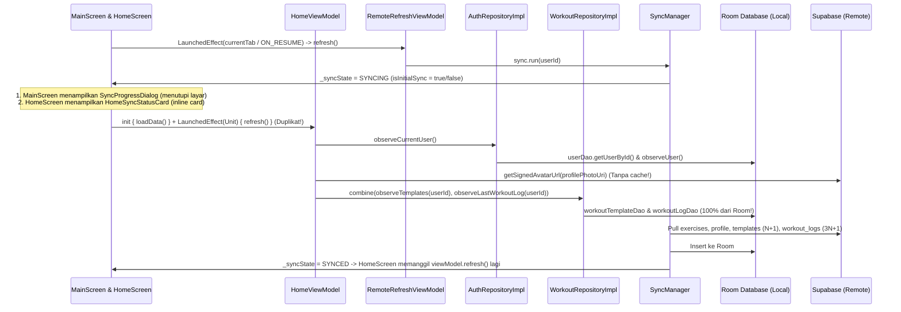
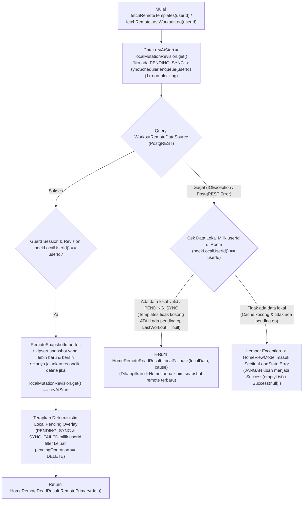

# Deepscan & Plan Implementasi Perbaikan Halaman Home, Profile Centralization, Remote Data Flow, dan Shimmer (Revisi v3.1 — Final)

**Tanggal:** 2026-10-31  
**Versi:** 3.1 (Final Ready-to-Execute — Mencakup Koreksi Atomicity vs Retry Recovery, Local Fallback saat Remote Read Gagal, Monotonic Revision Guard, & AC-01 s/d AC-17)  
**Status:** APPROVED FOR STEP-BY-STEP IMPLEMENTATION  
**Scope Utama:** Halaman Home (`HomeScreen`, `HomeViewModel`, `HomeComponents`, `SectionLoadState`), Host (`MainScreen`, `MainViewModel`, `ImfitMainAppBar`, `NavGraph`, `RemoteRefreshViewModel`), Centralisasi Profile (`AuthRepository`, `UserProfileState`, `ProfileViewModel`), Data Source Remote & Rekonsiliasi (`WorkoutRemoteDataSource`, `RemoteSnapshotImporter`, `WorkoutRepository`), dan Shimmer Skeleton (`IMFITShimmer`).

> **Prinsip Arsitektur (Non-Regresi):**  
> Halaman Home menampilkan **Remote-Primary Data dengan Deterministic Local Pending Overlay & Controlled Local Fallback** tanpa mengubah seluruh aplikasi menjadi *online-only* dan tanpa merusak kontrak Room maupun `SyncManager` yang masih digunakan oleh fitur lain (`WorkoutDetail`, `EditWorkout`, `ActiveWorkout`, `RestTimer`, `ProgressScreen`, serta pengujian `WorkoutRepositoryRoomFirstTest`).

---

## Bagian 1: Hasil Deepscan (Kondisi Saat Ini, Sumber Data, Alur Data, & Masalah)

### 1.1 Arsitektur & Alur Data Halaman Home Saat Ini



### 1.2 Temuan Deepscan per Area Masalah

#### Temuan 1 — Duplikasi UI Sync & Trigger Sinkronisasi Berlebih
1. **Full-Screen Blocking Overlay (`SyncProgressDialog` di `MainScreen.kt:215`)**:
   - Dipanggil di level root `MainScreen` (`Box(Modifier.fillMaxSize())`) sehingga menutupi `ImfitMainAppBar`, konten tab, dan `NavigationBar` saat `syncState.isInitialSync == true`, tanpa tombol *retry*/*dismiss*.
2. **Inline Sync Status Card (`HomeSyncStatusCard` di `HomeScreen.kt:83-90` & `HomeComponents.kt:257-315`)**:
   - Ditampilkan di dalam `LazyColumn` Home ketika `syncState.pendingCount > 0 || syncState.status == SYNCING || syncState.status == FAILED`.
   - Saat `isInitialSync == true`, `syncState.status` bernilai `SYNCING`, sehingga **`SyncProgressDialog` (menutupi layar) dan `HomeSyncStatusCard` (di dalam list Home) aktif bersamaan**.
3. **Trigger Background Sync Berulang (`RemoteRefreshViewModel` di `NavGraph.kt:47-48` & `MainScreen.kt:94`)**:
   - `MainScreen` memanggil `LaunchedEffect(currentTab) { onRefreshRemote() }` setiap kali user berpindah tab bawah, dan `NavGraph` memanggil `remoteRefresh.refresh()` setiap `ON_RESUME` dan perubahan `backStack`.
   - `HomeScreen` juga memanggil `LaunchedEffect(Unit) { viewModel.refresh() }` serta `LaunchedEffect(syncState.status)` yang menduplikasi `HomeViewModel.init { loadData() }`.
4. **Dead Code Sync UI (`SyncIndicator.kt`)**:
   - `SyncIndicator` dan `SyncDot` di `presentation/components/common/SyncIndicator.kt` tidak digunakan di layar mana pun.

#### Temuan 2 — Fragmentasi Data Profile, Status Auth, & Signed URL Avatar
Data profil pengguna (`User` + `signedAvatarUrl`) tersebar di 4 tempat tanpa *single source of truth* reaktif di memori:

| Lokasi | Cara Mengambil Profile | Masalah yang Ditemukan |
|---|---|---|
| `HomeViewModel.kt:61-86` | `authRepository.observeCurrentUser()` + `authRepository.getSignedAvatarUrl()` | Menyimpan `userName` & `userProfilePhotoUri` sendiri di `HomeState`. Memanggil API `createSignedUrl` ke Supabase Storage setiap kali `loadData()`/`refresh()` dipanggil. |
| `MainScreen.kt:98, 125` | Mengambil `homeState.userProfilePhotoUri` dari `HomeViewModel` | `MainScreen` terpaksa meng-inject `HomeViewModel` di level host hanya untuk mendapatkan URL foto profil pada `ImfitMainAppBar`. |
| `ProgressViewModel.kt:23-26, 53-85` | `authRepository.observeCurrentUser()` + `authRepository.getSignedAvatarUrl()` | Menduplikasi field `userName`, `userEmail`, `userBirthDate`, `userProfilePhotoUri` di `ProgressState` dan memanggil ulang `createSignedUrl` ke Supabase Storage. |
| `ProfileScreen.kt:43` | `viewModel: ProgressViewModel = hiltViewModel()` | `ProfileScreen` tidak memiliki `ProfileViewModel` sendiri dan memakai `ProgressViewModel` (yang ikut memuat seluruh histori kalender `workoutLogsByDate`). |
| `AuthRepositoryImpl.kt:169, 183-195` | `uploadProfilePhoto` menyimpan *storage path* privat (`"$userId/$filename.jpg"`) di kolom `avatar_url`; `getSignedAvatarUrl` selalu hit network | Tidak ada cache `signedAvatarUrl` di memori; selain itu raw `user.profilePhotoUri` berisi *storage path* privat yang **bukan** URL gambar publik sehingga tidak boleh langsung dipakai oleh `AsyncImage` tanpa *signed URL*. |

#### Temuan 3 — Card Ringkasan Terakhir (`HomeLastWorkout`) Menampilkan Empty Copy, Bukan UI Metrik `0`
- Di `HomeComponents.kt:166-170`, ketika `log == null`, seluruh struktur visual card ringkasan diganti menjadi teks `"Belum ada sesi yang selesai"` (`R.string.home_summary_empty`) dan `"Buat rutinitas untuk mulai berlatih."` (`R.string.redesign_start_hint`).
- Padahal string `R.string.workout_duration_zero` (`"0m"`), `R.string.workout_volume_zero` (`"0 kg"`), dan `R.string.placeholder_dash` (`"-"`) sudah tersedia di `strings.xml`.

#### Temuan 4 — Sumber Data Halaman Home Masih Berasal dari Room Database & Karakteristik Write
- `HomeViewModel.kt:87-91` masih meng-observe `workoutRepository.observeTemplates(userId)` dan `workoutRepository.observeLastWorkoutLog(userId)` yang membaca dari Room (`workoutTemplateDao`, `workoutLogDao`).
- Pada `WorkoutTemplateDto.kt:49`, `templateExercises?.mapNotNull { it.toDomain() }` belum mengurutkan `templateExercises` berdasarkan `orderIndex`.
- Pada `SyncManager.kt:650-660`, `syncTemplateExercises` melakukan `delete` lalu meng-insert `template_exercises` satu per satu di dalam loop `forEach`. Selain itu, `TemplateExerciseEntity` di Room belum menyimpan UUID child dari server sehingga `upsert_template_aggregate` RPC belum digunakan oleh klien (lihat `docs/backend/imfit-supabase-compose-integration.md:105-107`).

#### Temuan 5 — Bentuk Shimmer Tidak Sesuai dengan Komponen Asli pada Halaman Home
- `IMFITShimmer.kt` masih menggunakan anatomi kartu lama (`Card` dengan `elevation = 2.dp`, radius `20.dp`, tanpa border, thumbnail `52.dp`, dua bar subjudul bersebelahan, dan blok metrik `100x48.dp` tanpa divider vertikal `1.dp x 38.dp`).
- `ImfitMainAppBar` belum memiliki state loading terpisah untuk avatar (antara belum ada foto, sedang memuat signed URL/gambar, siap, atau gagal).

---

## Bagian 2: Desain Teknis & Perbaikan (Final v3.1)

### Fase 1: Menghapus Duplikat Sync UI, `MainViewModel` untuk TopBar, & Menata Trigger Sync (Kebutuhan #1)

#### 1.1 Penghapusan Sync UI yang Menutupi Layar & Card Sync di Home
1. **`MainScreen.kt`**:
   - Hapus pemanggilan dan import `SyncProgressDialog(syncState = syncState)` (`MainScreen.kt:48, 215`).
   - Hapus observasi `syncState` dan ketergantungan TopBar pada `HomeViewModel`.
2. **`MainViewModel.kt` Baru (`presentation/ui/main/MainViewModel.kt`)**:
   - Buat `MainViewModel` ringan yang meng-inject `AuthRepository` dan `SyncStateProvider`:
     ```kotlin
     @HiltViewModel
     class MainViewModel @Inject constructor(
         authRepository: AuthRepository,
         syncStateProvider: SyncStateProvider
     ) : ViewModel() {
         val userProfileState: StateFlow<UserProfileState> = authRepository.userProfileState
         val lastSyncTime: StateFlow<Long?> = syncStateProvider.syncState
             .map { it.lastSyncTime }
             .stateIn(viewModelScope, SharingStarted.WhileSubscribed(5_000), null)
     }
     ```
   - `MainScreen` membaca `userProfileState` dari `MainViewModel` untuk `ImfitMainAppBar` tanpa mengakses `AuthRepository` langsung di Composable dan tanpa membebani `HomeViewModel`.
3. **`HomeScreen.kt`, `HomeComponents.kt`, & `HomeViewModel.kt`**:
   - Hapus `syncState`, `previousSync`, `LaunchedEffect(syncState.status)`, dan item `"sync_status"` (`HomeSyncStatusCard`) dari `HomeScreen.kt`.
   - Hapus composable `HomeSyncStatusCard` dari `HomeComponents.kt:257-315`.
   - Hapus parameter `syncStateProvider: SyncStateProvider` dan properti `val syncState` dari `HomeViewModel.kt`.
4. **Pembersihan File Komponen Sync UI**:
   - Hapus `SyncProgressDialog.kt` dan `SyncIndicator.kt` (serta perbarui `ModalScrimTest.kt`).

#### 1.2 Pemisahan Trigger Refresh Home dari Trigger `SyncManager`
- Pertahankan `SyncManager` & `WorkManagerSyncScheduler` untuk sinkronisasi latar belakang.
- Di `MainScreen.kt:94`, ubah `LaunchedEffect(currentTab)` agar hanya memanggil `onRefreshRemote()` ketika `currentTab !is HomeTab` (yaitu saat membuka `ExerciseTab` atau `ProgressTab`), sehingga membuka `HomeTab` tidak memicu full database sync yang duplikat dengan remote fetch Home.

---

### Fase 2: Centralisasi Data Profile, Semantik `SessionStatus.RefreshFailure`, & Cache Signed URL Aman (Kebutuhan #2)

#### 2.1 Kontrak Abstrak Tanpa Default Fallback di `AuthRepository`
Deklarasikan `userProfileState` dan `refreshProfile` sebagai **kontrak abstrak tanpa default implementation** pada `AuthRepository` agar compiler menjamin seluruh implementasi (`AuthRepositoryImpl`, `DemoAuthRepository`, dan `FakeAuthRepository` di test) mendukung kontrak baru secara eksplisit:

```kotlin
interface AuthRepository {
    val userProfileState: kotlinx.coroutines.flow.StateFlow<com.diajarkoding.imfit.domain.model.UserProfileState>
    suspend fun refreshProfile(force: Boolean = false): Result<User?>
    // ... method existing tetap dipertahankan ...
}
```

#### 2.2 Pemisahan `hasRetainedSessionContext` vs `hasValidatedRemoteSession` pada `SessionStatus.RefreshFailure` (Koreksi P1 Review v3.0)
Pada `supabase-kt 3.0.3`, `SessionStatus.RefreshFailure(cause)` berarti proses perpanjangan token gagal sementara (misalnya perangkat sedang offline), sehingga:
1. Konteks UI tidak boleh langsung di-reset ke layar Login atau menghapus profil/cache yang sudah ada (`hasRetainedSessionContext == true`).
2. Namun, sesi tersebut **sedang tidak memiliki token yang tervalidasi untuk melakukan panggilan remote baru** sampai refresh token berhasil (`hasValidatedRemoteSession == false`).

Model `UserProfileState` di `domain/model/UserProfileState.kt`:

```kotlin
package com.diajarkoding.imfit.domain.model

enum class AuthSessionState {
    Initializing,
    Authenticated,
    /**
     * Refresh token gagal sementara (SessionStatus.RefreshFailure pada supabase-kt 3.0.3).
     * Konteks UI & cache lokal dipertahankan, tetapi session belum tervalidasi untuk request remote baru.
     */
    RefreshFailure,
    Unauthenticated
}

sealed interface ProfileLoadState {
    data object Unauthenticated : ProfileLoadState
    data object Loading : ProfileLoadState
    data class Ready(val user: User) : ProfileLoadState
    /** Session valid, tetapi baris di tabel `profiles` belum ada dan menggunakan fallback metadata auth. */
    data class Empty(val userId: String, val fallbackName: String, val fallbackEmail: String) : ProfileLoadState
    /** Fetch ke remote gagal; tetap menyimpan cachedUser (jika ada) agar UI tidak kehilangan identitas yang sudah diketahui. */
    data class Error(val userId: String, val message: String?, val cachedUser: User? = null) : ProfileLoadState
}

sealed interface AvatarLoadState {
    /** Pengguna tidak memiliki foto profil (`avatar_url == null/blank`). Jangan tampilkan shimmer. */
    data object None : AvatarLoadState
    /** Sedang mengambil signed URL dari Supabase Storage. Tampilkan shimmer lingkaran. */
    data object Loading : AvatarLoadState
    /** Signed URL (atau URI langsung yang valid) siap dimuat oleh Coil. */
    data class Ready(val url: String) : AvatarLoadState
    /** Gagal membuat signed URL. Tampilkan ikon fallback Person, bukan shimmer tanpa batas. */
    data object Error : AvatarLoadState
}

data class UserProfileState(
    val sessionState: AuthSessionState = AuthSessionState.Initializing,
    val userId: String? = null,
    val profileState: ProfileLoadState = ProfileLoadState.Loading,
    val avatarState: AvatarLoadState = AvatarLoadState.None
) {
    /**
     * Digunakan oleh UI untuk mempertahankan konteks tampilan (tidak memaksa logout saat RefreshFailure sementara).
     */
    val hasRetainedSessionContext: Boolean
        get() = sessionState == AuthSessionState.Authenticated ||
            (sessionState == AuthSessionState.RefreshFailure && userId != null)

    /**
     * Hanya bernilai true jika session benar-benar terautentikasi dan siap melakukan operasi remote.
     */
    val hasValidatedRemoteSession: Boolean
        get() = sessionState == AuthSessionState.Authenticated && userId != null

    val currentUser: User?
        get() = when (val s = profileState) {
            is ProfileLoadState.Ready -> s.user
            is ProfileLoadState.Error -> s.cachedUser
            is ProfileLoadState.Empty -> User(id = s.userId, name = s.fallbackName, email = s.fallbackEmail)
            else -> null
        }

    val displayName: String
        get() = currentUser?.name.orEmpty()

    val email: String
        get() = currentUser?.email.orEmpty()

    val birthDate: String?
        get() = currentUser?.birthDate

    val isProfileLoading: Boolean
        get() = sessionState == AuthSessionState.Initializing ||
            (profileState is ProfileLoadState.Loading && currentUser == null)

    val isAvatarLoading: Boolean
        get() = isProfileLoading || avatarState is AvatarLoadState.Loading

    /**
     * Hanya mengembalikan URL yang benar-benar siap dimuat oleh AsyncImage (Signed URL atau URI langsung yang valid).
     * TIDAK PERNAH mengembalikan storagePath privat mentah (seperti "userId/uuid.jpg").
     */
    val resolvedAvatarUrl: String?
        get() = (avatarState as? AvatarLoadState.Ready)?.url
}
```

#### 2.3 Aturan Transisi Session, Guard Side-Effect Repository, & Invalidasi Cache Avatar
1. **Observasi `supabaseClient.auth.sessionStatus` di `AuthRepositoryImpl`**:
   - **`SessionStatus.Initializing`**: Pertahankan state `Initializing`.
   - **`SessionStatus.Authenticated`**:
     - Ambil `newUserId = supabaseClient.auth.currentUserOrNull()?.id`.
     - Jika `lastAuthenticatedUserId != null && lastAuthenticatedUserId != newUserId` (pergantian akun A ke B):
       - Batalkan `profileFetchJob` yang sedang berjalan.
       - Hapus seluruh `avatarCache` dan `cachedUser` milik akun lama.
       - Reset `_userProfileState` ke `Loading` untuk `newUserId`, lalu jalankan `refreshProfile(force = true)`.
     - Jika `lastAuthenticatedUserId == newUserId`: perbarui `sessionState = AuthSessionState.Authenticated` dan muat profil bila belum `Ready`.
   - **`SessionStatus.RefreshFailure`**:
     - Pertahankan `userId`, `profileState` (beserta `cachedUser` dari memori atau Room lokal `userDao.getUserById(userId)`), dan `avatarState` terakhir dengan `sessionState = AuthSessionState.RefreshFailure`.
     - Saat berada di state `RefreshFailure`, `refreshProfile()` menggunakan fallback lokal `cachedUser` / `userDao.getUserById(userId)` tanpa menghapus state profil yang sudah ada.
   - **`SessionStatus.NotAuthenticated`**:
     - Batalkan `profileFetchJob`, bersihkan `avatarCache` & `cachedUser`, dan set `_userProfileState = UserProfileState(sessionState = AuthSessionState.Unauthenticated, userId = null, profileState = ProfileLoadState.Unauthenticated, avatarState = AvatarLoadState.None)`.
2. **Guard Session Sebelum Menulis Side-Effect di Repository**:
   - Sebelum `AuthRepositoryImpl` menyimpan hasil fetch profil ke `userDao`, `cachedUser`, `avatarCache`, maupun `_userProfileState`, wajib memverifikasi `peekLocalUserId() == expectedUserId` agar response yang terlambat dari akun A tidak pernah mengotori database atau memori setelah berganti ke akun B.
3. **Cache Signed URL Avatar (`AvatarCacheKey(userId, storagePath)`)**:
   - Simpan `(AvatarCacheKey(userId, storagePath) -> CachedSignedUrl(signedUrl, expiresAtEpochMs))` dengan masa berlaku aman 45 menit (dari TTL 60 menit).
   - Di-invalidasi saat logout, pergantian `userId`, perubahan `profilePhotoUri` pada `updateProfile`/`register`, atau saat `refreshProfile(force = true)` dipanggil ketika `avatarState is AvatarLoadState.Error`.
4. **`ProfileViewModel` Ringan (`presentation/ui/profile/ProfileViewModel.kt`)**:
   - `ProfileScreen` menggunakan `ProfileViewModel` yang hanya mengamati `authRepository.userProfileState`, memanggil `authRepository.refreshProfile(force = true)` saat retry, dan mengeksekusi `authRepository.logout()`, sehingga terlepas sepenuhnya dari `ProgressViewModel`.

---

### Fase 3: Card Ringkasan Terakhir Menampilkan UI Ringkasan dengan Data `0` Saat Belum Ada Data (Kebutuhan #3)

#### 3.1 Perubahan pada `HomeLastWorkout` (`HomeComponents.kt:160-189`)
Ketika `lastWorkoutState` berstatus **`SectionLoadState.Success(data = null)`**, `HomeLastWorkout(log = null)` merender struktur card ringkasan yang sama persis dengan saat `log != null`:
- **Baris Header Card**:
  - Ikon kiri: `R.drawable.ic_home_history` (`14.dp`, tint `colors.muted`)
  - Judul tengah (`Modifier.weight(1f)`): `stringResource(R.string.home_summary_heading, log?.templateName?.uppercase(locale) ?: stringResource(R.string.placeholder_dash))` (`TERAKHIR · -`)
  - Tanggal kanan (`TextAlign.End`): Tanggal format `d MMM yyyy` jika `log != null`, atau `stringResource(R.string.placeholder_dash)` (`"-"`) jika `log == null`.
- **Baris Metrik Card**:
  - **Metrik Kiri (Durasi Total)**: `log?.formattedDuration ?: stringResource(R.string.workout_duration_zero)` (**`0m`**).
  - **Divider Vertikal Tengah**: `Box(Modifier.width(IMFITComponentSizes.border).height(IMFITComponentSizes.metricDivider).background(colors.border))` (`1.dp x 38.dp`).
  - **Metrik Kanan (Total Volume)**: `String.format(locale, "%,.0f kg", log?.totalVolume ?: 0f)` (**`0 kg`**).

---

### Fase 4: Remote-Primary Data, Fallback Lokal Saat Remote Gagal, Monotonic Revision Guard, & Kebijakan Write (Kebutuhan #4 & Koreksi P0/P1 Review v3.0)

#### 4.1 Kontrak Abstrak `WorkoutRepository` & Model Provenance `RemoteReadResult<out T>` (Koreksi P0 #2 Review v3.0)
Untuk membedakan secara tegas antara:
1. **Data dari snapshot remote terbaru** (`RemotePrimary`),
2. **Fallback data lokal yang masih valid / memiliki perubahan `PENDING_SYNC` ketika request remote gagal** (`LocalFallback`), dan
3. **Kegagalan total saat remote gagal dan tidak ada data lokal yang relevan** (melempar exception / `Error`),

kita mendefinisikan `HomeRemoteReadResult<out T>` dan kontrak abstrak pada `WorkoutRepository`:

```kotlin
sealed interface HomeRemoteReadResult<out T> {
    val data: T
    val isFromRemote: Boolean

    /** Berhasil diambil dari Supabase dan telah digabung dengan Local Pending Overlay. */
    data class RemotePrimary<T>(
        override val data: T
    ) : HomeRemoteReadResult<T> {
        override val isFromRemote: Boolean = true
    }

    /**
     * Request ke Supabase gagal (mis. offline setelah menyelesaikan workout), tetapi Room memiliki
     * data milik userId yang valid / PENDING_SYNC yang dapat ditampilkan sebagai fallback.
     * TIDAK diklaim sebagai snapshot remote terbaru.
     */
    data class LocalFallback<T>(
        override val data: T,
        val cause: Throwable
    ) : HomeRemoteReadResult<T> {
        override val isFromRemote: Boolean = false
    }
}

interface WorkoutRepository {
    // Seluruh method Room-backed existing tetap dipertahankan.

    suspend fun fetchRemoteTemplates(userId: String): HomeRemoteReadResult<List<WorkoutTemplate>>
    suspend fun fetchRemoteLastWorkoutLog(userId: String): HomeRemoteReadResult<WorkoutLog?>
}
```

#### 4.2 Alur Eksekusi `fetchRemoteTemplates` & `fetchRemoteLastWorkoutLog` (Termasuk Fallback Lokal Saat Remote Gagal — Koreksi P0 #2 & AC-17)



**Aturan Spesifik Fallback Lokal (Koreksi P0 #2 Review v3.0 & AC-09 / AC-17):**
1. **Untuk `fetchRemoteTemplates(userId)` saat Remote Gagal**:
   - Verifikasi `authRepository.peekLocalUserId() == userId`.
   - Ambil daftar template aktif milik `userId` dari Room (`getTemplates(userId)`) yang sudah mencakup perubahan `PENDING_SYNC` / `SYNC_FAILED` (dan mengecualikan `isDeleted = true` / `pendingOperation == DELETE`).
   - Jika daftar lokal tidak kosong **atau** pengguna memang memiliki riwayat sinkronisasi sebelumnya (`syncPreferences.isInitialSyncCompleted(userId)` / ada row lokal untuk `userId`), kembalikan `HomeRemoteReadResult.LocalFallback(localTemplates, exception)`.
   - Jika belum pernah ada data lokal sama sekali untuk `userId` (misalnya login pertama kali saat koneksi langsung terputus), lempar exception agar `HomeViewModel` menampilkan `SectionLoadState.Error` dengan tombol Retry — **bukan** `Success(emptyList())`.
2. **Untuk `fetchRemoteLastWorkoutLog(userId)` saat Remote Gagal**:
   - Verifikasi `authRepository.peekLocalUserId() == userId`.
   - Ambil `localLastLog = getLastWorkoutLog(userId)` dari Room (yang mencakup workout yang baru saja diselesaikan secara offline dengan status `PENDING_SYNC`).
   - **Jika `localLastLog != null`**: kembalikan `HomeRemoteReadResult.LocalFallback(localLastLog, exception)`. Dengan demikian, saat pengguna menyelesaikan workout dalam kondisi offline lalu kembali ke Home, card *Latihan Terakhir* langsung menampilkan workout yang baru selesai tersebut secara konsisten (**AC-09 & AC-17**)!
   - **Jika `localLastLog == null`**: **jangan** mengembalikan `Success(null)` (karena akan menampilkan `0m / 0 kg` seolah-olah fetch remote berhasil dan menyembunyikan kegagalan jaringan). Lempar exception agar `HomeViewModel` masuk ke `SectionLoadState.Error` (yang tetap mempertahankan `previousData` di memori bila `hasPreviousData == true`, atau menampilkan card error/retry bila `hasPreviousData == false`).

#### 4.3 Proteksi Rekonsiliasi terhadap Stale Response dengan `localMutationRevision` (Koreksi P1 #1 Review v3.0)
Perbandingan timestamp `local.updatedAt > parent.updatedAt` saja tidak cukup apabila terjadi *clock skew* antara jam perangkat dan jam server, atau apabila request baca remote dimulai *sebelum* mutasi lokal selesai di-push ke server.
- **Mekanisme `localMutationRevision`**:
  1. Tambahkan `private val localMutationRevision = AtomicLong(0L)` di `WorkoutRepositoryImpl` (atau shared mutation tracker).
  2. Setiap operasi tulis lokal (`createTemplate`, `updateTemplate`, `updateTemplateExercises`, `updateTemplateExercise`, `deleteTemplate`, `finishWorkout`) menaikkan `localMutationRevision.incrementAndGet()` di dalam transaksi Room.
  3. Saat `fetchRemoteTemplates(userId)` dimulai (sebelum request jaringan dikirim), catat `val startRevision = localMutationRevision.get()`.
  4. Ketika response remote diterima, teruskan `val isUninterruptedFullSnapshot = (localMutationRevision.get() == startRevision)` ke `RemoteSnapshotImporter.reconcileActiveTemplates(...)`:
     - **Upsert / Update per-item**: Tetap berjalan dengan guard di dalam `database.withTransaction`:
       - `authRepository.peekLocalUserId() == userId`
       - `local == null || (local.userId == parent.userId && local.syncStatus == SyncStatus.SYNCED.name && local.pendingOperation == null && local.updatedAt <= parent.updatedAt)`
       - Seluruh child `template_exercises` milik `parent.id` di Room juga berstatus `SYNCED` dan `pendingOperation == null`.
     - **Reconcile Deletion (menandai `isDeleted = true` untuk row lokal yang tidak ada di snapshot remote)**:
       - **HANYA dijalankan jika `isUninterruptedFullSnapshot == true`** dan query remote berhasil mengembalikan seluruh halaman (`pages { ... }`) tanpa error!
       - Jika ada mutasi lokal yang terjadi selama request remote sedang berjalan (`localMutationRevision.get() != startRevision`), langkah penghapusan dilewati sepenuhnya sehingga template yang baru dibuat/diedit secara lokal tidak pernah terhapus oleh response remote yang *stale* (**AC-16**).

#### 4.4 Klasifikasi Eksplisit: Atomic RPC (`workout_logs`) vs Eventual Consistency with Retry Recovery (`workout_templates`) (Koreksi P0 #1 Review v3.0)
Sesuai fakta arsitektur PostgREST (setiap HTTP request berjalan dalam transaksinya sendiri) dan kondisi skema saat ini:

1. **Workout Logs (`finishWorkout`) — Atomic Aggregate Write via RPC**:
   - Menggunakan RPC `public.upsert_workout_aggregate(p_workout, p_exercises, p_sets)` (`20260828130154_imfit_backend_hardening.sql:490-670`) dengan UUID deterministik (`session.id` dan `stableUuid(...)`).
   - Seluruh operasi parent `workout_logs`, child `exercise_logs`, dan `workout_sets` dieksekusi dalam **satu transaksi PostgreSQL atomik**.
2. **Workout Templates (`createTemplate`, `updateTemplate`, `deleteTemplate`) — Eventual Consistency with Durable Room-Backed Retry Recovery**:
   - Mengapa belum menggunakan `upsert_template_aggregate` RPC?
     - Sesuai dokumentasi `docs/backend/imfit-supabase-compose-integration.md:105-107` dan migrasi `20260828130154_imfit_backend_hardening.sql:678-781`, `TemplateExerciseEntity` di Room saat ini menggunakan composite key `(templateId, exerciseId)` tanpa kolom UUID child `id`, dan RPC `upsert_template_aggregate` belum memiliki logika *pruning* (penghapusan child yang dihapus dari template) serta berpotensi bentrok dengan unique index `idx_template_exercises_order (template_id, order_index)` saat urutan gerakan diubah.
   - Oleh karena itu, sinkronisasi template menggunakan pendekatan **Multi-Request PostgREST (`upsert workout_templates` $\rightarrow$ `delete template_exercises` $\rightarrow$ batch `insert template_exercises`)** yang diklasifikasikan secara eksplisit sebagai **Eventual Consistency with Durable Room-Backed Retry Recovery** (bukan transaksi lintas-request yang atomik):
     - **Peningkatan Efisiensi & Pengurangan Titik Gagal**: Mengubah loop `exercises.forEach { insert(dto) }` di `SyncManager.syncTemplateExercises` (`SyncManager.kt:650-660`) menjadi **satu batch `insert(dtos)`** sehingga penyisipan seluruh child berjalan dalam satu transaksi request PostgREST.
     - **Jaminan Pemulihan (Recovery Guarantee)**:
       - Apabila `DELETE template_exercises` berhasil namun batch `INSERT template_exercises` gagal karena jaringan putus, `SyncManager` melempar exception **sebelum** memanggil `workoutTemplateDao.markAsSyncedIfUnchanged(...)` maupun `templateExerciseDao.markTemplateExercisesAsSynced(...)`.
       - Di Room, parent template tetap berstatus `PENDING_SYNC` / `SYNC_FAILED` dan seluruh child `TemplateExerciseEntity` di Room tetap utuh.
       - Selama status lokal masih `PENDING_SYNC` / `SYNC_FAILED`,:
         1. `RemoteSnapshotImporter` **menolak** menimpa template lokal yang utuh di Room dengan template remote yang parsial (0 exercises).
         2. *Deterministic Local Pending Overlay* pada `fetchRemoteTemplates` memastikan **Home dan WorkoutDetail tetap menampilkan daftar gerakan yang lengkap dari Room**, bukan kondisi parsial dari remote!
         3. Pada retry berikutnya, `SyncManager` membaca kembali daftar child yang utuh dari Room dan menjalankan ulang `delete` + batch `insert` hingga state di Supabase pulih sepenuhnya (**AC-15**).
     - **Penanganan UI terhadap Template dengan 0 Exercises**:
       - Baik `HomeWorkoutCard` (`0 gerakan` dengan fallback artwork `imfit_muscle_generic.webp`) maupun `WorkoutDetailScreen` sudah mendukung template dengan 0 gerakan secara native (karena alur pembuatan template baru dari Home memang membuat template dengan 0 gerakan terlebih dahulu).

---

### Fase 5: `SectionLoadState<T>` Tanpa Kehilangan Data Saat Refresh & Shimmer Presisi (Kebutuhan #5 & Koreksi P1 #2 Review v3.0)

#### 5.1 Model `SectionLoadState<out T>` dengan Provenance (`isFromRemote`) & `hasPreviousData`
Di `presentation/ui/home/SectionLoadState.kt`:

```kotlin
package com.diajarkoding.imfit.presentation.ui.home

import androidx.annotation.StringRes

sealed interface SectionLoadState<out T> {
    data object Loading : SectionLoadState<Nothing>

    data class Success<T>(
        val data: T,
        val isRefreshing: Boolean = false,
        /**
         * true jika berasal dari snapshot remote terbaru (RemotePrimary);
         * false jika berasal dari fallback lokal saat remote gagal (LocalFallback).
         */
        val isFromRemote: Boolean = true
    ) : SectionLoadState<T>

    data class Error<T>(
        @StringRes val errorRes: Int,
        val message: String? = null,
        val previousData: T? = null,
        val hasPreviousData: Boolean = false
    ) : SectionLoadState<T>
}
```

#### 5.2 Aturan Transisi Saat Refresh: Jangan Pernah Mengubah `Success(data)` Kembali ke `Loading` (Koreksi P1 #2 Review v3.0)
Saat `HomeViewModel.loadData()` / `refresh()` dipanggil untuk `userId` yang sama:
1. **Transisi Awal Sebelum Request Dimulai**:
   - Jika state section saat ini adalah `SectionLoadState.Success(data, ...)`: ubah menjadi **`SectionLoadState.Success(data = data, isRefreshing = true, isFromRemote = current.isFromRemote)`** — **JANGAN** diubah menjadi `SectionLoadState.Loading`!
   - Jika state section saat ini adalah `SectionLoadState.Error(..., previousData, hasPreviousData = true)`: pertahankan `previousData` dan `hasPreviousData = true` selama proses retry berlangsung.
   - Hanya gunakan `SectionLoadState.Loading` ketika belum pernah ada data sama sekali (`hasPreviousData == false` pada initial load) atau ketika terjadi pergantian `userId` (switch akun).
2. **Mengapa Ini Penting**:
   - Mencegah *shimmer flash* saat pengguna berpindah tab atau kembali ke Home.
   - Memastikan bahwa jika request refresh berikutnya gagal dan masuk ke blok `catch`, pembacaan `current.lastWorkoutState` / `current.templatesState` masih memegang `Success(data)` sebelumnya sehingga `previousData` dan `hasPreviousData = true` **tidak pernah hilang**!

```kotlin
// Transisi state di awal refresh untuk userId yang sama:
fun <T> SectionLoadState<T>.toRefreshingState(): SectionLoadState<T> = when (this) {
    is SectionLoadState.Loading -> SectionLoadState.Loading
    is SectionLoadState.Success -> copy(isRefreshing = true)
    is SectionLoadState.Error -> this
}

#### 5.3 Spesifikasi Shimmer & Layout Stability (Kebutuhan #5)
- **`shimmerBrush()` (`IMFITShimmer.kt`)**: Menggunakan token `IMFITColors.training.border` dan `IMFITColors.training.raised`.
- **Avatar di `ImfitMainAppBar.kt` & `IMFITProfilePhoto.kt`**:
  - `AvatarLoadState.Loading` -> `ShimmerCircle(size = IMFITSizes.avatarSm)` (`40.dp`).
  - `AvatarLoadState.None` -> langsung `Icon(Symbols.Default.Person)` (tanpa shimmer).
  - `AvatarLoadState.Ready(url)` -> `IMFITProfilePhoto` (shimmer lingkaran saat Coil loading, foto saat `Success`, ikon `Person` saat `Error`).
  - `AvatarLoadState.Error` -> langsung `Icon(Symbols.Default.Person)`.
- **`ShimmerWelcomeSection`**: 2 baris proporsional (`fillMaxWidth(0.52f)` x `27.dp` dan `fillMaxWidth(0.68f)` x `18.dp`, `spacedBy(IMFITSpacing.xs)`).
- **`ShimmerStatCard` (`HomeLastWorkout`)**: `Surface` dengan `shape = IMFITShapes.CardSmall` (`14.dp`), `border = 1.dp colors.border`, `padding = 16.dp`, `spacedBy(14.dp)`, baris header (ikon `14.dp` + judul + tanggal), dan baris metrik (2 kolom `weight(1f)` dengan baris ikon+caption dan bar nilai `25.dp`, dipisahkan oleh **Vertical Divider `1.dp x 38.dp`**).
- **`ShimmerWorkoutCard` (`HomeWorkoutCard`)**: `Surface` dengan `minHeight = 80.dp`, `shape = RoundedCornerShape(12.dp)`, `border = 1.dp colors.border`, `padding = 12.dp`, thumbnail `56.dp` (`radius = 10.dp`), 1 bar judul + 1 bar subjudul (`spacedBy(5.dp)`), dan ikon kanan `20.dp`.

---

### Fase 6: Pull-to-Refresh pada Halaman Home untuk Pemulihan Error & Sinkronisasi Cepat (Kebutuhan #6)

#### 6.1 Tujuan & Cakupan Data yang Di-refresh
Menyediakan interaksi **Pull-to-Refresh** pada `HomeScreen` agar pengguna dapat memuat ulang halaman Home secara manual apabila terjadi gangguan jaringan, state error pada salah satu section, atau data belum tampil semestinya.

Data yang dimuat ulang saat *pull-to-refresh* dibatasi hanya pada **data yang diperlukan oleh Halaman Home**:
1. **Data Profile Esensial Home (`userName` & `avatar_url`)**:
   - Memanggil `authRepository.refreshProfile(force = true)` untuk menyegarkan `name` (pada `HomeGreeting`) dan `avatar_url` (pada `ImfitMainAppBar`).
   - **Efisiensi Signed URL**: Apabila `avatar_url` (*storage path*) tidak berubah dan `signedAvatarUrl` di cache memori masih valid (`AvatarLoadState.Ready`), tidak perlu men-generate ulang token signed URL baru; namun apabila sebelumnya gagal (`AvatarLoadState.Error`) atau path berubah, signed URL baru langsung diambil.
2. **Ringkasan Latihan Terakhir (`lastWorkoutState`)**:
   - Memanggil ulang `workoutRepository.fetchRemoteLastWorkoutLog(userId)` secara langsung ke remote (dengan rekonsiliasi Room & *LocalFallback* bila offline).
3. **Daftar Routine Template Workout & Status Sesi Aktif (`templatesState` & `activeWorkoutTemplateId`)**:
   - Memanggil ulang `workoutRepository.fetchRemoteTemplates(userId)` dan `workoutRepository.getActiveSession()`.

#### 6.2 Desain Teknis Pipeline Terpadu (`HomeRefreshTrigger`), `HomeViewModel`, dan `HomeScreen` (Terkoreksi P0-1..P0-3 & P1-1..P1-3)
1. **Satu Refresh Pipeline dengan `HomeRefreshTrigger` (P0-1)**:
   - Hindari duplikasi pipeline antara initial load, auto refresh, dan manual pull-to-refresh:
     ```kotlin
     enum class HomeRefreshTrigger {
         INITIAL,
         AUTO,
         MANUAL
     }
     ```
   - `fun pullToRefresh() = refreshHome(HomeRefreshTrigger.MANUAL)`
   - `fun refreshOnEntry()`: pada pemanggilan pertama dilewati (karena `init` sudah menjalankan `INITIAL`), dan pada pemanggilan berikutnya menjalankan `refreshHome(HomeRefreshTrigger.AUTO)`.
   - **Pencegahan Duplicate Manual Refresh**: Jika `trigger == HomeRefreshTrigger.MANUAL` dan `_state.value.isPullRefreshing && loadJob?.isActive == true`, abaikan trigger manual duplikat tersebut sampai refresh yang sedang berjalan selesai (**AC-20**).
   - Jika `MANUAL` dipanggil saat `INITIAL` atau `AUTO` masih berjalan, batalkan `loadJob` sebelumnya dan naikkan `val gen = requestGeneration.incrementAndGet()` sehingga hanya hasil refresh terbaru yang berhak memperbarui state.
2. **Generation-Safe `finally` untuk `isPullRefreshing` (P0-2)**:
   - Hanya pemilik `generation` yang masih aktif yang berhak mematikan indikator `isPullRefreshing`:
     ```kotlin
     finally {
         if (requestGeneration.get() == gen) {
             _state.update { it.copy(isPullRefreshing = false) }
         }
     }
     ```
   - Dengan guard ini, jika Refresh A dibatalkan oleh Refresh B, blok `finally` milik Refresh A tidak pernah menghentikan spinner milik Refresh B (**AC-21**).
3. **Semantik `toRefreshingState()` Selama Refresh (P0-3)**:
   - `Success(data)` $\rightarrow$ `Success(data, isRefreshing = true)` (data lama tetap terlihat, tanpa shimmer penuh).
   - `Success(null)` $\rightarrow$ `Success(null, isRefreshing = true)` (card `0m / 0 kg` tetap terlihat).
   - `Error` (dengan maupun tanpa `previousData`) $\rightarrow$ tetap `this` (mempertahankan `previousData` atau error card dengan indikator *pull-to-refresh* di atas hingga hasil baru tiba).
   - `Loading` $\rightarrow$ tetap `Loading`.
4. **Isolasi Eksekusi di Dalam `supervisorScope` (P1-1 & P1-2)**:
   - Jalankan 4 unit kerja secara independen di dalam `supervisorScope` (dan tunggu hanya penyelesaian request remote awal sebelum menutup `isPullRefreshing`, sementara observasi perubahan lokal `.drop(1)` berjalan di coroutine terpisah):
     1. `authRepository.refreshProfile(force = trigger == HomeRefreshTrigger.MANUAL)`: memeriksa `Result<User?>` secara eksplisit, menangkap exception yang dapat dipulihkan, mempertahankan cached profile bila gagal, dan menggunakan kembali `signedAvatarUrl` di cache selama `storagePath` tidak berubah & belum kedaluwarsa (**AC-23**).
     2. `workoutRepository.getActiveSession()`: dieksekusi di coroutine terpisah sehingga kegagalan membaca active session tidak pernah membuat `templatesState` menjadi `Error` (**P1-1**).
     3. `workoutRepository.fetchRemoteLastWorkoutLog(userId)`
     4. `workoutRepository.fetchRemoteTemplates(userId)`
5. **Komponen UI (`PullToRefreshBox` di `HomeScreen.kt`) (P1-3)**:
   - Gunakan `@OptIn(ExperimentalMaterial3Api::class)` dan bungkus `LazyColumn` di dalam `Column` utama `HomeScreen.kt` dengan `PullToRefreshBox`:
     ```kotlin
     PullToRefreshBox(
         isRefreshing = state.isPullRefreshing,
         onRefresh = viewModel::pullToRefresh,
         modifier = Modifier
             .fillMaxWidth()
             .weight(1f)
             .testTag("home_pull_to_refresh")
     ) {
         LazyColumn(
             modifier = Modifier.fillMaxSize(),
             // ...
         ) {
             // Greeting, Strength Banner, Last Workout, Workout Section Header, Templates
         }
     }
     ```

---

## Bagian 3: Urutan Implementasi Final & Gate Verifikasi (7 Langkah)

| Langkah | Fokus Implementasi | Gate Sebelum Lanjut ke Langkah Berikutnya |
|---|---|---|
| **Langkah 1** | **Kontrak Repository & State**<br>• Buat `UserProfileState.kt` (`hasRetainedSessionContext` vs `hasValidatedRemoteSession`), `HomeRemoteReadResult.kt`, & `SectionLoadState.kt` (`hasPreviousData`, `isFromRemote`, `toRefreshingState()`).<br>• Tambahkan kontrak abstrak `userProfileState`, `refreshProfile()`, `fetchRemoteTemplates()`, dan `fetchRemoteLastWorkoutLog()` tanpa default fallback, dilengkapi implementasi stub yang valid pada semua class implementor. | Semua implementasi (`AuthRepositoryImpl`, `DemoAuthRepository`, `WorkoutRepositoryImpl`, `DemoWorkoutRepository`) dan test fake (`FakeAuthRepository`) berhasil dikompilasi tanpa fallback tersembunyi. |
| **Langkah 2** | **Centralized Profile & Consumer Migration**<br>• Implementasikan `userProfileState` berbasis `sessionStatus` (termasuk `RefreshFailure`), guard session, dan `AvatarCacheKey(userId, storagePath)` di `AuthRepositoryImpl` & `DemoAuthRepository`.<br>• Buat `MainViewModel` dan `ProfileViewModel`.<br>• Migrasikan `MainScreen`, `HomeViewModel`, `ProgressViewModel`, dan `ProfileScreen`. | Unit test untuk session switching (A $\rightarrow$ B), `SessionStatus.RefreshFailure`, dan invalidasi avatar cache lulus (**AC-02, AC-03, AC-04, AC-14**). |
| **Langkah 3** | **Remote Read Home, Local Fallback, & Isolasi Section**<br>• Buat `WorkoutRemoteDataSource` (filter `deleted_at IS NULL`, `end_time IS NOT NULL`, ordering deterministik) & perbaiki sorting DTO.<br>• Implementasikan kebijakan `HomeRemoteReadResult` (`RemotePrimary` vs `LocalFallback`) saat remote gagal.<br>• Implementasikan `HomeViewModel` dengan `supervisorScope`, `toRefreshingState()` (mempertahankan data saat refresh), dan pembatalan job + generation guard. | Unit test untuk query mapping, ordering DTO, fallback lokal saat remote gagal, isolasi error antar-section, dan `Success(null)` $\rightarrow$ `Error` saat refresh lulus (**AC-05, AC-07, AC-11, AC-17**). |
| **Langkah 4** | **Write Consistency, `localMutationRevision`, & Snapshot Reconciliation**<br>• Perkuat `RemoteSnapshotImporter` dengan `localMutationRevision` guard dan 5 aturan konsistensi.<br>• Ubah `SyncManager.syncTemplateExercises` menjadi batch insert, larang penandaan `SYNCED` pada partial failure, dan terapkan *Deterministic Local Pending Overlay* untuk melindungi UI dari state remote yang parsial. | Integration test (`RemoteSnapshotImporterTest` & `WorkoutRepositoryRoomFirstTest`) untuk retry recovery, pending delete, stale snapshot protection, dan partial failure lulus (**AC-08, AC-09, AC-10, AC-15, AC-16**). |
| **Langkah 5** | **UI Home, Default Ringkasan `0`, Shimmer, & Sync UI Cleanup**<br>• Update `HomeLastWorkout(null)` agar merender `0m` dan `0 kg` pada `Success(null)` serta error/retry pada `Error`.<br>• Perbarui `IMFITShimmer.kt`, `ImfitMainAppBar.kt`, dan `IMFITProfilePhoto.kt`.<br>• Hapus `HomeSyncStatusCard`, `SyncProgressDialog.kt`, dan `SyncIndicator.kt`. | UI/Compose test dan verifikasi visual untuk loading shimmer, empty `0m / 0 kg`, error state, retensi data saat refresh, serta layout stability lulus (**AC-01, AC-06, AC-12**). |
| **Langkah 6** | **Pull-to-Refresh Halaman Home (Fase 6)**<br>• Implementasikan `HomeRefreshTrigger` (`INITIAL`, `AUTO`, `MANUAL`), `isPullRefreshing` dengan generation-safe `finally`, dan `PullToRefreshBox` pada `HomeScreen.kt`.<br>• Pisahkan kegagalan `getActiveSession()` dari `templatesState` dan tangani hasil `refreshProfile(force = true)`. | Unit test & Compose UI test memverifikasi **AC-18 s/d AC-23** lulus. |
| **Langkah 7** | **Full Regression Testing (Demo & Production)**<br>• Jalankan seluruh suite unit test, instrumented test, dan build APK untuk kedua flavor. | `./gradlew testDemoDebugUnitTest testProductionDebugUnitTest assembleDemoDebug assembleProductionDebug` hijau dan seluruh AC-01 s/d AC-23 terpenuhi (**AC-13**). |
---

## Bagian 4: Daftar File yang Akan Dimodifikasi / Ditambahkan / Dihapus

| Kategori | File | Aksi | Ringkasan Perubahan |
|---|---|---|---|
| **Domain Model** | `app/src/main/java/com/diajarkoding/imfit/domain/model/UserProfileState.kt`<br>`app/src/main/java/com/diajarkoding/imfit/domain/model/HomeRemoteReadResult.kt` | **NEW** | Model `AuthSessionState` (`hasRetainedSessionContext` vs `hasValidatedRemoteSession`), `ProfileLoadState`, `AvatarLoadState`, `UserProfileState`, dan `HomeRemoteReadResult` (`RemotePrimary` vs `LocalFallback`). |
| **Presentation State** | `app/src/main/java/com/diajarkoding/imfit/presentation/ui/home/SectionLoadState.kt` | **NEW** | Sealed interface `SectionLoadState<out T>` (`Loading`, `Success`, `Error` dengan `hasPreviousData`, `isFromRemote`, & `toRefreshingState()`). |
| **Domain Repo** | `app/src/main/java/com/diajarkoding/imfit/domain/repository/AuthRepository.kt`<br>`app/src/main/java/com/diajarkoding/imfit/domain/repository/WorkoutRepository.kt` | **EDIT** | Kontrak abstrak tanpa default untuk `userProfileState`, `refreshProfile()`, `fetchRemoteTemplates()`, dan `fetchRemoteLastWorkoutLog()`. |
| **Remote Data Source** | `app/src/main/java/com/diajarkoding/imfit/data/remote/WorkoutRemoteDataSource.kt` | **NEW** | Query PostgREST khusus Home (`workout_templates` dan `workout_logs` selesai terbaru) dengan filter `end_time IS NOT NULL` & ordering deterministik. |
| **Remote DTO** | `app/src/main/java/com/diajarkoding/imfit/data/remote/dto/WorkoutTemplateDto.kt`<br>`app/src/main/java/com/diajarkoding/imfit/data/remote/dto/WorkoutLogDto.kt` | **EDIT** | Sorting deterministik `templateExercises` (`orderIndex`), `exerciseLogs` (`orderIndex`), dan `workoutSets` (`setNumber`). |
| **Sync & Importer** | `app/src/main/java/com/diajarkoding/imfit/data/sync/RemoteSnapshotImporter.kt`<br>`app/src/main/java/com/diajarkoding/imfit/data/sync/SyncManager.kt`<br>`app/src/main/java/com/diajarkoding/imfit/data/local/dao/WorkoutTemplateDao.kt` | **EDIT** | Rekonsiliasi snapshot penuh dengan guard `isUninterruptedFullSnapshot` (`localMutationRevision`), proteksi child `PENDING_SYNC`, guard session di dalam transaksi, dan batch insert `template_exercises` dengan retry recovery. |
| **Data Repo (Prod)** | `app/src/main/java/com/diajarkoding/imfit/data/repository/AuthRepositoryImpl.kt`<br>`app/src/main/java/com/diajarkoding/imfit/data/repository/WorkoutRepositoryImpl.kt`<br>`app/src/production/java/com/diajarkoding/imfit/di/AppModule.kt` | **EDIT** | Implementasi `userProfileState` & cache signed URL di `AuthRepositoryImpl`; koordinasi `WorkoutRemoteDataSource` + `localMutationRevision` + `RemoteSnapshotImporter` + *Local Pending Overlay* + *Controlled Local Fallback* di `WorkoutRepositoryImpl`. |
| **Data Repo (Demo)** | `app/src/demo/java/com/diajarkoding/imfit/data/repository/DemoAuthRepository.kt`<br>`app/src/demo/java/com/diajarkoding/imfit/data/repository/DemoWorkoutRepository.kt`<br>`app/src/main/java/com/diajarkoding/imfit/data/local/FakeUserDataSource.kt` | **EDIT** | Implementasi eksplisit `userProfileState`, `refreshProfile`, `fetchRemoteTemplates`, dan `fetchRemoteLastWorkoutLog` untuk mode Demo. |
| **Presentation: Main & Profile** | `app/src/main/java/com/diajarkoding/imfit/presentation/ui/main/MainViewModel.kt`<br>`app/src/main/java/com/diajarkoding/imfit/presentation/ui/main/MainScreen.kt`<br>`app/src/main/java/com/diajarkoding/imfit/presentation/ui/profile/ProfileViewModel.kt`<br>`app/src/main/java/com/diajarkoding/imfit/presentation/ui/profile/ProfileScreen.kt` | **NEW / EDIT** | `MainViewModel` untuk menyuplai `userProfileState` ke `ImfitMainAppBar`; `ProfileViewModel` agar `ProfileScreen` tidak lagi memakai `ProgressViewModel`. |
| **Presentation: Common UI** | `app/src/main/java/com/diajarkoding/imfit/presentation/components/common/ImfitMainAppBar.kt`<br>`app/src/main/java/com/diajarkoding/imfit/presentation/components/common/IMFITProfilePhoto.kt`<br>`app/src/main/java/com/diajarkoding/imfit/presentation/components/common/IMFITShimmer.kt` | **EDIT** | 4 state avatar pada TopBar; pembaruan `shimmerBrush`, `ShimmerWelcomeSection`, `ShimmerStatCard`, dan `ShimmerWorkoutCard`. |
| **Presentation: Home & Progress** | `app/src/main/java/com/diajarkoding/imfit/presentation/ui/home/HomeViewModel.kt`<br>`app/src/main/java/com/diajarkoding/imfit/presentation/ui/home/HomeScreen.kt`<br>`app/src/main/java/com/diajarkoding/imfit/presentation/ui/home/HomeComponents.kt`<br>`app/src/main/java/com/diajarkoding/imfit/presentation/ui/progress/ProgressViewModel.kt` | **EDIT** | Fetch independen berbasis `SectionLoadState` + `toRefreshingState()`; `PullToRefreshBox` & `pullToRefresh()`; default `0m / 0 kg` pada `HomeLastWorkout(null)`; error/retry per section; hapus `HomeSyncStatusCard`. |
| **Sync UI Cleanup** | `app/src/main/java/com/diajarkoding/imfit/presentation/components/common/SyncProgressDialog.kt`<br>`app/src/main/java/com/diajarkoding/imfit/presentation/components/common/SyncIndicator.kt` | **DELETE** | Hapus komponen sync UI yang menutupi layar dan duplikat. |
| **Tests** | `app/src/androidTestDemo/java/com/diajarkoding/imfit/data/sync/RemoteSnapshotImporterTest.kt`<br>`app/src/androidTestDemo/java/com/diajarkoding/imfit/data/repository/WorkoutRepositoryRoomFirstTest.kt`<br>`app/src/androidTestDemo/java/com/diajarkoding/imfit/presentation/components/common/ModalScrimTest.kt`<br>`app/src/androidTestDemo/java/com/diajarkoding/imfit/presentation/ui/home/HomeScreenPresentationTest.kt` | **EDIT / NEW** | Tambahkan pengujian untuk AC-01 s/d AC-18 dan sesuaikan fake repository dengan kontrak abstrak baru. |

---

## Bagian 5: Matriks Acceptance Criteria Lengkap (AC-01 s/d AC-23)

| ID | Skenario Pengujian | Expected Result |
|---|---|---|
| **AC-01** | **Tanpa Duplikat Sync UI** | Saat login awal, refresh, maupun perubahan jaringan, tidak ada full-screen `SyncProgressDialog` yang memblokir layar dan tidak ada `HomeSyncStatusCard` di dalam list Home. |
| **AC-02** | **Switch Akun A ke Akun B** | Saat user A logout dan login sebagai user B, `userProfileState`, cache signed URL avatar, Room, dan state `HomeViewModel` bersih dari data user A; response terlambat dari user A ditolak oleh session guard. |
| **AC-03** | **Refresh Profile Berulang / Pindah Tab** | Memanggil `refreshProfile(force = false)` saat data user sudah ada di memori tidak memicu duplicate fetch signed URL dan tidak memunculkan shimmer ulang pada Greeting maupun Avatar TopBar. |
| **AC-04** | **Avatar Path Berubah / Kosong / Gagal** | • Jika `avatar_url == null`: langsung menampilkan ikon `Person` (tanpa shimmer).<br>• Jika path berubah: cache signed URL lama di-invalidasi.<br>• Jika pembuatan signed URL gagal: menampilkan ikon `Person` (tidak terjebak shimmer tanpa batas). |
| **AC-05** | **Isolasi Kegagalan Antar-Section (Profile Berhasil, Templates Gagal)** | Greeting dan Last Workout tetap tampil normal; hanya section *Rutinitas Saya* yang menampilkan pesan error + tombol *Coba lagi* (bukan menampilkan empty state). |
| **AC-06** | **Last Workout Kosong (`Success(null)`)** | Ketika fetch berhasil dan user belum memiliki riwayat latihan selesai, `HomeLastWorkout` menampilkan struktur card ringkasan lengkap dengan judul `TERAKHIR · -`, tanggal `-`, durasi **`0m`**, divider tengah, dan volume **`0 kg`**. |
| **AC-07** | **Last Workout Request Gagal (`Error`) & Transisi `Success(data) -> Refreshing -> Error`** | •Saat refresh dimulai, `Success(data)` bertransisi ke `Success(data, isRefreshing = true)` (bukan `Loading`), sehingga ketika refresh gagal, `previousData` dan `hasPreviousData = true` tetap terjaga.<br>• Jika belum pernah berhasil memuat data (`hasPreviousData == false` dan tidak ada fallback lokal): menampilkan state error/retry, **bukan** `0m / 0 kg`. |
| **AC-08** | **Konsistensi Navigasi Home -> WorkoutDetail** | Template yang diambil dari remote melalui `fetchRemoteTemplates` tersinkron ke Room via `RemoteSnapshotImporter`, sehingga mengetuk template di Home selalu berhasil membuka `WorkoutDetailScreen`. |
| **AC-09** | **Finish Workout Saat Online vs Offline** | • **Online**: `finishWorkout()` mengirim aggregate via RPC `upsert_workout_aggregate`, menandai Room `SYNCED`, dan Home langsung menampilkan workout terbaru dari remote (`RemotePrimary`).<br>• **Offline / Remote Gagal**: Data tersimpan aman di Room (`PENDING_SYNC`), dijadwalkan oleh `SyncScheduler`, dan tetap ditampilkan di Home melalui `LocalFallback` (`isFromRemote = false`). |
| **AC-10** | **Retry Operasi Write (Idempotensi)** | Retry pada `createTemplate`, `updateTemplate`, maupun `finishWorkout` menggunakan UUID stabil dan operasi upsert/RPC idempotent sehingga tidak pernah menghasilkan duplikasi template, exercise, atau workout log. |
| **AC-11** | **Pindah Tab / Refresh Baru Saat Request Aktif** | Job sebelumnya dibatalkan (`loadJob?.cancel()`) dan hasil diperiksa terhadap `requestGeneration` & `expectedUserId` sehingga tidak terjadi *stale-response overwrite*. |
| **AC-12** | **Layout Stability pada Font Scaling & Dark Mode** | Shimmer dan komponen aktual tetap stabil pada layar `320dp–430dp`, *font scale* hingga `1.3x+`, bahasa ID/EN, serta Light/Dark mode. |
| **AC-13** | **Kompatibilitas Flavor `demo` & RLS `production`** | Flavor `demo` berjalan penuh secara in-memory tanpa membutuhkan Supabase/jaringan; flavor `production` mematuhi kebijakan RLS Supabase (`auth.uid()`). |
| **AC-14** | **Ketahanan & Semantik `SessionStatus.RefreshFailure`** | Kegagalan sementara saat refresh token (`SessionStatus.RefreshFailure` pada `supabase-kt 3.0.3`) mempertahankan konteks UI (`hasRetainedSessionContext = true`) tanpa menghapus data profil/cache avatar, namun menandai `hasValidatedRemoteSession = false` hingga refresh berhasil. |
| **AC-15** | **Retry Recovery & Tidak Ada Status `SYNCED` Palsu pada Partial Failure** | Pada write template multi-request (eventual consistency with retry recovery) maupun RPC workout, kegagalan parsial tidak pernah menandai Room sebagai `SYNCED`. Selama masih `PENDING_SYNC`/`SYNC_FAILED`, *Local Pending Overlay* melindungi UI dari state remote yang parsial, dan retry berikutnya memulihkan aggregate di remote secara utuh. |
| **AC-16** | **Perlindungan Perubahan Lokal & `localMutationRevision` pada `RemoteSnapshotImporter`** | Proses import snapshot remote ke Room tidak menghapus perubahan child lokal yang belum tersinkron, tidak menghidupkan kembali template `pendingOperation == DELETE`, tidak menimpa data lokal yang lebih baru, dan melewatkan penghapusan rekonsiliasi apabila `localMutationRevision` berubah selama request remote berjalan. |
| **AC-17** | **Remote Read Failure dengan Local Pending / Valid Data (`LocalFallback`)** | Ketika request Supabase gagal sementara Room masih memiliki data milik `userId` yang valid atau perubahan `PENDING_SYNC`, Home tetap menampilkan fallback lokal yang direkonsiliasi (`HomeRemoteReadResult.LocalFallback` / `isFromRemote = false`), tanpa mengklaim data tersebut sebagai snapshot remote terbaru dan tanpa menyamarkan kegagalan pada cache kosong sebagai `Success(emptyList())` atau `Success(null)`. |
| **AC-18** | **Pull-to-Refresh Ketika Semua Section Berhasil Dimuat** | Profile (`name` & `avatar_url`), last workout, templates, dan active session diperbarui secara paralel; konten lama tetap terlihat selama refresh tanpa *shimmer flash*, dan `isPullRefreshing` kembali `false` setelah selesai. |
| **AC-19** | **Pull-to-Refresh Saat Salah Satu Section Error** | Semua section dicoba ulang secara independen; kegagalan satu section (termasuk `getActiveSession`) tidak memengaruhi atau menyembunyikan section lain yang berhasil. |
| **AC-20** | **Pull-to-Refresh Berulang dengan Cepat** | Trigger manual duplikat saat `isPullRefreshing == true` diabaikan; tidak memulai duplicate manual refresh dan tidak terjadi *stale-response overwrite*. |
| **AC-21** | **Refresh A Dibatalkan oleh Refresh B (Generation-Safe `finally`)** | Ketika Refresh A (initial/auto) dibatalkan dan digantikan oleh Refresh B (manual), blok `finally` milik Refresh A tidak menghentikan indikator `isPullRefreshing` milik Refresh B. |
| **AC-22** | **Pull-to-Refresh Saat Offline (`LocalFallback`)** | `LocalFallback` berlaku sesuai v3.1; workout/template pending lokal tetap terlihat dan spinner `isPullRefreshing` berhenti setelah refresh selesai. |
| **AC-23** | **Efisiensi Avatar Cache Saat Pull-to-Refresh** | `refreshProfile(force = true)` menyegarkan data profil, tetapi `signedAvatarUrl` tidak dibuat ulang selama `storagePath` tidak berubah dan cache belum kedaluwarsa (kecuali sebelumnya `AvatarLoadState.Error`). |
